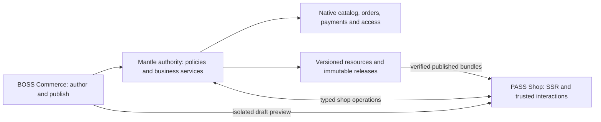

# IronStone PASS — Shop design

Nov 5, 2026 — checked against the code while writing [impl-shop.md](impl-shop.md) (its F1–F34) and mr-boss
impl-commerce.md; the changes are marked Nov 5. Nov 1, 2026 — draft; reviewed against research-commerce.md,
design-forum.md, the reference apps and the other designs (the suite-app review, since removed from mr-boss; read it
there with `git show bd74564^:plan/review-suite-apps.md`).

**IronStone Shop** is the commerce application of **IronStone PASS — Public Application
Software Suite**. It serves customers browsing and buying physical goods, digital products and
subscriptions, and managing their purchases. **IronStone Commerce** in BOSS manages stores,
merchandising, themes, pages and operations. Shop is a public presentation/application layer over
Mantle, with a local authority or a separate remote authority; it does not require BOSS to run.
A customer's returns, questions and cancellations go to Customer Service through its PASS Support
pages and Mantle services; the customer's one account is the PASS Account hub.

The initial complete release includes a visual theme editor **in BOSS Commerce**, sandboxed JS
templates, physical/digital checkout, prepaid subscriptions, and automatic recurring billing,
which is gated on the first payment adapter with off-session charges (§8.1). Liquid
compatibility, advanced B2B, POS and a theme marketplace are later. This is a new design, not a
port of PopRestStore or a claim of Shopify feature compatibility.

**Inputs:** [Commerce research](../../mr-boss/plan/research-commerce.md),
[Commerce design](../../mr-boss/plan/design-commerce.md),
[design guide](../../mr-boss/plan/design-doc-guide.md),
[crosscut](../../mr-boss/plan/design-crosscut.md),
[Products](../../mr-boss/plan/design-products.md),
[Accounting](../../mr-boss/plan/design-accounting.md),
[Customer Service](../../mr-boss/plan/design-customer-service.md),
[Sales](../../mr-boss/plan/design-sales.md), [Marketing](../../mr-boss/plan/design-marketing.md),
[Forum and PASS foundation](design-forum.md), [PASS deployment](../docs/Deployment.md), the
Mantle [payments plan](../../mr-mantle/plan/payments-shipping-edi.md), the suite-app review (see above), and the
source evidence in §3. The build is planned in [impl-shop.md](impl-shop.md), in one order with Commerce's
[impl-commerce.md](../../mr-boss/plan/impl-commerce.md). The
public screen inventories follow the design guide but use a site shell, shopper capabilities and
HTML templates rather than the BOSS launcher. Proposed services and records are labelled.

**Sections:** [1 shell](#1-shell) · [2 screens](#2-screens) · [3 evidence](#3-reference-evidence-and-disposition) ·
[4 authority](#4-sites-deployment-and-identity) · [5 catalog](#5-discovery-and-merchandising) ·
[6 cart](#6-carts-and-checkout-screens) · [7 checkout](#7-checkout-contract) ·
[8 payments](#8-payments-order-placement-and-existing-automation) ·
[9 accounts](#9-customer-account-and-service) · [10 subscriptions](#10-digital-delivery-and-subscriptions) ·
[11 content](#11-content-navigation-and-cross-app-integration) · [12 themes](#12-themes-templates-and-publishing) ·
[13 APIs](#13-service-and-api-catalog) · [14 data](#14-data-model-and-current-source-gaps) ·
[15 needs](#15-framework-and-data-needs) · [16 outputs](#16-documents-and-outputs) ·
[17 delivery](#17-adoption-and-delivery-stages) · [18 validation](#18-validation-and-completeness) ·
[19 decisions](#19-decided) · [20 open](#20-open).

## 1. Shell

Register app key `shop`, screen root `Shop` under `Pass.xml`, default mount `/shop`, target type
`productStore`, and a readiness service. Extend both PASS `Apps.js` and Mantle `PublicApps.js`,
the route/operation registries and the runtime's operator allowlist using Forum §13.1; the Header's
app branches, the test runtime's mounts and the three `TOKEN_WRITES` lists are registration places
too (Nov 5, impl-shop F1). Shop may also mount at `/`; Mantle's `storeMounts` permits only Forum at
root, so this is an explicit extension: one root app per site, Forum or Shop, with Mantle's reserved
paths aligned with the framework's (impl-shop F2). One Shop mount per PublicSite is the initial rule. Multiple stores use separate sites;
one store may have multiple sites with independently bound themes/content. No fallback store
is chosen for an unknown hostname.

The customer sees the configured brand. Generic defaults say **IronStone PASS** and **Shop**,
and this application's name is **IronStone Shop**. Shared account/security pages remain PASS
pages: on a Shop site they keep the PASS shell with the site's brand values from `PublicSite.theme`,
which nothing reads today, while Shop's own pages render the theme's layout (Nov 5, impl-shop §4). Do not rename `mr-pass`, `Pass`, or established namespaces/routes as part of branding.

Navigation, configurable labels and order within supported destinations:

- Shop — Home, Categories, Search; ProductDetail from lists.
- Cart — Cart, Checkout, confirmation/result pages.
- My purchases — Orders, Downloads, Subscriptions; visible when authorized.
- Account — Sign in/Register, or My account (the PASS Account hub, in which AccountOverview is
  the Shop card), Addresses, PaymentMethods, Email preferences, Sign out.
- Help — published policy/contact pages; return and help requests from an order open Customer
  Service's Support pages (§9).
- Community/Articles — links to other enabled PASS mounts when configured.

The theme supplies header/footer, menus, page layouts and composition. Critical account/payment
components remain trusted application components. No BOSS drawer, staff navigation, authoring
route, or embedded staff credentials reaches the public shell. All theme/page editing lives in
[Commerce §5](../../mr-boss/plan/design-commerce.md#5-website-authoring).

Catalog, category, search and informational pages are server-rendered HTML with normal links,
paginated results, descriptive headings, canonical URLs and usable content without JavaScript.
Cart and checkout use HTML forms with progressive enhancement; payment providers may require
JavaScript, disclosed before their selection. Trusted Vue components enhance variants, cart
updates, checkout and account tasks without compiling merchant browser code. `.qvue` is used for
those components, not as the entire storefront delivery model. Public TUI is not required;
Commerce authoring has the normal BOSS TUI counterparts.

Use accessible labels/errors, skip links, focus restoration, live total/status announcements,
keyboard-operable variant/quantity controls, reduced motion, and 390 px phone layouts (checked by
an acceptance test, §18.1 Accessibility and devices). Dates, language and formatting follow
site/user preferences; money calculations stay decimal on the authority. Theme translations use
stable keys; the site's default locale is the explicit fallback.

**Stack contributions** (crosscut §1.5). Shop's notices are sources on the one Comms delivery
ledger (X8, CX-DELIVERY). Checkout placement, payment reconciliation, renewal dispatch and
download issue declare `operation` and `operation-ref`, and Commerce's shipped definitions carry
the checkout-failure alert (R-LV-W07). Confirmation and return documents carry a QR code from
`ec.resource.barcodeSvg('QR', …)` (§16). Staff Assist, Comms hooks and reports are Commerce's
(Commerce §1.4); a public site has no Assist drawer. Video help from an order is later, through
Customer Service and an Event with a CallLink (L7, R-SHP-L03). Semantic catalog search, social
sign-in and shopper agents over MCP are in §20.

## 2. Screens

Every Shop-owned row is `new`; the Scope column also gives the delivery stage S1–S4 of §17. Impl
is `xml` for every row: an XML screen selects a locked theme template (§12), and the Layout line
names any trusted Vue component it embeds (ProductDetail's purchase selection, Cart, Checkout,
PaymentResult, PaymentMethods, SubscriptionDetail). Public screen paths use `PASS:` in
inventories. No staff editor is a Shop screen. A simple review/address/payment dialog is a form on
its parent, not another route. Customer Service's Support pages RequestReturn and NewCustomerCase
are linked from Shop's order pages with the order, on the site's Support mount (§9, X7; Nov 5); the
PASS Account pages are reused.

| Screen | Path | Archetype | Impl | Purpose | Main record | Reused | Roles | Scope/stage | Context |
| --- | --- | --- | --- | --- | --- | --- | --- | --- | --- |
| Home | PASS:Shop/Home | landing | xml | Discover the store | authorized store projection | own | permitted visitor | new S1 | site/store, locale |
| Categories | PASS:Shop/Categories | tree list | xml | Browse published categories | ProductCategory | own public view | visitor | new S1 | store, tree |
| CategoryDetail | PASS:Shop/Categories/CategoryDetail | list | xml | Browse category products | catalog projection | own | visitor | new S1 | category, filters |
| Search | PASS:Shop/Search | list | xml | Search visible products/content | public search projection | PASS search foundation | visitor | new S1 | query, facets |
| ProductDetail | PASS:Shop/Products/ProductDetail | detail | xml | Choose and buy a product | Product + store projection | own | visitor; purchaser writes | new S1/S2 | product, variant |
| Page | PASS:Shop/Page | detail | xml | Read a published store page | WikiPage version + PublicSitePage (proposed extension) | framework wiki rendering | visitor | new S1 | page/version |
| Cart | PASS:Shop/Cart | task | xml | Review intended purchases | OrderHeader in OrderOpen | own over Mantle | cart holder | new S2 | cart revision |
| Checkout | PASS:Shop/Checkout | wizard | xml | Provide/confirm delivery and payment | proposed StoreCheckout | own | cart holder; account for subscriptions | new S2/S3 | checkout revision |
| PaymentResult | PASS:Shop/Checkout/PaymentResult | task | xml | Resume or inspect a payment | public payment-attempt projection | Accounting's typed PortalPaymentAttempt coordinator | attempt holder | new S2 | attempt |
| OrderConfirmation | PASS:Shop/Orders/OrderConfirmation | detail | xml | Confirm an authoritative order | safe OrderHeader projection | own | order capability/self | new S2 | order |
| AccountOverview | PASS:Shop/Account | landing | xml | This store's purchase work; the Shop card of the Account hub | authorized customer summary | own; card in AccountHub | self | new S2 | self/store |
| Addresses | PASS:Shop/Account/Addresses | settings | xml | Maintain own addresses | PartyContactMech | own over contact services | self | new S2 | self |
| PaymentMethods | PASS:Shop/Account/PaymentMethods | settings | xml | Manage tokenized methods | PaymentMethod | own safe projection | self | new S2 | self/provider |
| Orders | PASS:Shop/Orders | list | xml | Find own purchases | OrderHeader | own public view | self | new S2 | filters |
| OrderDetail | PASS:Shop/Orders/OrderDetail | detail | xml | Follow fulfillment and request help | safe order/shipments projection | own public view | self/order capability | new S2 | order |
| RequestReturn | PASS:Support/RequestReturn, linked from OrderDetail (Nov 5) | wizard | xml | Ask to return eligible goods of this order | ReturnHeader | Customer Service Support RequestReturn (Customer Service §8) | self/order capability | new S2 | order, items |
| NewCustomerCase | PASS:Support/NewCustomerCase, linked from OrderDetail (Nov 5) | wizard | xml | Ask privately about a purchase, or ask to cancel it (its `cancelOrder`) | Request (case) | Customer Service Support NewCustomerCase (Customer Service §8) | self/order capability | new S2 | order, store queue |
| Downloads | PASS:Shop/Downloads | list | xml | Retrieve entitled digital content | proposed StoreDownloadGrant | existing protected media primitives | self/delivery capability | new S2 | order item/grant |
| Subscriptions | PASS:Shop/Subscriptions | list | xml | Inspect paid/recurring access | Subscription + StoreRecurringContract | own over Mantle | verified self | new S3 | self |
| SubscriptionDetail | PASS:Shop/Subscriptions/SubscriptionDetail | detail | xml | Renew/manage billing and cancellation | recurring contract projection | own | verified self | new S3 | contract |
| Login | PASS:Account/Login | task | xml | Authenticate/recover account | UserAccount | built Forum Account flow | anonymous | new S2 | site, checked return |
| Registration | PASS:Account/Register | wizard | xml | Verify a public account | registration challenge | built Forum Account flow | anonymous | new S2 | site |
| AccountSettings | PASS:Account/Settings | settings | xml | Manage profile/security | PublicSiteProfile + account | built Forum Account flow | self | new S2 | self |
| AccountHub | PASS:Account/Home (proposed) | landing | xml | One "My account" across PASS apps | signed-in party | PASS Account hub, crosscut §5.1 (X6) | self | new S2 | self |
| EmailPreferences | PASS:Account/EmailPreferences (proposed) | settings | xml | List unsubscribe, topics and Forum opt-out in one page | PartyConsent; ContactListParty | Comms page, Commons §16 (X15) | self or unsubscribe token | new S2 | self |

Unavailable/withdrawn, empty search/cart, checkout failure and maintenance are states/templates
of these screens. Readiness and publication do not create public operational dashboards.

## 3. Reference evidence and disposition

Sources were inspected Oct 31, 2026. Local source paths are relative to their named checkout,
not copied machine-specific `/home/...` paths from the earlier research. Odoo is the checked-out
source, not a promise that an older released version has each feature. Learn behavior; do not
copy third-party implementation code. This table supplements Commerce research §§2–9.

| ID | Verified reference and source | Adopt / change / defer |
| --- | --- | --- |
| R1 | [PopRestStore](https://github.com/moqui/PopRestStore): README; `screen/store.xml`; `service/popstore/{StoreServices,ProductServices,CartServices,CustomerServices}.xml`; `service/pop.rest.xml`; `data/PopRestStoreAaaSetupData.xml` | Adopt server-rendered discovery, enhanced customer tasks, ProductStore/Mantle reuse and replaceable templates. Change routing, identity, public projection, checkout coordination and publishing as below. |
| R2 | ridgecrest: `data/RidgeCrestStoreDataPop.xml`, `screen/{popdynamic,popstatic,poptemplate}/`, `screen/rcherbals/checkout.xml`, `service/ridgecrest/CheckoutServices.xml` and `service/ridgecrest/vdc/VdcServices.xml` | Real store evidence for template overrides, typed store bindings, guest checkout composition and SystemMessage intake. Use protected provider methods and modern PASS identity; do not port FTL, Vue 2, store-specific tax code or custom review joins. |
| R3 | [Odoo website_sale source](https://github.com/odoo/odoo/tree/master/addons/website_sale): `models/website_checkout_step.py`, `website.py`, `product_public_category.py`, `product_feed.py`; `controllers/{cart,payment,delivery,reorder,portal}.py`; `templates/checkout/` | Adopt structured checkout with server validation, published categories, reorder, feed records and website integration. Steps can be presented flexibly, but arbitrary merchant step execution is deferred. Cart remains the business order. |
| R4 | [Frappe Web Template source](https://github.com/frappe/frappe/tree/develop/frappe/website/doctype/web_template): `web_template.py`; neighboring `web_page`, `web_page_block`, `website_route_redirect`; `website/path_resolver.py` | Adopt reusable template sections with typed fields, separation of content/route/template and explicit redirects. Extend MR Moqui wiki/resources instead of adopting another CMS data model. |
| R5 | Shopify official [theme architecture](https://shopify.dev/docs/storefronts/themes/architecture), [JSON templates](https://shopify.dev/docs/storefronts/themes/architecture/templates/json-templates), [section schema](https://shopify.dev/docs/storefronts/themes/architecture/sections/section-schema), [theme editor](https://shopify.dev/docs/storefronts/themes/tools/online-editor) | Adopt composable layouts/templates/sections/blocks, typed settings, alternate templates and editor preview. Specify our JS renderer and package API; no initial Liquid syntax or drop-in Shopify compatibility. |
| R6 | Ever Gauzy: `packages/plugins/cart/src/lib/commerce-checkout-session/commerce-checkout-session.entity.ts`, `checkout/cart-checkout.registry.ts`; catalog product/channel bindings; fulfillment shipping-option | Adopt durable checkout coordination and registered provider boundaries. Do not add a second commerce cart/order model or infer an existing admin UI from backend plugins. |
| R7 | Current MR Mantle: ProductStoreEntities, ProductDefinitionEntities, OrderEntities, AccountingPortalEntities, PublicEntities; order/payment/promotion/subscription services and SECAs | These are the business baseline. Extend guarded services rather than rebuilding pricing, customers, stock, payment or subscription ledgers. |
| R8 | Current PASS: `Apps.js`, `Schema.js`, `Routes.js`, `Facade.js`, `Contracts.d.ts`; Mantle PublicApps, ForumSchema, PassRoutes/PassApi; Forum §13 and Deployment | Reuse target-bound mounts, registered remote authority, shared identity, explicit publication and source-bound entitlements. Shop operations and root mounting are new registrations/extensions. |

### 3.1 Deliberate differences from PopRestStore

PopRestStore already offers broad template replacement: per-store server root/header/footer/
home/category/product/content/search paths, client page templates, and wiki-backed template
spaces selected by store/locale. This design does not describe it as a fixed-layout store.
Its separate catalog HTML and Vue customer pages are a useful precedent.

The changes are substantive:

- Replace regex hostname settings and the root's `POPC_DEFAULT` fallback with registered
  PublicSiteHost/mount resolution that conceals unknown hosts.
- Replace loose template-location overrides with validated packages, structured composition,
  exact-version releases, visual editing, draft preview and atomic publication/rollback.
- Replace FTL/Groovy and the legacy browser template stack with locked MR JS templates and
  trusted modern interaction components. Public data and rendering share a versioned contract.
- Replace the single web-session `cartOrderId`/`productStoreId` assumption and recovery of the
  latest open customer order with explicit site/store/currency cart ownership. The existing
  legacy lookup does not scope its latest-order search by store; Shop must.
- Do not export raw ProductStore/settings or a login API key as a generic `config.js` object.
  Expose a deliberately limited shop configuration and shopper projections.
- Preserve Mantle calls while adding durable attempts, frozen checkout totals and authoritative
  reconciliation. PopRestStore explicitly authorizes before `place#Order`, which also triggers
  authorization; Shop must resolve that interaction rather than reproduce it.
- Use current public account/access flows, masked/tokenized payment methods, permission-checked
  downloads and explicit publication. Customer transactions never authorize template execution.

## 4. Sites, deployment and identity

### 4.1 Authority and routing



The same authority boundary applies in-process and remotely. The preview connection is needed
only while editing; a published Shop does not call BOSS.

`PublicSiteApp.targetId` holds the ProductStore ID for app `shop`. Extend PublicApps' target
validator to recognize a real store and its organization. Only an operator changes targeted
mounts and host allowlists. The current one-app-root helper and route conflict checks must
support Shop at root without intercepting Account, Forum, API, token, asset or operational
routes. Shop is a target-bound app, not an alias for the old future app name `commerce`.

One authority owns all mutable business state. Local PASS calls it in-process. A remote PASS
frontend loads framework/webroot/PASS, its session database and published theme assets; it does
not load Mantle's business entity catalog, copy Party records or execute business services from
the theme. Registered transport carries deployment identity and the already checked site/mount;
browser parameters cannot substitute store, backend origin, organization or customer party.

Published theme release bundles may be cached on remote frontends after authenticated transfer
and digest verification. Public/product/order data is still projected by the authority. An
unreachable authority cannot accept offline orders or payments. Personalized responses fail
closed; public cached content is served only while the publication generation remains valid
under §12.7. There is no promise of an offline shopping cart mutation queue.

**Tracking (X10).** A remote PASS keeps its sessions and `moqui.server.Visit` rows on the
frontend, so Shop never keys tracking on a visit. The facade carries the landing tracking code
(UTM source, medium, campaign) and an opaque visitor key with each call, and the authority records
Marketing's tracking events (MKT-TRACKING) when the visitor's tracking consent allows it. At
placement the proposed Mantle SECA `OrderPlacedRecordAttribution` (tx-commit) calls Marketing's
proposed `record#OrderAttribution`; Shop writes no TrackingCodeVisit row and runs no attribution
of its own. Previews send nothing. **Needs:** SHOP-RENDER; Marketing MKT-TRACKING.

### 4.2 Shopper identity and authorization

Reuse PASS registration, verification, login, password recovery, second-factor and delegated
session flows. No new user directory or broad customer UserGroup grant. Site/store policy may
require account access for browsing or purchase. Public browsing and physical/digital guest
checkout are the defaults for a published retail store; subscriptions require a verified,
signed-in account so renewals and paid resource access have a stable owner.

Creating an account or completing checkout does not opt a shopper into a public profile,
community directory or marketing list. Guest email does not prove ownership of an existing
Party/account. Create or use the guest purchase identity scoped to the cart; merge/link only
after proof through the existing account verification process. Duplicate parties are merged only
through Commons' `merge#Parties`, whose guards live in Mantle (X15); those guards cover Shop's
StoreCartAccess, StoreRecurringContract and StoreDownloadGrant rows as well as
ExternalAccessContact, the PASS UserAccount and PartyConsent, and a merge never transfers
purchase access on email alone.

**One customer account (X6, R-SHP-01, R-SHP-02).** Shop keeps no token store of its own:
- A signed-in customer reaches their orders, invoices, cases and returns through a proposed
  self relationship in Mantle's ExternalAccess `check`: the record's party is the signed-in
  user's party, and the account's email is verified. No invitation or ExternalAccessContact row
  is needed. `appKinds` gains `support` and `sales`, so the same purchaser sees their Billing
  invoices and Support cases and returns. A Shop-registered buyer therefore has one account
  across Shop, Billing, Support and Sales, and "My account" is the PASS Account hub, with
  AccountOverview as its Shop card.
- A guest's order, download and renewal links are `ExternalAccessCapability` rows issued by
  `mantle.party.ExternalAccessServices.create#AccessCapability` and checked by
  `check#AccessCapability`, on one proposed customer-direction record kind `SalesOrder` (the
  existing `Order` kind is supplier-direction). Its scopes are `OrderView` (which also admits
  return and help requests for that one order), `Download` and `RenewalAction`; Sales uses the
  same kind for QuoteView and QuoteRespond.
- Cart access stays the session-bound proposed `StoreCartAccess` (§7.1), which rotates at login
  and logout and reuses the ExternalAccess capability digest and throttle rather than a second
  token scheme. A cart recovery link is a one-time token of that StoreCartAccess. Today the digest
  and throttle are inside ExternalAccess.js's token check, so Shop exports them as helpers (Nov 5,
  impl-shop F16).
- Customer Service's customer services (`request#CustomerReturn`, `create#CustomerCase`,
  `request#CustomerCancel`) admit the `SalesOrder` OrderView capability for its one order, beside a
  contact and the self relationship (Nov 5, impl-shop F27).

For every operation, intersect routed site/store, active shopper/cart capability, resource
ownership, publication and business eligibility. Signed-in order lists require customer identity;
guest order/download actions use narrow expiring capabilities. Customer account permissions do
not reveal staff notes, costs, supplier prices, gateway credentials or another store's purchases.

Cookies remain host-scoped, Secure/HttpOnly where appropriate; cookie writes require the
framework CSRF token. Use the existing registered SSO/session handoff across hosts rather than
a broadly scoped shared cookie. Rate limits cover account discovery, cart creation, coupons,
order lookup, checkout, downloads and reviews. A capability has random secret material with
only its digest stored; database record IDs remain ordinary sequenced IDs. **Needs:**
SHOP-ACCOUNT, SHOP-CART.

### 4.3 Publication/readiness

Sites and Shop mounts start disabled/unpublished. Readiness checks canonical host/mount,
organization/store, explicit assortment, active compatible theme, mandatory pages/terms,
locale/currency, payment capability, applicable shipping/tax policy, digital/recurring
fulfillment handlers, the store's support queue and, for purchase, a Support mount on the site
targeting the store's organization (§9). A browse-only release is permitted but must
not advertise purchase. Turning on checkout requires its independent readiness check, and
recurring offers require the off-session capability of §8.1. When the store sells paid access
for the site, `store#RecurringOffer` sets `PublicSite.subscriptionUrl` to the Shop Subscriptions
route and clears it when no offer remains, so Forum's "Manage your subscription" link opens Shop
(R-SHP-13, R-SHP-W04); it never replaces an outside address a site owner entered, and readiness,
which only reads, reports the difference (Nov 5, impl-commerce §4). All checks run on the
authority, including when a remote frontend previews a proposed release; the shop readiness
service is Commerce's `check#StoreReadiness`, registered as the `shop` app's PASS readiness and,
once Admin builds the registry, as an Admin §14 readiness provider (Z9; Nov 5, impl-shop F34).

Public page access always rechecks current site/mount publication; possession of an old theme
bundle or URL does not keep a withdrawn site accessible. Preview is a separate limited staff
capability with no real purchase or marketing side effects (§12.6).

## 5. Discovery and merchandising

### 5.1 Catalog projection

Proposed `mantle.product.ShopCatalogServices` exposes read-only shop views. The query begins
with the routed store and explicit effective product publication. Intersect `Product.salesAllowed`,
product lifecycle/availability, store browse/search roots and effective view/purchase category
rules. Categories organize an assortment; they are not a grant to expose every associated product.

A published virtual product covers its saleable variants by default; a variant with an explicit
withdrawal row is not exposed (Commerce §4, R-COM-14). An unavailable variant
may be displayed as unavailable according to policy but never becomes a purchasable default.
Choose a real saleable variant before adding to cart. Shared master descriptions/media may be
reused; store-specific title/SEO/template/badge overrides live with the store publication, not
copies of Product. Public category pages omit private/empty descendants unless deliberately
published as content-only landing pages. Cycle and pagination limits apply to category trees.

Use existing `mantle.product.PriceServices.get#ProductPrice` and its store/buyer/currency/UOM/
effective-date context, with the existing named price services as extended by Products. For an
anonymous user it reads only rows with no vendor, customer or agreement, while a store makes its
organization the vendor, so the catalog service prices as the authority for the routed store and
the signed-in customer, its own checks done (Nov 5, impl-shop F18). Expose
unavailable price separately from valid zero price. Keep quantity breaks and promotional
adjustments explainable, but never return the internal price-rule trace, cost or margin publicly.
Final price, promotions, shipping and tax are recalculated by checkout.

Availability comes from existing `mantle.product.AssetServices.get#AvailableInventory` and
`get#AvailableInventoryMulti` over the store's facilities (its ProductStoreFacility rows, or
`ProductStore.inventoryFacilityId` when it has none). A shopper sees only the customer-facing
bands of crosscut §3.7 (for example in stock, low stock, backorder, unavailable), never on-hand
quantities (R-SHP-14).

Search, feed generation, recommendations, related products, reviews and structured metadata use
this same projection. Search indexes are candidate sources, not authorization. Withdrawal and
effective-date changes invalidate generations; an old index hit is filtered before being returned.
Postgres search remains sufficient; OpenSearch is optional. No anonymous raw UniversalSearch or
DataDocument access is introduced.

### Home

**Layout:** theme-composed landing with published navigation, hero/content, featured categories
and product sections.

| Form | Kind | Purpose | Highlighted fields | Widgets of note | Operations/services | Derived from |
| --- | --- | --- | --- | --- | --- | --- |
| HomeSections | component | Compose the published landing | composition, approved source projections | themed sections | `getShopHome` | PopRestStore home; Shopify sections |
| SearchBox | find | Open catalog search | query | accessible search input | — | PopRestStore search |
| FeaturedProducts | list, read | Discover featured offers | image, name, public price, availability | product cards | `getShopHome` | ridgecrest featured products |

Derived from PopRestStore home,
ridgecrest featured products and Shopify sections. Source queries are bounded and server-owned.
Empty sections are omitted; a configured empty store shows helpful contact/content without fake
products. **Needs:** SHOP-CATALOG, SHOP-THEME, SHOP-RENDER.

### Categories

| Form | Kind | Purpose | Highlighted fields | Widgets of note | Operations/services | Derived from |
| --- | --- | --- | --- | --- | --- | --- |
| CategoryTree | list, read | Browse the published tree | name, image, description, authorized children | nested links and keyboard expansion | `getStoreCategories` | ProductStoreCategory/ProductCategoryRollup; Odoo public categories |

Normal links and keyboard expand controls; a phone sees a nested list.
Derived from ProductStoreCategory/ProductCategoryRollup and Odoo public categories. **Needs:**
SHOP-CATALOG, SHOP-RENDER.

### CategoryDetail

| Form | Kind | Purpose | Highlighted fields | Widgets of note | Operations/services | Derived from |
| --- | --- | --- | --- | --- | --- | --- |
| CategoryHeader | display | Explain the selected category | name, safe body, image | theme composition | `getStoreCategory` | PopRestStore category |
| ProductFind | find | Narrow visible products | registered facets, sort, cursor | facet choices | — | Odoo shop grid |
| ProductGrid | list, read | Browse eligible offers | product card, public price, availability band | responsive product cards | `findProducts`; existing `AssetServices.get#AvailableInventoryMulti` | PopRestStore category/search |

Sort/facet keys are registered, never entity field expressions. Availability
and variant minimum price have explicit labels. Derived from PopRestStore category/search and
Odoo shop grid. **Needs:** SHOP-CATALOG.

### Search

| Form | Kind | Purpose | Highlighted fields | Widgets of note | Operations/services | Derived from |
| --- | --- | --- | --- | --- | --- | --- |
| SearchFind | find | Search public shop content | query, category, registered facets/sort | accessible filters | — | PASS search |
| SearchResults | list, read | Open eligible products/pages | summary, canonical URL, public price | result cards, pagination | `searchShop` | PASS search projection; Frappe routing |

Only
published shop pages participate; Forum/Publishing results are separate ACL-checked app sections
through the PASS search contract. No-match, invalid filter and unavailable backend are distinct
states. Derived from Frappe routing and PASS search projection. **Needs:** SHOP-CATALOG.

### ProductDetail

| Form | Kind | Purpose | Highlighted fields | Widgets of note | Operations/services | Derived from |
| --- | --- | --- | --- | --- | --- | --- |
| Product | display | Explain the product | title, safe description, gallery, price, availability band, delivery/terms | accessible image gallery | `getProduct`; existing `mantle.product.AssetServices.get#AvailableInventory` | PopRestStore product; Odoo product page |
| PurchaseSelection | single | Choose a purchasable offer | variant, quantity/UOM, permitted options, one-time/recurring offer | trusted Vue variant selectors, server price update | `quoteSelection`, `addCartItem` | PopRestStore add product; Mantle order services |
| PublicReviews | list, read | Read moderated feedback | rating, body, public author label, date, verified purchase, store reply | rating distribution | `getProductReviews` | ProductReview; Odoo product discussion and `portal_rating` publisher comment |
| SubmitReview | dialog | Submit or revise own purchase feedback | rating, body, display-name choice, order-item proof, images, own review/revision when editing | plain/rich text sanitizer; image upload through the facade's media staging | `submitProductReview` | existing ProductReview model; new guarded public submission |
| RelatedContent | list, read | Discover relevant products/support | published related products, help articles, Forum topics about the product, "Ask a question" | normal links | product projection; Forum topic creation with a `CommunicationEventProduct` link | ProductAssoc; Forum product binding |

**Layout:** detail; the theme composes the page, and PurchaseSelection is a trusted Vue component
inside it. The submit-review form fields above are complete; authority derives product/store/party and
validates the claimed purchase proof. Images are PNG or JPEG, staged and scanned through Mantle's
`PortalMedia.js`, and shown only with an approved review (Nov 5, impl-commerce P9). Editing requires
ownership and the expected review revision.
No direct ProductReview CRUD endpoint. Pending reviews are visible only to their author/staff,
and only approved reviews affect public aggregates. Add an approved-to-pending transition for
author edits; the current ProductReview status flow does not provide it. An approved review shows
the store's reply under it (Commerce Reviews, COM-F03). "Ask a question" opens a new Forum topic
in the site's product category, linked to the product by existing `CommunicationEventProduct`, when
the site has a Forum mount; a private order question goes to NewCustomerCase instead
(R-SHP-W05). Purchase form errors preserve selections;
out-of-stock or unavailable pricing never silently substitutes a different variant. Schema.org
product/offer data matches the visible public projection and canonical URL. **Needs:**
SHOP-CATALOG, SHOP-CART, SHOP-SUPPORT.

### Page

| Form | Kind | Purpose | Highlighted fields | Widgets of note | Operations/services | Derived from |
| --- | --- | --- | --- | --- | --- | --- |
| PublishedPage | display | Read a published store page | title, body, template sections, locale, policy version | safe wiki fragments | `getShopPage` | Frappe Web Page; PASS PublicSitePage |

`getShopPage` calls existing `mantle.public.SiteServices.get#SitePage`, extended with mount,
route, locale and publication window (X14), and reads the exact published WikiPage version that
`PublicSitePage` binds, not whatever is currently saved in its source wiki space. There is no
Shop-specific page binding. Derived from Frappe Web Page and PASS PublicSitePage. Contact and
return blocks are trusted components that open Customer Service's intake pages (§9); theme text
cannot submit arbitrary services. **Needs:** SHOP-CONTENT, SHOP-THEME.

## 6. Carts and checkout screens

### Cart

**Layout:** editable lines, discounts, estimated totals, delivery caveat and one Checkout action;
a trusted Vue component enhances line edits, and the plain HTML form works without it. Use an
ordinary page even when a theme also offers a mini-cart; both consume the same projection.

| Form | Kind | Purpose | Highlighted fields | Widgets of note | Operations/services | Derived from |
| --- | --- | --- | --- | --- | --- | --- |
| CartItems | list, editable rows | Review/change intended purchases | product/variant, quantity, unit price, adjustments, availability band | bounded quantity input, remove | `getCart`, `updateCartItem`, `removeCartItem` | PopRestStore CartServices; Mantle order items |
| PromoCode | single | Add/remove a code | code, eligibility result | generic rejection without private party hints | `applyPromoCode`, `removePromoCode` | PromotionServices add/remove OrderPromoCode |
| CartTotals | display | Explain estimated cost | items, discounts, shipping estimate, tax estimate, total/currency | changed-price notices | `getCart` | get#OrderDisplayInfo |
| BeginCheckout | single | Start/resume checkout | cart revision (`orderRevision`), operation ID | one primary action | `beginCheckout` | PopRestStore place path; Ever Gauzy checkout session |

Removing a line is reversible while the cart is open. A declined payment can return to editing
only when its attempt is resolved; an unknown outcome cannot. Mini-cart updates announce counts
without forcing focus or full-page reload. Cart access is not granted by knowing an order ID.
**Needs:** SHOP-CART, SHOP-CHECKOUT.

### Checkout

**Layout:** responsive single workspace with contact, delivery, payment and review groups, a
summary on desktop and a compact expandable summary on phones. A theme may present the groups
as one page or successive panels; a trusted Vue component enhances the groups and mounts the
provider's hosted fields. The authority validates prerequisites in the fixed order below;
presentation never changes the business state machine.

| Form | Kind | Purpose | Highlighted fields | Widgets of note | Operations/services | Derived from |
| --- | --- | --- | --- | --- | --- | --- |
| Contact | wizard step | Identify the buyer/contact | verified account or guest email/name, optional phone | shared sign-in handoff | `setCheckoutContact` | ridgecrest guest/returning checkout; PASS accounts |
| Addresses | wizard step | Supply billing/delivery facts | saved own address or postal fields, billing-same flag | locale-aware address, own-address picker; suggested correction from address validation | `setCheckoutAddresses`; existing `mantle.shipment.CarrierServices.validate#PostalAddress` | Mantle set#OrderBillingShippingInfo and contact services |
| Delivery | wizard step | Select a current quote | order part, carrier/method, quote ID, amount, estimate | available options with full cost | `getDeliveryOptions`, `selectDelivery` | StoreServices.get#StoreShippingOptions; Odoo delivery |
| Payment | wizard step | Choose an eligible method | provider/instrument, existing own token or hosted setup result, off-session consent for a recurring offer | operator-installed provider component | `getPaymentOptions`, `selectPayment` | Mantle gateways; Frappe registry |
| ReviewPurchase | wizard step | Accept the authoritative purchase | lines, totals, due-now/later, recurring cadence/amount, delivery, terms version, required consents, optional marketing opt-in (not in the first build, below) | changed-value comparison; unchecked opt-in | `getCheckout`, `submitCheckout`; Marketing's proposed `mantle.marketing.MarketingPortalServices.request#Subscription` | Odoo checkout validation; PopRestStore composition |

Contact/account creation is optional for ordinary guest purchases; recurring offers require a
verified account before payment, and Payment records the customer's explicit off-session consent
for renewal charges on the chosen method (X5). Address validation runs through the carrier
gateway when the store has one (Shippo, payments plan S1) and offers, never forces, a correction
(R-SHP-W02). Marketing consent is an unchecked separate choice and is never a prerequisite for
purchase. When the shopper checks it, `submitCheckout` calls Marketing's `request#Subscription`
with source checkout: pending double opt-in for a guest, accepted for a verified account. That
service records the evidence with `mantle.party.ConsentServices.store#PartyConsent`; Shop keeps no
consent of its own (X15, R-SC-12, R-SHP-W03). The first build leaves the opt-in out until
Marketing builds `request#Subscription` (Nov 5, the user's call, impl-commerce §4). Provider-hosted fields collect payment credentials;
Shop receives only provider references/tokens. Required address fields derive from destination
and tax rules, not a hard-coded US form. Digital-only carts omit delivery. Totals remain
authoritative while each invalid/expired quote or changed price returns a clear re-review state
with the entered non-sensitive data intact. **Needs:** SHOP-CHECKOUT, SHOP-PAYMENT, SHOP-ACCOUNT.

### PaymentResult

| Form | Kind | Purpose | Highlighted fields | Widgets of note | Operations/services | Derived from |
| --- | --- | --- | --- | --- | --- | --- |
| PaymentState | display | Explain the authoritative outcome | state, safe message, reference | bounded status polling | `getCheckoutPaymentResult` | PASS Billing/InvoicePay |
| ProviderAction | component | Complete a required provider step | approved hosted URL or supported SDK action | registered provider component/link | `getCheckoutPaymentResult` | Odoo/Frappe payment outcomes |
| ResumeCheckout | single | Resume a resolved attempt | attempt reference, revision | resume action | `resumeCheckout` | proposed checkout coordination |

**Layout:** task; a trusted Vue component polls the attempt and mounts the provider action.
These fields are the full new public result contract.
Derived from PASS Billing/InvoicePay and Odoo/Frappe payment outcomes. The page reads Accounting's
typed attempt (purpose shopCheckout, X9), not a Shop attempt record.

The return page proves only possession of its scoped attempt reference; it does not trust
`success`, amounts or transaction IDs in query parameters. A link from a hosted provider returns
to a server-generated canonical site/mount address. The authority queries/verifies the provider
and returns its result. Polling is bounded with backoff; a timeout says processing/unknown, never
paid or declined by inference. A pending attempt can be resumed across a refreshed frontend
session through its narrow capability, without exposing the whole customer account.
**Needs:** SHOP-PAYMENT.

### OrderConfirmation

| Form | Kind | Purpose | Highlighted fields | Widgets of note | Operations/services | Derived from |
| --- | --- | --- | --- | --- | --- | --- |
| Confirmation | display | Confirm the accepted order | reference, items/totals, payment/fulfillment, delivery summary, QR of the order page | status and record links; QR SVG | `getOrderConfirmation` | PopRestStore checkout success |
| NextActions | display | Offer authorized next steps | own order, downloads, subscription, verification, create an account from this guest purchase | scoped links | `getOrderConfirmation` | Mantle order summaries |

Derived from
PopRestStore checkout success and Mantle order summaries. A confirmation is available only after
authoritative placement; pending payment gets PaymentResult. A newly placed order may still need
staff approval, so wording must not promise shipping or access before the relevant state.
Refresh never places the order again. The QR encodes the signed-in order page URL, never a bearer
token (R-SHP-W06). An account created from NextActions with the purchase email is linked to the
guest's party only after that email is verified, and then the self relationship reaches the
order (X6). **Needs:** SHOP-CHECKOUT, SHOP-ACCOUNT.

## 7. Checkout contract

### 7.1 Cart ownership and lifecycle

The cart is an existing `OrderHeader` with `OrderOpen` status, store and `ScWeb` channel (or the
store's explicitly permitted web channel). Its lines, pricing, promotion adjustments and parts
are ordinary Mantle records. Proposed `StoreCartAccess` adds public ownership, activity and
expiry metadata; it does not store a second set of lines/totals.

The authority issues a secret cart capability, stored by the presentation session, with only a
digest on the authority; it uses the same digest and throttle as the ExternalAccess capability
(`tokenCapability`), not a second token scheme (X6). Cart scope includes site, store and currency.
A cart recovery link (Commerce CartDetail) carries a one-time recovery token of the cart's
StoreCartAccess; redeeming it binds a fresh session capability, reprices the cart and requires new
purchase consent. A logged-in identity may
attach its own cart; an existing verified account does not inherit all open orders with matching
email. On login, merge only two proven carts with matching scope and no pending checkout:
re-add source lines through `mantle.order.OrderServices.add#OrderProductQuantity`, reprice and
reevaluate codes, report unavailable lines, then retire the source capability atomically. Carts
from different stores/currencies stay separate. A conflicting pending checkout is resumed or
resolved first, not merged. Logout rotates capabilities so a later shared-browser user cannot
read the prior account's saved data.

Use existing `update#OrderProductQuantity`, `delete#OrderItem`,
`mantle.product.PromotionServices.add#OrderPromoCode` / `remove#OrderPromoCode`, and
`mantle.order.OrderInfoServices.get#OrderDisplayInfo` through guarded Shop services. Public
inputs specify product/options/quantity, not unit prices, customer IDs, status, store IDs or
adjustment amounts. Every mutation checks the expected cart revision and operation ID. The cart
revision is the native `OrderHeader.orderRevision`, which the order EECAs and
`increment#OrderRevision` maintain and which, under X2, counts only commercial changes; Shop adds
no revision counter of its own (R-SHP-W01).

Activity is updated for shopper actions, not background reads/repricing/jobs. Expired open carts
can be cancelled through the existing order path according to retention policy once no provider
attempt is unresolved. Do not delete paid/placed records to clean up cart storage.

### 7.2 Checkout coordination

Proposed `StoreCheckout` coordinates one current checkout for a cart. Use typed states
`editing`, `ready`, `paymentPending`, `placementPending`, `completed`, `expired`, `cancelled`
and `reviewRequired` as proposed status data. These are not replacements for OrderHeader or
Payment statuses. Revisions and durable operation results prevent duplicate writes across tabs,
retries and frontend restarts. One order can have historical attempts, but only one unresolved
submission for a frozen revision.

1. **Begin/resume:** prove cart ownership, publication and purchase eligibility; create or return
   its checkout. Snapshot the applicable store policy, terms and offer versions.
2. **Contact/address:** validate account requirements and owned saved records; save permitted
   contact/address data through existing services. No lookup result exposes whether another
   account already uses a guest email.
3. **Reprice:** calculate price, promotions, delivery and tax using existing Mantle entry points,
   including `mantle.product.StoreServices.get#StoreShippingOptions`,
   `mantle.shipment.CarrierServices.get#OrderShippingRatesBulk`, and
   `mantle.other.TaxServices.calculate#OrderSalesTax`. Quotes carry source, currency, scope,
   revision and expiry; a later address/line change invalidates affected quotes.
4. **Review:** return amounts as decimal strings plus formatted text, available payment methods,
   items/delivery promises, recurring consent and due-now/later totals. The client accepts the
   exact summary revision and terms versions, not an arbitrary `accepted=true` for unknown terms.
5. **Freeze:** lock/recheck the order, stock policy, effective publication, prices, quotes, code
   limits (Commerce's proposed `P.check#OrderPromotionLimits` under a lock, since Mantle counts
   uses without one and never at placement; Nov 5) and eligibility. A mismatch produces `reviewRequired` and a comparison; never silently
   charge a higher amount. Persist the immutable monetary snapshot/hash bound to the frozen
   `orderRevision`, and begin attempt metadata, in a committed short transaction before
   contacting a provider.
6. **Payment and placement:** §8 owns provider actions, outcome reconciliation and exactly-once
   logical order placement. Reject cart/address edits during unresolved monetary operations.
7. **Complete:** return the existing order/confirmation on every matching retry; retire mutation
   capabilities, retain scoped order access, and let normal order/fulfillment events drive outputs.

The core flow and prerequisites are code-owned. Themes can reorder explanatory sections or
choose single/multi-panel presentation, but cannot skip price/stock/tax/terms checks. Initial
checkout does not expose a database-driven arbitrary service workflow. A registered extension
may add typed non-sensitive fields and validation without taking authority over money or actor.

### 7.3 Failure and concurrency rules

Failures use the PASS facade's existing error kinds, with a camelCase `reason` for the page to
map to field errors and customer-safe messages (R-SHP-19):

| Kind | Reasons |
| --- | --- |
| `NotFound` | `notAvailable`; also an access failure where authorization requires hiding that the resource exists |
| `AuthenticationRequired` | `signInRequired` (recurring offer, own order list) |
| `Unauthorized` | `accessDenied` where existence may be shown |
| `Conflict` | `staleRevision`, `reviewRequired`, `quoteExpired` |
| `Unprocessable` | field validation, `paymentDeclined` |
| `Tarpit` | `rateLimited` |
| `Unavailable` | `providerUnavailable`, authority unreachable |

A pending or unknown payment is not an error: it is the attempt's state in the result
(`paymentPending`, `paymentUnknown`). No UI matches raw gateway exception text. The authority's
error envelope today answers a fixed message per status and no field errors, so a remote frontend
cannot see a reason; it gains an allow-listed `reason` and the field errors (Nov 5, impl-shop F4).

Scope an operation ID to site, principal/capability and operation; persist its normalized input
digest and result. Matching replay returns the result; changed input with the same key conflicts.
Optimistic checks plus order/attempt locking guard multi-tab submission. Network requests to a
gateway do not occur while holding a database transaction open. A timeout leaves the attempt
unresolved until lookup/webhook reconciliation proves its outcome. Do not generate a new provider
idempotency key to escape an unknown previous request.

No cart reservation is invented beside Mantle. Follow the store's configured reservation policy;
checkout validates current availability before submitting and on authoritative placement. Before
placement, an exception has a checkout state (`reviewRequired`, `paymentPending`): if stock is
lost after a financial action, keep the payment evidence and either place the order under
permitted backorder policy or void/refund the attempt. After placement, stock is Warehouse's
reservation or backorder fact, not an order hold; there is no `OhtStock` (X4). Never promise
stock merely because it was shown earlier.

## 8. Payments, order placement and existing automation

### 8.1 One payment authority

Use Mantle `Payment`, `PaymentMethod`, `PaymentGatewayResponse` and the existing gateway operation
interfaces. `mantle.account.PaymentServices.authorize#OrderPayments`, `authorize#SinglePayment`,
`capture#SinglePayment`, `release#SinglePayment`, `refund#SinglePayment`, and
`get#SinglePaymentGatewayDetails` remain the native path. Never directly mark a Payment paid
from a browser return or build a Shop payment ledger.

**One coordinator, owned by Accounting (X9).** The current `PortalPaymentAttempt` is
**invoice-specific**, and its worker assumes Billing semantics. Accounting owns its extension into
one typed payment-attempt coordinator (Accounting AC-02), with purposes `invoice`,
`shopCheckout`, `shopRenewal` and `eventRegistration` (Marketing's paid registration, R-SHP-10),
order/checkout/occurrence references, snapshot identity and phase/result metadata. Shop is a
caller with two purposes, as Marketing is with one; Shop does not extend the entity itself.
Existing invoice behavior and URLs stay compatible, worker queries select their purpose so
Billing cannot capture an unrelated Shop attempt, and a Shop order never goes through
invoice-only `start#InvoicePayment`.
- **Attempt key.** The attempt's key is the existing `PaymentGatewayResponse.operationKey`:
  Shop passes its occurrence or checkout attempt key as `operationKey` (and the canonical
  `returnUrl`) to existing `mantle.account.PaymentServices.authorize#SinglePayment`, whose retry
  with the same key answers the first gateway response. Shop adds no idempotency field of its
  own (R-SHP-08). Status is read with existing `poll#PaymentGatewayDetails` and the details
  lookup.
- **Webhooks.** Provider callbacks are authenticated, persisted as deduplicated SystemMessage
  receipts before success is returned, and consumed through SystemMessage, as the Mantle
  [payments plan](../../mr-mantle/plan/payments-shipping-edi.md) §3 requires (§8.4).

**First adapter (R-SHP-05).** The payments plan ports Authorize.Net and PayTrace first, plans
Stripe next under its own plan, and puts provider-run subscriptions out of initial scope. Shop
needs no provider-run subscription, because its occurrence coordinator charges each period, but
it does need hosted checkout and a saved method charged off-session. The first adapter for Shop
is Authorize.Net ([plan P1](../../mr-mantle/plan/payments-shipping-edi.md#p1--authorizenet-port-and-modernize)):
Accept Hosted for hosted checkout, customer payment profiles for saved methods, and renewal
charges against a profile marked as stored-credential, merchant-initiated transactions. S2 needs
P1's hosted checkout. S3 is gated on P1 delivering profile charges with those indicators, so
automatic renewal ships only when that adapter does; Stripe (P3) is the second adapter.

**What P1 built (Nov 5, 2026; impl-shop F14).** The payments plan's P1 is built: Accept.js and
AcceptUI opaque tokens, CIM customer and payment profiles, and webhooks received as SystemMessages.
Accept Hosted is documented there and not built, and profile charges carry no stored-credential or
merchant-initiated fields; Billing's hosted redirect is answered only by the test gateway. Shop
adds Accept Hosted (with its profile save) to the adapter for S2 and the merchant-initiated
indicators for S3. Accept Hosted, a redirect as Billing's hosted flow, is the S2 payment page, so
PASS's CSP stays as it is; AcceptUI on Shop's page is later (Nov 5, the user's call,
impl-commerce §4).

Payment forms use provider-hosted redirects or operator-installed tokenization components.
Raw card numbers/security codes never enter Shop templates, logs, records or frontend caches.
Provider capability registration covers currencies, tokenization, hosted/customer-action flow,
authorization/capture/void/refund, partial capture and off-session recurring consent. Unsupported
flows fail readiness instead of falling back to unsafe payment entry. Zero-total eligible orders
skip the gateway but still run all other purchase/fulfillment checks.

### 8.2 Placement and capture

For a frozen checkout, persist attempt/Payment references, call the provider with the attempt's
`operationKey`, then reconcile under lock. Commit safe outcomes in separate short transactions.
Only the server verifies amount, currency, merchant account, source order and transaction identity.
An amount mismatch remains an exception, not a successful payment.

**Exceptions after placement (X4, R-SHP-06).** A capture that fails, an amount or account
mismatch found after placement, or a chargeback puts the order on hold with existing
`mantle.order.OrderServices.hold#Order` and the proposed `OhtPayment` hold type. Its `enumCode`
names an Accounting payment-operator release permission, proposed `PAYMENT_HOLD_RELEASE` (held by
Accounting's treasury group; Nov 5), so Accounting releases it with existing
`release#OrderHold`; Commerce shows it. There is no `OhtStock`.

Physical items normally authorize first and capture through existing shipment/invoice policy.
Digital and paid subscription items require settled funds before access activation. For a mixed
cart, group order parts/payment allocations by fulfillment and capture policy, so digital items
are always in an order part of their own; disclose due-now
and authorized-for-later amounts before submit. Use native order-part payments, not duplicate
totals. A provider with supported partial capture can share an authorization; otherwise use
separate native payments per policy group. Readiness prevents a combination the provider cannot
process. A partial success leaves a visible recoverable checkout; it never recharges a completed
group during retry.

After payment readiness, call existing `mantle.order.OrderServices.place#Order` once for the
frozen order. Record durable placement intent before the call and inspect actual order state on
recovery: a crash after placement returns that order rather than repeating its side effects.
If a provider succeeded but placement fails, preserve the attempt and financial record for
reconciliation/compensation; do not lose them in a rolled-back cart transaction.

### 8.3 Rule audit

| Existing automation | Kept or changed for Shop |
| --- | --- |
| `OrderPlacedAuthorizePayments` in AccountingPayment.secas.xml | Kept. `authorize#OrderPayments` already skips Authorized payments, so preauthorization plus placement re-tries only Promised ones; the proposed guard skips a Promised payment that has an unresolved attempt (R-SHP-08). Never two provider requests. |
| `OrderPlacedAutoApprove` in OrderReturn.secas.xml; `OrderPreApproveCredit` in AccountingCredit.secas.xml | Kept: configured delay, registered ProductStoreApprove checks and credit policy. `autoApprove#Order` already requires Authorized, Delivered or Confirmed payments covering the grand total, so the Shop pre-approve check is limited to manual `approve#Order`, which runs `mantle.order.OrderInfoServices.check#OrderPreApprove` (X4), and to an attempt in an unknown state. |
| D7 `OrderHold`, OrderHoldEntities.xml | Extended with the proposed `OhtPayment` type for exceptions after placement (§8.2, X4); no `OhtStock`. |
| ProductAsset.secas.xml reservation rules and `OrderItemHandleChange` EECA | Kept: native reservation/line-change paths and store policy. Enforce checkout freeze in the guarded order mutation services; staff edits to an active checkout must explicitly resolve/release it first. Conditioned: no reservation for a RecurringTemplate base (X5). |
| `OrderPartHandleChange` and the revision EECAs `OrderContentRevision`, `OrderPartPartyRevision`, `OrderPartContactMechRevision`, `OrderPartTermRevision`, `OrderNoteRevision` in entity/Order.eecas.xml | Kept. `orderRevision` is the cart and checkout revision (§7.1); under X2, OrderContent, OrderNote and status-only part updates stop incrementing it, so a note or a status change does not invalidate a frozen checkout. |
| `OrderPlacedSendEmail`, `OrderApprovedSendEmail`, `OrderApprovedNotify` | Kept as status-triggered outputs, delivered through the Comms ledger, whose keys prevent replay duplicates (X8); in the first build they keep `send#OrderStoreEmail` and join the ledger when Comms moves them (Nov 5, impl-shop §4). Confirmation rendering does not send mail. Conditioned: none runs for a RecurringTemplate base (X5), and `OrderApprovedSendEmail` does not run for an order whose parts are all digital or subscription items, whose approval follows payment at once. |
| `ShipmentShippedSendEmail`, `ShipmentDeliveredSentEmail` in Shipment.secas.xml | Kept for physical parts. A digital part has no shipment, so neither runs for it. |
| `InvoiceFinalizedSendEmail` in AccountingInvoice.secas.xml | Kept. For a digital or subscription purchase it is the receipt, sent when fulfillment finalizes the invoice. So such a purchase sends the placed confirmation, the receipt and the download-ready or access notice (§10), and no approved email. |
| `ShipmentOutgoingPackedCreateInvoices`, `ShipmentShippedFinalizeInvoices` | Kept for physical invoicing/capture, including `salesInvoiceFinalizedAtShip`. The public frontend only reports it. |
| `OrderApprovedFulfillSubscriptions` in ProductSubscription.secas.xml | Conditioned for Shop: existing fulfillment creates the Subscription before invoicing/applying payment. Separate preparation/settlement from activation, and retry the source-bound activation only after required settlement. It already skips recurring bases. Retain non-Shop policy behavior unless explicitly migrated. |
| ServiceJob `create_RecurringOrders` (`create#RecurringOrders`) in MantleSetupData.xml | Kept, with Shop-linked bases dispatched to Shop's occurrence coordinator (§10.1, X5). |
| Proposed refund and chargeback SECA | New Mantle SECA on Payment refund and return-item settlement, and on Accounting's chargeback intake, calling `reconcile#RefundedItem` (§10.2, X5). |
| Proposed `OrderPlacedRecordAttribution` | New Mantle SECA (tx-commit) calling Marketing's `record#OrderAttribution` (X10, §4.1). |
| `RequestTriageNotice` in entity/Request.eecas.xml | Kept for the case Customer Service's `create#CustomerCase` makes from a Shop question; Shop files no plain Request. |
| `PaymentApplyForInvoice` and AccountingLedger posting rules | Kept: applications/postings through native services. Payment retries cannot make duplicate invoices, applications, captures or GL postings. |
| Existing return processing rules | Kept per Customer Service D11 and Accounting's mode; a customer return request (`request#CustomerReturn`) cannot authorize or settle itself. |

**Digital items (R-SHP-09, R-SC-07).** A plain downloadable product (no ProductSubscriptionResource)
has no native invoice, capture or completion path: `fulfill#OrderPartSubscriptions` invoices only
items with a ProductSubscriptionResource, and the pack SECA needs a shipment. Proposed
`StoreItemFulfillment` drives the digital order part instead, once the order is approved:
1. invoice the part with existing `mantle.account.InvoiceServices.create#InvoiceFromSource`
   (`basis` ordered, the part's `orderPartSeqId` and an `operationKey`), which invoices the
   part's unbilled lines and marks the order's payments for the invoice;
2. capture the authorized payment with `capture#SinglePayment` (same `operationKey` rules) and
   finalize the invoice; the existing `PaymentApplyForInvoice` and `InvoiceApplyForPayments`
   SECAs apply the payment, and `InvoiceFinalizedSendEmail` sends the receipt;
3. complete the part with existing `mantle.order.OrderServices.checkComplete#OrderPart`;
4. issue the download grant (§10).

Accounting names Shop as a caller of `create#InvoiceFromSource`. That service needs
`RECEIVABLE_EDIT` for a sales order, which fulfillment's actor does not hold, so the step calls an
internal Mantle service split from it under fulfillment's own entry point (Nov 5, impl-shop F22). The durable fulfillment marker is
keyed by order item/resource, so a crash after invoice creation but before activation resumes each
step independently. Do not assume Subscription existence proves that its payment succeeded.
Failed capture gives no new download or access grant. A fully paid zero-charge resource follows
its explicitly accepted zero-price policy, not a fake captured payment.

### 8.4 Provider returns, webhooks and reconciliation

Provider endpoints and credentials are operator registered. Return URLs are built from canonical
host/mount and a short-lived attempt reference, never caller-supplied origins. Verify webhook
signatures and event/account identity before applying facts, persist each event as a
deduplicated SystemMessage receipt, and consume it through SystemMessage; reject stale
transitions. Both callbacks and polling (`poll#PaymentGatewayDetails`) use Accounting's one
reconciliation service. A provider event cannot change cart totals or directly grant a
subscription.

Current PASS CSP allows same-origin form submission and forbids framing. Hosted checkout can
use a link to the approved provider, as Billing does. Embedded provider flows require an explicit
operator CSP/SDK capability extension, not `*`, arbitrary merchant scripts or a globally weaker
policy. Preview framing has a separate policy (§12.6).

Jobs inspect pending attempts with bounded retries/backoff, record safe errors, and continue after
one independent attempt fails. Operators see unresolved amount/account mismatches, payment holds
and long-lived unknown states in Commerce, and Commerce's shipped alert template fires on them.
Only a verified provider result or authorized financial resolution can leave the unknown state;
elapsed time alone is not proof of failure.

## 9. Customer account and service

Proposed `mantle.party.ShopCustomerServices` projects customer-owned data and calls existing
contact/payment/order services after its own site/store/ownership checks. Ownership is the self
relationship in ExternalAccess `check` or a `SalesOrder` capability (§4.2, X6). It never trusts a
browser Party ID. Staff views remain Commerce Customer360; public views below deliberately
omit internal fields and actions.

Customer requests go to Customer Service (X7). A return is a ReturnHeader made by proposed
`mantle.order.ReturnPolicyServices.request#CustomerReturn`; a question is a case made by proposed
`mantle.request.SupportCaseServices.create#CustomerCase` in the store's service queue; a
cancellation is a proposal filed by proposed `mantle.order.OrderChangeServices.save#OrderChange`,
applied at once only under ServicePolicy's `customerImmediateCancel` flag.
Shop designs none of these pages and keeps no Request of its own.

**Privacy (X15).** Shop registers the store privacy provider with Admin's privacy request
coordination. It covers StoreCartAccess and carts, StoreCheckout, StoreDownloadGrant,
StoreRecurringContract, review authorship and recovery sends, and offers export and redaction
where the financial record allows. The customer files the request from the PASS Account privacy
page, which calls Admin's proposed `PrivacyServices.create#Request`; Shop has no privacy form.

### AccountOverview

**Layout:** landing for this store's purchases. The same summary is the Shop card of the PASS
Account hub (`PASS:Account/Home`, X6), which also holds the Billing, Support, Sales and Marketing
cards; AccountOverview does not repeat them.

| Form | Kind | Purpose | Highlighted fields | Widgets of note | Operations/services | Derived from |
| --- | --- | --- | --- | --- | --- | --- |
| PurchaseSummary | display | Summarize purchase work in this store | recent orders, pending action, downloads, subscriptions, invoices of these orders | scoped result cards; invoices link Billing Invoices | `getShopAccount` | ridgecrest account home |
| AccountLinks | display | Open this store's purchase tasks | addresses, methods, orders, downloads, subscriptions; My account hub | registered PASS links | `getShopAccount` | Frappe portal navigation |

Derived from ridgecrest account home and Frappe role-aware portal navigation. An order's invoices
open the built PASS Billing Invoices page (`mr-pass/screen/Billing/Invoices.xml`), which the self
relationship now opens to a Shop-registered buyer (R-SHP-W06). Profile, security and email
preferences are hub links, not Shop links. Empty sections link back to published catalog; no
public profile is created to fill an account card. **Needs:** SHOP-ACCOUNT.

### Addresses

| Form | Kind | Purpose | Highlighted fields | Widgets of note | Operations/services | Derived from |
| --- | --- | --- | --- | --- | --- | --- |
| AddressList | list | Find owned addresses | formatted address, purposes, default flags | locale-aware display | `getAddresses` | PopRestStore customer contacts |
| AddressEdit | dialog | Save an owned address | name, postal fields, required phone, purpose, revision | locale-aware postal fields; suggested correction | `storeAddress`; existing `CarrierServices.validate#PostalAddress` | Mantle contact forms |
| EndAddress | dialog | Stop using an address | own address, confirmation | usage warning | `endAddress` | PartyContactMech effective dates |

Call `getAddresses`, `storeAddress`,
`endAddress`, reusing existing `mantle.party.ContactServices.get#PartyContactInfoList`,
`store#PartyContactInfo`, `create#PostalAddress`, `update#PartyPostalAddress` and effective
PartyContactMech handling. Derived from ridgecrest account/profile and Mantle contact forms.
An edit does not rewrite an already placed order's address history. Address ownership is
checked before both selection and modification. Address validation offers, never forces, a
correction (R-SHP-W02). **Needs:** SHOP-ACCOUNT.

### PaymentMethods

**Layout:** settings; AddMethod is a trusted Vue component that mounts the provider's hosted setup.

| Form | Kind | Purpose | Highlighted fields | Widgets of note | Operations/services | Derived from |
| --- | --- | --- | --- | --- | --- | --- |
| SavedMethods | list, read | Inspect own tokenized methods | provider, masked brand/digits, expiry, recurring contracts | masked descriptors | `getPaymentMethods` | PopRestStore customer methods |
| AddMethod | component | Complete protected setup | registered provider, hosted/tokenized setup result | trusted provider handoff | `beginPaymentMethodSetup`, `finishPaymentMethodSetup` | PASS Billing provider pattern |
| EndMethod | dialog | Replace or end a method | method, affected contracts, replacement or stop-future-billing, confirmation | impact preview | `endPaymentMethod` | native PaymentMethod; proposed contract guard |

`getPaymentMethods`, `beginPaymentMethodSetup`, `finishPaymentMethodSetup` and
`endPaymentMethod` wrap existing `mantle.account.PaymentMethodServices.get#PartyPaymentMethodInfoList`,
`store#PaymentMethodInfo`, and `delete#PaymentMethod` after ownership/provider checks.
Derived from PopRestStore customer methods, updated to hosted/tokenized entry.

A method used by recurring contracts cannot silently disappear while those contracts continue
charging it. Confirmation identifies affected contracts; replacement is validated at the provider
before switching. No API returns reusable provider tokens to templates; only opaque method
choices and masked descriptors. **Needs:** SHOP-ACCOUNT, SHOP-PAYMENT, SHOP-SUBSCRIPTION.

### Orders

| Form | Kind | Purpose | Highlighted fields | Widgets of note | Operations/services | Derived from |
| --- | --- | --- | --- | --- | --- | --- |
| OrderFind | find | Find own submitted purchases | order reference, date range, status | date-period | — | Odoo portal |
| Orders | list, read | Inspect purchase progress | reference, date, total/currency, payment/fulfillment | authorized order links | `findShopOrders` | ridgecrest order history |

Derived from ridgecrest
order history and Odoo portal. Exclude open carts and recurring base orders (RecurringTemplate
purpose, X5). A guest link (`SalesOrder` OrderView) opens its one order; it cannot enumerate
other purchases. **Needs:** SHOP-ACCOUNT.

### OrderDetail

| Form | Kind | Purpose | Highlighted fields | Widgets of note | Operations/services | Derived from |
| --- | --- | --- | --- | --- | --- | --- |
| OrderSummary | display | Explain accepted purchase | lines, taxes, discounts, total, status, placed addresses | current fulfillment alongside historic terms | `getShopOrder` | get#OrderDisplayInfo; Odoo portal |
| Shipments | list, read | Follow delivery | shipped items, packages, carrier, tracking/ETA | approved carrier link | order projection | Mantle Shipment and package routes |
| PurchaseDocuments | list, read | Read permitted documents | invoice/receipt, available date | authorized PDF or Billing link | `getShopOrderDocument` | existing invoice print and external access |
| Reorder | single | Rebuild eligible lines in a current cart | selected order items, quantities, changed/unavailable summary | preview before add | `previewReorder`, `reorder` | Odoo reorder controller |
| OrderActions | display | Request permitted help | return eligibility, ask a question, downloads, cancel eligibility, pending cancellation proposal | capability-derived actions | order projection; Support's `requestOrderCancel` through OrderCancelRequest | Customer Service Support pages and order-change proposals |

Reorder calls the current cart/pricing path; it does not clone historic prices, discounts,
shipping or subscription consent. Subscription lines require a fresh offer/consent through
SubscriptionDetail. "Request return" opens RequestReturn and "Get help" opens NewCustomerCase,
both mounted in Shop with this order (below). "Request cancellation" opens NewCustomerCase's
OrderCancelRequest for this order, whose Support operation `requestOrderCancel` calls Customer
Service's proposed `OrderChangeServices.request#CustomerCancel`, filing a cancel-kind
`RqtOrderChange` proposal through `save#OrderChange` with the customer's consent recorded; Customer
Service decides it. Shop has no cancellation operation or service of its own (Nov 5, impl-shop
F26). Cancellation is immediate only when Customer Service's ServicePolicy flag
`customerImmediateCancel` is on for the organization, for an order with nothing reserved, picked,
shipped or invoiced and not yet approved, and then goes through `apply#OrderChange` with the policy
as the recorded decision ([Customer Service §4](../../mr-boss/plan/design-customer-service.md#orderchangedetail);
X7, R-SHP-11, R-SC-05). Payments/refunds follow the normal financial path. Customer-specific
documents use checked download capabilities, never raw resource URLs. **Needs:** SHOP-ACCOUNT.

### RequestReturn and NewCustomerCase — Context passed

Shop links Customer Service's PASS Support pages
[RequestReturn and NewCustomerCase](../../mr-boss/plan/design-customer-service.md#8-support-app-pages)
on the site's own Support mount, passing the order (X7, R-SHP-03). The pages resolve their
organization from that mount and redirect within it, so a Shop site needs a Support mount
targeting the store's organization, which readiness requires for purchase (Nov 5, 2026;
impl-shop F35, the user's call in impl-commerce §4; they were to be mounted inside Shop). Shop
designs no return or question form of its own.

| Page | Link | Context passed | Emphasis |
| --- | --- | --- | --- |
| RequestReturn | `PASS:Support/RequestReturn` with the order | this order (signed-in self or the order's `SalesOrder` OrderView capability), its store, eligible lines from existing `mantle.order.ReturnServices.find#ReturnableOrderItems` and the store's ReturnPolicy; submit calls `ReturnPolicyServices.request#CustomerReturn`, making a ReturnHeader in ReturnRequested | requested remedy is not an approved refund; the receipt links Support CustomerReturn |
| NewCustomerCase | `PASS:Support/NewCustomerCase` with the order | this order and its lines as the case's source and its store on the case, the store's service queue from CheckoutPolicy; submit calls `SupportCaseServices.create#CustomerCase`; its `cancelOrder` is the cancellation request | private help; the receipt links Support CustomerCase; nothing is posted to Forum |

### Shared account screens — Context passed

| Screen | Context and reuse |
| --- | --- |
| Login | Existing PASS Account/Login and its second-factor/recovery flow. Site and checked local return path point back to checkout; successful login explicitly reconciles proven carts. |
| Registration | Existing Account/Register verification/site-eligibility flow. Registration policy comes from the site; purchase does not bypass a closed/invitation-only policy. No automatic public profile discoverability. |
| AccountSettings | Existing Account/Settings identity/security/preferences. Shop links its addresses/payment methods/orders; it does not duplicate password, verification or second-factor forms. |
| AccountHub | The PASS Account "My account" hub (X6, crosscut §5.1); not built yet, so Shop builds it as the PASS Account foundation's unless Customer Service has (Nov 5, impl-shop F6). Shop registers one card, the AccountOverview summary for each store the customer bought from; Billing, Support, Sales and Marketing register theirs. |
| EmailPreferences | The one PASS Account "Email preferences" page (X15): list unsubscribe, topic preferences and the Forum opt-out; `/u/` redirects to it. Today `Account/Unsubscribe` handles only the Forum opt-out and `/u/` is a BOSS route, so Shop builds the page with the hub (Nov 5, impl-shop F6). Among its topics is each store's "cart reminders", which a signed-in customer turns on (`ConsentServices.store#PartyConsent`) and cart recovery requires, there being no checkout opt-in (Nov 5, impl-commerce §4). Shop's recovery, review-request and marketing links point here; Shop keeps no preference page. |

## 10. Digital delivery and subscriptions

### Downloads

| Form | Kind | Purpose | Highlighted fields | Widgets of note | Operations/services | Derived from |
| --- | --- | --- | --- | --- | --- | --- |
| DownloadList | list, read | Find entitled files | product, order, file/version, entitlement dates, availability, filename/size | authorized download links | `getDownloads` | ProductContent PcntDownload; protected media |
| DownloadAction | single | Request protected delivery | selected grant | short-lived scoped action | `issueDownload` | source-bound subscription access |

Derived from ProductContent `PcntDownload`, protected PASS media
and source-bound subscription access. These are complete public fields; no private location,
storage key or provider credential is returned.

Proposed `StoreDownloadGrant` binds an eligible settled order item to a specific resource
version and recipient, with expiry/revocation/audit metadata; StoreItemFulfillment issues it after
the invoice, capture and part completion of §8.3. A request for a download issues a short-lived
scoped capability (default ten minutes, configurable downward). The streaming handler rechecks
current grant state; a cached asset URL cannot bypass revocation. Range requests remain
authorized. Guest delivery requires the order's `SalesOrder` capability with the `Download` scope
(§4.2), sent to the purchase contact in the download-ready notice, not an order-number/email
guessing form. Signed-in lists show only linked owned purchases. A refund, return settlement or
chargeback revokes the affected grant through `reconcile#RefundedItem` (§10.2); historical
orders/documents remain readable. Public previews are separate ProductContent entries.
**Needs:** SHOP-DIGITAL, SHOP-PAYMENT.

### Subscriptions

| Form | Kind | Purpose | Highlighted fields | Widgets of note | Operations/services | Derived from |
| --- | --- | --- | --- | --- | --- | --- |
| SubscriptionList | list, read | Inspect own access and renewals | product/plan, paid-through, next renewal/amount, payment action, state | separate billing/access status | `getSubscriptions` | Mantle Subscription; Forum paid access |

Derived from existing Subscription records and Forum paid
access. It includes prepaid access even when no recurring contract exists. Status describes
billing and access separately: cancellation of future renewal does not mean the paid term has
already ended. `store#RecurringOffer` points `PublicSite.subscriptionUrl` here, so Forum's "Manage
your subscription" link lands on this page (§4.3). What a product grants is edited in Commerce's
Product360 Paid access pane (X16). **Needs:** SHOP-SUBSCRIPTION.

### SubscriptionDetail

| Form | Kind | Purpose | Highlighted fields | Widgets of note | Operations/services | Derived from |
| --- | --- | --- | --- | --- | --- | --- |
| Subscription | display | Explain current agreement/access | plan/version, price/currency/cadence, terms, paid-through, next charge, cancellation | separate billing/access state | `getSubscription` | Mantle Subscription/recurring order |
| RenewPrepaid | single | Purchase another fixed term | current eligible offer, term, price, review | current-offer preview | `beginSubscriptionPurchase` | SubscriptionServices renewal |
| RenewalHistory | list, read | Inspect own charges/access | period, order/invoice, amount, state, next retry | safe order/document links | subscription projection | recurring order occurrences |
| ChangeMethod | single | Replace future billing method | owned eligible method, affected contracts, off-session consent | hosted setup handoff | `changeSubscriptionMethod` | native payment methods |
| CancelRenewal | dialog | Stop future automatic billing | end-of-paid-term date, reason optional, revision, confirmation | clear access-until notice | `cancelSubscription` | recurring schedule + resource expiry |
| ResolveRenewal | single | Complete a failed/action-required renewal | occurrence, verified provider action, current terms | same attempt/result flow | `resumeRenewal` | payment reconciliation contract |

**Layout:** detail; a trusted Vue component carries ChangeMethod's hosted setup and
ResolveRenewal's provider action. The cancellation form fields listed are complete. Changing
cadence/plan or prorating a term is later; a customer can cancel future renewal and buy a
different offer through a fresh consent. A renewal email's "Resolve" link is the order's
`SalesOrder` capability with the `RenewalAction` scope, which opens ResolveRenewal for that one
occurrence after sign-in (§4.2). **Needs:** SHOP-SUBSCRIPTION, SHOP-PAYMENT.

### 10.1 Offers and recurring records

Existing `ProductSubscriptionResource`, `SubscriptionResource` and `Subscription` remain the
access model. Existing recurring orders use `OrderHeader.recurCronExpression`,
`recurAutoInvoice`, `lastOrderedDate`, `mantle.order.OrderServices.update#OrderRecur`,
`create#RecurringOrders` and `create#RecurringOrder`. These are useful primitives, not a complete
consumer subscription contract: they do not by themselves provide accepted plan versions,
customer cancellation, durable per-period payment recovery or off-session consent.

Propose `StoreRecurringOffer` for effective product/plan/cadence/price/terms choices,
`StoreRecurringContract` for the customer's accepted source-bound agreement, and
`StoreRenewalOccurrence` for one due billing period. Money and order lines remain on native
orders/invoices/payments. An occurrence has a unique contract + scheduled-period key and links
its order/payment attempts, result and next retry. This is coordination, not a new billing ledger.

At checkout, allow physical/digital one-time lines and subscription purchases together, but
split native order parts and future recurring base orders by store, currency, customer, cadence
and capture policy. The first actual purchase is an ordinary order and grants its paid term.
Different cadences cannot share an ambiguous recurring order.

**Recurring base orders (X5, R-SHP-04, R-SC-01).** A base order carries Sales' proposed
`OrderHeader.orderPurposeEnumId` value RecurringTemplate and is the next period's template. It is
in OrderApproved, which the native worker requires, and carries no Payment. The marker keeps it
out of credit exposure (CreditOpenOrderSum), the store-email and reservation SECAs, subscription
fulfillment (`OrderApprovedFulfillSubscriptions` already skips recurring bases), and the
Commerce, Warehouse, Insights and Shop order lists. It never ships, invoices or grants access
itself.

**Owners.** Sales owns the recurring worker's guards and the recurrence fields (SAL-RECURRENCE,
Sales' `store#SalesRecurrence`); Shop owns dispatch; Accounting monitors the worker and owns the
auto-invoice right. The existing `create_RecurringOrders` job selects Shop-linked bases and
dispatches them to Shop's occurrence coordinator, which claims the period; other recurring orders
keep their behavior. Each scheduled period makes at most one native renewal order; concurrent jobs
and retries return that occurrence.

**Renewal order and charge.** The coordinator clones the base with existing
`mantle.order.OrderServices.clone#Order` and `copyPayment=false`, because the default copies
payments as Promised and `OrderPlacedAuthorizePayments` would then charge the saved method on its
own. It charges only when the contract records the customer's off-session consent for that
method: it creates the renewal Payment, calls `authorize#SinglePayment` with the occurrence
attempt's `operationKey` through Accounting's coordinator (purpose `shopRenewal`), and only then
calls `place#Order`. Without recorded consent there is no charge: the occurrence waits for the
customer in ResolveRenewal. Reuse Accounting's native invoice/application paths, without
combining the subscription fulfillment invoice and `recurAutoInvoice` into two invoices for the
same order items.

The first release supports fixed recurring monetary terms/cadence accepted by the customer.
Taxes remain determined by applicable policy at billing. A price/currency/cadence change outside
the accepted contract requires renewed explicit consent; otherwise pause renewal and notify.
Do not silently substitute the latest catalog price for a promised fixed plan. Complex usage
metering, proration, plan switching and physical subscription-box orchestration are later.

### 10.2 Renewal, cancellation and access

Use an approved saved provider token with explicit recurring/off-session consent, charged as a
merchant-initiated transaction by the first adapter (§8.1). For each due occurrence, prepare the
native renewal order and durable attempt, then charge through the same payment reconciliation
machinery. Customer-action-required outcomes open a scoped action flow. Retries use the same
occurrence and unresolved provider identity. The default retry schedule is one day, three days and
seven days after the initial failure, bounded by the store's approved policy; never retry unknown
outcomes as new charges.

**Notices and Dunning (R-SC-03).** Failure and action notices are payment-attempt notices
(`PsetPaymentRetry`), sent once per attempt through the Comms delivery ledger (X8). Accounting's
Dunning, the only scheduled reminder sender, skips the invoice of a renewal whose occurrence is
still in retry (`mantle.account.CollectionServices.preview#Dunning` exclusion), so a customer
never gets both. After retry exhaustion the invoice, if one exists, returns to Dunning.

Access lasts through the already paid term. **No grace period by default**, matching Forum's
contract. Failed renewal does not extend it; a later successful renewal starts from the paid
boundary if continuous, otherwise from the successful recovery time. Cancellation defaults to
end of the current paid term, stops future unstarted occurrences and preserves existing access.
A renewal already in flight must reconcile before cancellation can claim it never charged.
Refund/immediate termination is a separate authorized financial/access operation, not implied
by the Cancel renewal button. Retry exhaustion stops automatic attempts and leaves a clear
customer/staff recovery action.

On settled, approved fulfillment, use existing SubscriptionServices interfaces
`init#SubscriptionResource`, `renew#SubscriptionResourceAccess`,
`revoke#SubscriptionResourceAccess`, `restore#SubscriptionResourceAccess`, and
`destroy#SubscriptionResource`. Public resources use existing `PublicSubscriptionBinding` and
`PublicAccessGrant` contracts. Extend fulfillment to carry explicit contract/resource-instance
identity: the current latest-party/resource lookup has a resource-instance TODO and must not
renew another independent subscription merely because the same person bought it.

Every activation/renewal/revocation is keyed to its source order item/occurrence/resource. Expiry
uses `expire#SubscriptionAccess`; restoration affects only the authorized remaining period.
Ending one subscription does not remove independent manual/organization grants. A paid resource
never adds a UserGroup.

**Refund and chargeback (X5, R-SC-04).** A proposed Mantle SECA on Payment refund and on
return-item settlement, and Accounting's chargeback intake, call Shop's proposed
`mantle.product.ShopFulfillmentServices.reconcile#RefundedItem` with the source order item. It
revokes or shortens the matching download grant or subscription period through
`revoke#SubscriptionResourceAccess` and notifies operators when policy needs a decision; it never
touches independent grants. Webhooks do not directly edit site membership. The rule belongs in the
crosscut §1.3 register.

## 11. Content, navigation and cross-app integration

Published pages bind exact WikiPage versions through the extended `PublicSitePage` (X14), the
same binding Forum and Marketing pages use. Themes compose approved content fragments and
resource projections; editing a wiki draft does not change the public page. Navigation and
redirects are versioned configuration (proposed `PublicSiteNavigation`) with locale-aware labels
and typed destinations. Link resolution uses the selected site's registered mounts. Reserved
routes cannot be shadowed.

Product/category URLs contain stable IDs plus decorative slugs from existing
`mantle.product.StoreServices.generate#UrlSlugFromProductName` and
`generate#UrlSlugFromCategoryName`/`format#UrlSlug` conventions. Access checks precede old-slug
redirects. Do not use a slug alone as a cross-store lookup key. Content page paths are unique
within site/mount/locale and have explicit redirect history. Sitemap/canonical/hreflang/robots
outputs contain only current public pages; cart/account/checkout, internal search combinations
and all previews are noindex. Structured product data agrees with visible price/availability.

Forum links use `CommunicationEventProduct` and the shared source-access contract. A private
order question is a Customer Service case, never Forum content. A public product discussion does
not disclose its participants' purchases. Article/product links use published target
projections; full Blog/Publishing authoring remains its own future design. Shop informational
pages are not a second blog platform.

**Delivery (X8, R-SHP-07).** Store confirmation, shipping, download-ready, renewal, review-request
and recovery messages reuse `ProductStoreEmail` and approved EmailTemplates with authoritative
event data. Each is a source on the one Comms-owned Mantle delivery ledger (CX-DELIVERY),
generalized from Forum's ForumDelivery: event, recipient, channel and template key, consent
snapshot and outcome, built on `send#EmailMessage`'s retryable, permanent and uncertain outcomes
and the SystemMessage retry jobs. Shop keeps no delivery ledger or outbox of its own.
Transactional notices are distinguished from marketing consent; marketing and recovery messages
carry an unsubscribe link to the PASS Account email preferences page (X15). Guest recovery is
opt-in by store and subject to recipient eligibility/consent, capped sends and completion
suppression. A recovery link restores only its owned cart scope, reprices it, and requires new
purchase consent.

## 12. Themes, templates and publishing

### 12.1 Ownership and engine contract

Commerce §5 owns all authoring screens, including the initial visual editor. Framework owns
the safe renderer, resource revisions, parsing/escaping and immutable asset delivery. Mantle
owns theme/page/site bindings, publication authorization and approved business projections.
PASS selects the authorized release, assembles the page view and renders it. Installed component
code may provide new trusted data sources and interaction components; a merchant theme cannot.

The initial engine ID is **`js-fancy`**, implemented using MR's locked `.html.fancy-locked`
renderer plus the guarded composition adapter below. Current configuration already registers
`fancy-locked` and `html.fancy-locked`; they receive plain snapshots without `ec`, in a frozen
sandbox with a 5 s deadline and 32 MiB of memory, and no file uses them yet (Nov 5, impl-shop F10).
That alone is not the full Shop theme system. Schema validation, bounded composition, SafeHtml/URL handling,
asset policy, resource limits, release management and remote delivery are explicit new work.

The proposed renderer registration contract is `validate(package, apiVersion)` and
`render(templateKey, view, composition, limits) -> html + diagnostics + dependencies`, where
view is plain approved data and dependencies are permitted release resource IDs (SHOP-THEME).
A future Liquid engine must meet the same
data, safety, versioning and output contract. Liquid syntax/object/filter coverage, Shopify
imports and compatibility tooling require a separate later design; do not accept `.liquid` now.

### 12.2 Package and concrete example

Theme files are versioned resources under one allowed package root, supported by `dbresource://`
or operator-configured `git://` storage. A release pins every resource version and digest; no
request follows an arbitrary mutable resource URL. Starter packages may ship in components and
be copied into editable resources. A dependency is another approved pinned package, never a
runtime package-manager install. The initial package is self-contained apart from trusted
component registrations and its declared approved assets.

```text
theme.json
layouts/store.html.fancy-locked
templates/home.json
templates/product.json
templates/product.featured.json
templates/category.json
templates/search.json
templates/page.json
templates/cart.json
templates/checkout.json
templates/account.json
sections/product-main.html.fancy-locked
sections/product-main.schema.json
sections/hero.html.fancy-locked
sections/hero.schema.json
blocks/text.html.fancy-locked
snippets/product-card.html.fancy-locked
config/settings.schema.json
config/settings.json
locales/en.json
assets/store.css
assets/logo.svg
```

The locale filename is illustrative, not a system default. Additional page templates cover
order results, orders, downloads, subscriptions and not-available/error states. Account/security
flows embed trusted components; merchant markup does not replace authentication mechanics.

Example `theme.json` (proposed schema):

```json
{
  "schemaVersion": 1,
  "name": "Stone Market",
  "engine": "js-fancy",
  "viewApiVersion": 1,
  "layout": "store",
  "requiredComponents": ["shop.productPurchase", "shop.cart", "shop.checkout"],
  "styles": ["assets/store.css"],
  "defaultTemplates": {"home": "home", "product": "product", "checkout": "checkout"}
}
```

The example omits the remaining required default-template entries for brevity; validation lists
every supported page kind and required contract. Merchant source cannot supply executable
component implementations. Example `templates/product.json`:

```json
{
  "layout": "store",
  "sections": {
    "main": {"type": "product-main", "settings": {"showSku": false}},
    "story": {"type": "hero", "settings": {"heading": "Made for everyday use"}}
  },
  "order": ["main", "story"]
}
```

Example `sections/hero.schema.json`:

```json
{
  "name": "Hero",
  "settings": [
    {"id": "heading", "type": "text", "label": "Heading", "maxLength": 160},
    {"id": "image", "type": "image", "label": "Image"},
    {"id": "destination", "type": "resourceLink", "label": "Link"}
  ],
  "blocks": [{"type": "text", "limit": 4}],
  "allowedPageKinds": ["home", "product", "category", "page"],
  "presets": [{"name": "Hero", "settings": {"heading": "Welcome"}}]
}
```

Example locked section markup:

```html
<section class="store-hero">
  <h2>${section.settings.heading}</h2>
  <#if section.image>
    
  </#if>
</section>
```

`section.image` is a resolved approved media projection, not an arbitrary merchant URL. The
HTML renderer escapes interpolated values. A product-card loop uses the existing `<#list ... as
...>` dialect with approved `productList` data; unsupported FTL macros or Liquid are errors.
The composition adapter resolves sections/snippets and approved component slots outside the
template's unrestricted expression namespace, rather than giving templates a resource facade.

### 12.3 Typed settings, composition and data

Settings types initially include text, multiline text, sanitized rich text, boolean, bounded
number, enum, color, image, resourceLink, product, category, page and approved dynamic-source
binding. Schema controls defaults, bounds, required values, localization and where a section is
allowed. No arbitrary JavaScript expression is stored as a setting. Theme developers edit
locked expressions only in template source with separate permission. Stable section/block IDs
survive reordering and selection in the editor; validation rejects duplicate IDs, unknown types,
invalid references and recursive composition.

Global theme settings, template settings and section/block instances are separate. Default
schema values apply only when an instance omits a value; explicit empty/false/zero is preserved.
Template selection is explicit resource assignment, then page-kind default in the active release;
there is no uncontrolled chain of mutable per-store resource overrides. A missing required
template blocks publication. The built-in safe not-available/error template handles runtime
failure and does not expose draft or private source text.

The view contract contains only `site`, `shop`, `locale`, `page`, `navigation`, `settings`,
`section`, `blocks`, and the needed `product`, `category`, `productList`, `cart`, `checkout` or
`account` projection. Include stable public IDs/links, formatted display values and decimal
amount strings. Private projections are request-scoped and never serialized into public release
bundles. Do not include `ec`, `sri`, entities, service callers, secret keys, payment tokens, staff
fields, arbitrary resource locations or a raw user/session object.

Example approved product-page view fragment (proposed view API v1):

```json
{
  "site": {"displayName": "Stone Market"},
  "shop": {"baseUrl": "/shop"},
  "locale": "en-US",
  "page": {"kind": "product", "canonicalUrl": "/shop/products/10000/stone-mug"},
  "section": {
    "id": "story",
    "settings": {"heading": "Made for everyday use"},
    "image": {"url": "/shop/assets/sha256-example/mug.webp", "alt": "Stoneware mug"}
  },
  "product": {
    "id": "10000",
    "name": "Stone mug",
    "price": {"amount": "24.00", "currencyUomId": "USD", "display": "$24.00"},
    "availability": {"label": "Available", "purchasable": true}
  }
}
```

IDs, locale, price and asset path are illustrative. The real asset route comes from the
validated manifest, and the trusted purchase component receives only its separate permitted
action/variant contract. No template computes an authoritative total from this display data.

Registered source descriptors choose approved catalog/page/media queries with typed arguments
and bounded result sizes. Assemble each page's sources in batches to avoid one request per card.
Formatting/translation and approved link/media helpers are pure, narrowly scoped functions;
they cannot call services or fetch resources. Dynamic markup slots carry opaque safe-fragment
values made by the adapter, not a general `raw(string)` escape hatch for merchant expressions.

### 12.4 Rendering and safety

Request flow: resolve host/mount → authorize current site/store/page → select active release →
assemble approved source projections → choose template → compose layout/sections/blocks → render
locked expressions → validate/emit safe HTML and declared assets → enhance trusted components.
Preview uses the same rendering path with a different authorized release, not a mock renderer.

Sandboxing server access does not make literal HTML, CSS or URLs safe. Validate source markup
and rendered contexts; reject scripts, event attributes, executable/data-HTML URLs, unapproved
frames/forms and styles capable of external exfiltration. Sanitize rich content and SVG assets.
Restrict resource references to the declared immutable manifest and registered safe media/link
handlers. `raw` is not allowed for arbitrary values. Trust only adapter-produced fragments;
escaping HTML text alone is insufficient for URL/CSS/attribute contexts. Test these boundaries.

Enforce execution time, memory, expression/loop, include depth, output size and query-count
budgets. Defaults for the first renderer: 100 sections per page, 100 blocks per section, nesting
depth 8 and 2 MiB rendered HTML; operator limits may lower them. The locked renderer already
enforces a per-render deadline and memory limit; the composition adapter adds the output, section,
block, depth and include budgets (Nov 5, impl-shop F10). No infinite loop, recursion or output expansion can consume an unbounded request worker.

An independent optional section failure logs its release/template/section ID and safe reason,
omits that section or uses its defined neutral placeholder, and lets the rest render. Required
product/cart/checkout component failure stops the purchase action with a safe retry state.
Never catch a failed authorization or settlement check and continue purchasing. Developer
diagnostics stay in authenticated preview/Commerce logs; public pages get safe messages.

### 12.5 Drafts, releases and publication

Theme drafts and page/navigation drafts are editable, revision-checked resources. A proposed
`PublicThemeRelease` pins the package manifest, file revisions/digests, schemas, settings,
composition and renderer/view API versions. Bind the active theme to site + app mount, not a
global mutable theme string. Existing PublicSite.theme branding settings remain supported until
explicitly adopted into a Shop theme; Forum does not silently change its theme semantics.

Validation compiles templates, checks schemas/links/assets/required components, renders bounded
representative pages and proves package completeness. Publish rechecks the current draft and
validation digest, authorization and site bindings; then atomically advances the active release
and publication generation. It does not publish draft products or page bodies as a side effect.
Page/navigation publication pins their own versions; live rendering always intersects current
business publication even when an old theme references a withdrawn resource.

Rollback activates an existing validated immutable release through the same publication gate.
It leaves a new audit event and never restores expired permissions or product eligibility.
Concurrent publishing requires expected active revision. Remote nodes fetch a complete manifest
and verify every resource before using it; a node missing the selected release returns a safe
unavailable state rather than mix files from different releases. Old bundles may be garbage
collected only when no active release, retained history or preview depends on them.

### 12.6 Visual preview

Commerce's visual editor has an outline, live preview and typed property panel. Authorize a
short-lived preview for an exact site/mount/draft, actor and representative resource context.
It is noindex/no-store, excludes analytics, sends no notifications, performs no real cart/payment
mutations and uses safe synthetic private-state fixtures or the actor's explicitly authorized
redacted data. It cannot impersonate arbitrary shoppers to expose their records.

The current PASS shell has `frame-ancestors 'none'`. Do not globally remove it to make preview
work. Serve the preview in a dedicated isolation context/origin with a specific operator-allowed
BOSS parent origin, minimal cookies and narrowly checked postMessage events. Live Shop remains
unframeable unless an explicitly supported deployment policy requires otherwise. Preview tokens
are not general public API credentials and must not appear in third-party referrers/logs.

Source preview and editor selection render the actual draft through the same theme adapter.
Device width, locale, product/category/page and empty/error states are selectable. Save changes
only the draft; publish is an explicit separate confirmation with affected pages and findings.

### 12.7 Caches, assets and remote delivery

Cache compiled templates by engine/API version and immutable digest. Cache anonymous page/data
projections by site/mount/store, publication generation, theme/page versions, locale, currency,
tax-display context and bounded query parameters. Personalized prices, cart/account/checkout,
capabilities and drafts are private/no-store and never share anonymous cache entries.

The PASS shell today sends `Cache-Control: no-store` on every page (`mr-pass/screen/Pass.xml`), so
none of this HTTP caching exists yet. Shop adds a route-level cache policy: public caching only
for anonymous catalog and content routes (Home, Categories, CategoryDetail, Search without
personal facets, ProductDetail, Page) and `no-store` for everything else, including any request
with a session cart or signed-in user (R-SHP-15, §14.3).

Authority-issued publication generations invalidate affected catalog, content, feeds and public
HTML. Request authorization checks current generation before using cached projections; cluster
notifications speed invalidation but are not the only withdrawal guarantee. If the authority or
current publication check is unavailable, do not serve a cache entry whose eligibility cannot
be established. Immutable public assets can remain cached by digest only if their public
classification permits it; protected downloads always use current access checks.

Remote PASS obtains theme bundles through its fixed authenticated authority connection and
verifies manifest digests/API compatibility. Themes cannot name arbitrary origins or initiate
network fetches. Readiness blocks unsupported renderer versions before activation. Operator
assets/components have their own approved CSP entries; theme settings cannot broaden CSP.

## 13. Service and API catalog

### 13.1 Public transport and types

All operations below are **proposed**, registered explicitly in PASS `Schema.js`/`Routes.js`
and the authority's matching registry, with declared inputs and result projections in
`Contracts.d.ts`. Continue using `pass.Facade.call#Operation` and the existing result/error
envelope, with no new REST or GraphQL server: the same operations go over the authority's REST routes or, where the
package has gRPC, the generic PassAuthority gRPC operation (direct, or on an edge node's link; mr-moqui
plans/Edge-Node.md §5.5), so a Shop operation registered once is served by both transports.

**Operation names (R-SHP-19).** Operation names are flat camelCase, as built PASS operations are
(`getPaymentResult`, `searchForum`), and unique across the PASS registry; routes sit under
`shop/`. A name that would collide with a built operation or be ambiguous across apps carries a
Shop noun: `getCheckoutPaymentResult` (Billing has `getPaymentResult`), `getStoreCategory`
(Forum has `getCategory`), `getStoreCategories`, `getShopHome`, `searchShop`, `getShopPage`,
`getShopAccount`, `findShopOrders`, `getShopOrder`, `getShopOrderDocument`, `getProductReviews`
and `submitProductReview`. Errors use the facade's existing kinds with a camelCase reason
(§7.3). Sales and Marketing PASS operations follow the same rule.

Every call receives trusted resolved site/app/mount/store and actor/cart context from the
facade, not caller-supplied authority fields. Browser input is allowlisted. Writes carry durable
operation ID and expected resource revision; paginated reads accept bounded limit/cursor and
registered sort/facet keys. Responses return declared fields only, safe error codes, authorized
next actions and relevant revision/generation. Money and quantities cross the boundary as
decimal strings with currency/UOM and separate localized display text. Instants have an explicit
zone-independent representation plus localized display text where needed.

Core proposed DTO families are `ShopContext`, `CatalogPage`, `ProductView`, `CartView`,
`CheckoutView`, `PaymentAttemptView`, `CustomerOrderView`, `DownloadView`, `SubscriptionView`
and `ThemeReleaseManifest`. View objects carry capabilities, not broad entity maps. Theme views
are a further restricted projection, not every API result made automatically available to templates.

Anonymous writes are limited to proven cart/checkout capabilities, `SalesOrder` capabilities
and explicit registration/guest-recovery/intake paths. Extend PASS's token-write handling (the
`TOKEN_WRITES` lists of PASS's `Transport.js` and Mantle's `PassApi.js` and `PassAuthority.js`) with
operation-specific grant checks and registered remote-deployment binding; do not turn every Shop operation into `anonymous-all` authority. Authenticated
self-service still checks ownership through the self relationship. Payment webhooks, workers,
theme authoring and BOSS operations are not public Shop operations.

### 13.2 Operation families and primary Mantle reuse

Package aliases below are **proposed**: K = `mantle.product.ShopCatalogServices`,
C = `mantle.order.ShopCartServices`, X = `mantle.order.ShopCheckoutServices`,
A = `mantle.party.ShopCustomerServices`, D = `mantle.product.ShopFulfillmentServices`,
R = `mantle.product.ShopSubscriptionServices`. These letters are this design's own: Commerce §1.3's C
is `StoreAdminServices`, so where both designs are read together the services are named in full
(Nov 5, impl-commerce §2). Named services receive a restricted `input` map
and return declared `result`; the underlying business services keep their normal typed APIs.
These wrappers add public ownership/projection/orchestration, not merely alternate names.

| Public operations | Proposed service operations | Principal input/result | Existing primary path or required extension |
| --- | --- | --- | --- |
| `getShopHome`, `getStoreCategories`, `getStoreCategory`, `findProducts`, `searchShop`, `getProduct`, `quoteSelection`, `getProductReviews`, `getShopPage` | K.get#Home, get#Categories, get#Category, find#Products, search#Shop, get#Product, quote#Selection, get#Reviews, get#Page | public resource/filter/locale → published bounded view | ProductStore/category/content/price records; get#ProductPrice; current-publication/search guard is new |
| `getCart`, `addCartItem`, `updateCartItem`, `removeCartItem` | C.get#Cart, add#CartItem, update#CartItem, remove#CartItem | capability + selected product/quantity/revision → CartView | OrderServices.add#OrderProductQuantity, update#OrderProductQuantity, delete#OrderItem; OrderInfoServices.get#OrderDisplayInfo |
| `applyPromoCode`, `removePromoCode` | C.apply#PromoCode, remove#PromoCode | cart + code/revision → repriced CartView | PromotionServices.add#OrderPromoCode, remove#OrderPromoCode, apply#OrderPromotions |
| `beginCheckout`, `getCheckout`, `resumeCheckout` | X.begin#Checkout, get#Checkout, resume#Checkout | cart/checkout revision → CheckoutView | new coordination over the existing open order |
| `setCheckoutContact`, `setCheckoutAddresses` | X.set#CheckoutContact, set#CheckoutAddresses | verified account or permitted guest contact/address → revised checkout | ContactServices.store#PartyContactInfo; OrderServices.set#OrderBillingShippingInfo |
| `getDeliveryOptions`, `selectDelivery` | X.get#DeliveryOptions, select#Delivery | address/part/quote → eligible rates and revised checkout | StoreServices.get#StoreShippingOptions; CarrierServices.get#OrderShippingRatesBulk; TaxServices.calculate#OrderSalesTax |
| `getPaymentOptions`, `selectPayment`, `submitCheckout`, `getCheckoutPaymentResult` | X.get#PaymentOptions, select#Payment, submit#Checkout, get#PaymentResult | permitted method, accepted snapshot/terms, optional marketing opt-in (later, §6) → attempt/action or placed order | OrderServices.add#OrderPartPayment, place#Order; PaymentServices.authorize#OrderPayments and `authorize#SinglePayment` with `operationKey`; Accounting's typed attempt coordinator (purpose shopCheckout, X9); Marketing `request#Subscription` for the opt-in |
| `getOrderConfirmation`, `getShopAccount`, `findShopOrders`, `getShopOrder`, `getShopOrderDocument` | A.get#OrderConfirmation, get#Account, find#Orders, get#Order, get#OrderDocument | self (ExternalAccess self relationship) or `SalesOrder` OrderView capability → safe summary or protected document | OrderInfoServices.get#OrderDisplayInfo; ExternalAccessServices.check#AccessCapability; native document rendering/access; no raw internal order display output |
| `previewReorder`, `reorder` | A.preview#Reorder, reorder#Order | owned order/items → current offer preview/cart | OrderServices.add#OrderProductQuantity; new ownership and replay guards |
| `getAddresses`, `storeAddress`, `endAddress` | A.get#Addresses, store#Address, end#Address | self + own address/revision → own addresses | ContactServices.get#PartyContactInfoList, store#PartyContactInfo, create#PostalAddress, update#PartyPostalAddress; CarrierServices.validate#PostalAddress |
| `getPaymentMethods`, `beginPaymentMethodSetup`, `finishPaymentMethodSetup`, `endPaymentMethod` | A.get#PaymentMethods, begin#PaymentMethodSetup, finish#PaymentMethodSetup, end#PaymentMethod | self + registered provider/own method → masked choices/setup action | PaymentMethodServices.get#PartyPaymentMethodInfoList, store#PaymentMethodInfo, delete#PaymentMethod; new hosted setup and contract-impact guard |
| `submitProductReview` | K.submit#Review | proven purchase/product + rating/body, optional own review/revision → pending receipt | ProductReview; new moderated public write and approved-to-pending edit transition, no generic entity API |
| `getDownloads`, `issueDownload` | D.get#Downloads, issue#Download | self or `SalesOrder` Download capability + grant → protected download action | PcntDownload content and framework protected streaming; new order-item entitlement |
| `getSubscriptions`, `getSubscription`, `beginSubscriptionPurchase`, `changeSubscriptionMethod`, `cancelSubscription`, `resumeRenewal` | R.get#Subscriptions, get#Subscription, begin#SubscriptionPurchase, change#SubscriptionMethod, cancel#Subscription, resume#Renewal | verified self (or `SalesOrder` RenewalAction capability for one occurrence) + owned contract/offer/occurrence → subscription view or checkout/action | existing Subscription/recurring-order/payment services with proposed offer/contract/occurrence guards; Accounting's coordinator (purpose shopRenewal) |

Returns, questions and cancellation requests are not Shop operations: the linked Support pages
RequestReturn and NewCustomerCase call Customer Service's operations over
`ReturnPolicyServices.request#CustomerReturn` (with existing
`ReturnServices.find#ReturnableOrderItems` for eligibility), `SupportCaseServices.create#CustomerCase`
and, for NewCustomerCase's OrderCancelRequest, `requestOrderCancel` over
`OrderChangeServices.request#CustomerCancel` (§9, X7; Nov 5).

Additional internal service operations prepare/resolve attempts through Accounting's
coordinator, consume provider SystemMessage receipts, expire checkouts, fulfill settled items
(StoreItemFulfillment over `create#InvoiceFromSource`), generate/execute renewal occurrences,
reconcile refunds (proposed `D.reconcile#RefundedItem`, its download half with S2 and its
paid-access half with S3), keep `PublicSite.subscriptionUrl` from the store's offers (§4.3), and
hand notices to the Comms delivery ledger. They are not browser API entries.

Two public entries come from Commerce's work (Nov 5, impl-commerce P10 and P14): `recoverCart`,
whose route under the Shop mount spends a cart's one-time recovery token (a token write), rotates
the cart capability into a fresh session and reprices; and the store's Shop-site feed
destination, a reserved feed path under the Shop mount that serves the active feed build after
checking the current publication generation.
Commerce calls scoped staff methods of the same business modules, not public operations with
forged shopper context. Media uploads use existing staging/scanner handling; only server-owned
scanned handles cross into intake services.

## 14. Data model and current-source gaps

### 14.1 Existing foundations

| Existing records/services | Reuse and limitation |
| --- | --- |
| `mantle.product.store.ProductStore` and its category/product/settings/ship/gateway/email/facility/party/group/approval/wiki/document children | Store/channel policy and bindings; ProductStoreProduct currently has signature requirements, not a complete publication/theme model |
| `mantle.order.OrderHeader`, OrderPart, OrderItem, OrderPromoCode; OrderServices and OrderInfoServices | Cart/order/recurring templates and totals; public cart ownership, frozen checkout and durable attempts need extensions |
| Product, variants/features/associations, ProductContent, ProductCategoryContent, ProductPrice/list/rule services | One catalog/pricing model; public projection/explicit assortment and protected digital delivery are additional |
| ProductReview and `PrvwPending`, `PrvwApproved`, `PrvwDeleted` | Existing moderation states, the author keyed by user account and the status audit-logged; no service reads or writes it; guarded submission, purchase proof, reply and safe public projection are new |
| Payment, PaymentMethod, PaymentGatewayResponse (with `operationKey`) and `PortalPaymentAttempt` | Native financial records, idempotent `authorize#`/`capture#SinglePayment` by `operationKey`, `poll#PaymentGatewayDetails`, and the hosted Billing precedent; the attempt is currently invoice-specific, and Accounting generalizes it (X9) |
| D7 `OrderHold`/`OrderHoldReason`, `hold#Order`, `release#OrderHold` | Typed holds released by the permission in each type's `enumCode`; types today are Credit, Change, Purchase and Manual |
| `ExternalAccessCapability`, ExternalAccess.js, ExternalAccessServices | One capability service; record kinds today are Invoice, supplier-direction Order and Quote, and Customer Service's RequestCategory and Request; contact access needs an invitation |
| `mantle.account.InvoiceServices.create#InvoiceFromSource` | Ordered-basis invoice of an approved order part's unbilled lines, idempotent by `operationKey` |
| ProductSubscriptionResource, SubscriptionResource, Subscription; recurring OrderHeader fields | Existing resource lifecycle and recurring-order jobs; source-instance-safe paid activation, accepted terms and per-period charge recovery are incomplete |
| PublicSite/Host/App/Party/Profile/Page, PublicAccessGrant, PublicSubscriptionBinding | Shared sites/accounts/access, targeted mounts and entitlement sources; Shop target/operations/theme bindings are new |
| PublicSitePage with `get#SitePage`/`publish#SitePage` | Keyed by site + page role → exact WikiPage version and publication revision; `get#SitePage` serves the guidelines and about roles only; no mount, route, locale or window yet (X14) |
| framework WikiPage/resources/revisions, media, jobs, search, mail, SystemMessage | Reuse content versions and infrastructure; not a pre-existing theme publisher |

### 14.2 Proposed extensions and coordination records

Names below are proposed Mantle entities, with scope and keys required to prevent duplication.
Detailed field lists are limited to new records; use existing native fields for business facts.
All persistent states use status/enum data, all ordinary IDs use sequences, and mutable writes
carry audit actor/time/reason and expected revision. Token secrets are generated cryptographically
and stored only as digests, separately from record IDs.

| Record / extension | Essential fields and invariant |
| --- | --- |
| `ProductStoreProduct` as a dated association, `mantle.product.store` (Nov 5) | `fromDate` joins the product/store key, with `thruDate`, the publication kind (published, or a variant's exclusion), template key, badge text and featured rank, key fields audit-logged; a change is a new row. Store-specific text is the store's existing `ProductContent` rows. No current row means not publicly published; legacy data is not automatically visible. |
| `StoreCartAccess`, `mantle.order` | access ID, order/site/mount/store/currency, optional verified customer, capability digest (same digest and throttle as ExternalAccess), one-time recovery token digest, last shopper activity, expiry/revocation. Its revision is the order's `orderRevision`. One authoritative order; capability cannot switch scope. |
| `StoreCheckout`, `mantle.order` | checkout ID, order/cart access, state, frozen `orderRevision`, accepted policy/terms versions, quote references/expiry, frozen summary/hash, current submission operation, expiry, completion result. Unique active coordination per order. |
| `PortalPaymentAttempt` extension, `mantle.account.payment` (Accounting-owned, X9) | existing Payment key; typed purpose (invoice, shopCheckout, shopRenewal, eventRegistration), order/checkout/occurrence, store/site, monetary snapshot hash, phase and safe outcome. The provider key is `PaymentGatewayResponse.operationKey`; no second idempotency field. Preserve invoice fields/semantics; purpose-specific workers. Provider secrets stay configuration. |
| `SalesOrder` record kind in ExternalAccess.js (Mantle, X6) | customer-direction sales order: resolves organization (internal vendor) and customer party; scopes `OrderView`, `Download`, `RenewalAction` for Shop and `QuoteView`, `QuoteRespond` for Sales; plus the self relationship in `check` and `support`/`sales` in `appKinds`. |
| `OhtPayment` seed (Mantle, X4) | OrderHoldType enumeration whose `enumCode` is Accounting's payment-operator release permission. |
| durable Shop operation results | the CX-POSTING operation record (`PostingOperation`), as Billing and Customer Service use it, scoped by site and cart capability or party (Nov 5; the Forum's receipts are keyed by a party, which a guest lacks); normalized input digest, operation key, result/reference, retention. No second operation ledger. |
| `StoreItemFulfillment`, `mantle.product.store` | order/item/resource unique source, invoice from `create#InvoiceFromSource` and payment links, settlement/activation states, granted resource/subscription ID, last safe error. Enables retry between settlement and activation without duplicate grants/invoices. |
| `StoreDownloadGrant`, `mantle.product.store` | grant ID, source order/item, recipient, resource/version, from/thru, revocation reason/date, usage audit. Never stores a publicly reusable raw resource URL. |
| `StoreRecurringOffer`, `mantle.product.subscription` | offer ID, store/product/resource, effective dates, fixed plan/price/currency/cadence, terms version, eligible providers, retry/cancellation policy, revision. Accepted contracts pin this version. |
| `StoreRecurringContract`, `mantle.product.subscription` | contract ID, verified customer/site/store, accepted offer/terms/consent, owned payment-method reference with its off-session consent (time, method, terms version, evidence), recurring base-order refs (RecurringTemplate purpose), resource instance, schedule zone/next due, paid-through, cancel-at, state/revision. No separate money balance. |
| `StoreRenewalOccurrence`, `mantle.product.subscription` | occurrence ID, contract/scheduled-period unique key, order, attempt, invoice, due period, state, attempt count/next retry, settled/fulfilled facts. At most one renewal order per period; no second clone loop. |
| review fields and audit | review order-item proof and store reply text/actor/time (COM-F03) on ProductReview, audit-logged with its status; a decision is a status change with its reason in the audit log, no decision record (Nov 5); approved-to-pending status transition for owned edits. Public aggregates include only approved state. |
| `PublicTheme`, `PublicThemeRelease`, `PublicThemeBinding`, `mantle.public` | theme identity/engine/draft revision; immutable release manifest/version/digest and validation; site/app-mount active release/revision/generation. File contents remain framework resources. |
| `PublicSitePage` extension and `PublicSiteNavigation`, `mantle.public` (X14) | PublicSitePage gains a sequenced `sitePageId` key, with site + page role unique when a role is set (Nov 5), and app mount, route, locale, template/composition version, publication window, SEO, with page role optional (policy pages keep it); navigation: site/mount/locale menu key, typed destinations, redirects, revision. No `PublicShopPage`. Avoid copying wiki bodies into Mantle. |

Store shipping-rate and product-feed records belong to Commerce's needs table. They feed Shop
quotes/catalog outputs; this document does not define competing records. `PublicSite.theme`
remains the current small branding object; a release manifest is not stuffed into that field.
Delivery has no Shop record: notices are sources on the Comms delivery ledger (X8). Guest order,
download and renewal links have no Shop record: they are ExternalAccessCapability rows.

### 14.3 Current-source limits

These limits of today's code are what the needs of §15 remove:
- root mounting is limited to Forum, and the registry/type parity for a target-bound Shop is
  missing;
- remote anonymous cart capability writes are not supported;
- locked-renderer budgets and safe composition are missing;
- the Authorize.Net adapter is built with browser tokens and saved profiles, but not the hosted
  payment page or merchant-initiated charges (§8.1);
- the authority's error envelope carries no reason or field errors to a remote frontend (§7.3);
- PASS has no Account hub or list email preferences page, and list unsubscribe is a BOSS route;
- Mantle's reserved mount paths miss some of the framework's, and the Forum's product link looks
  for an app named `store`;
- digital fulfillment's invoice service needs `RECEIVABLE_EDIT`;
- `PortalPaymentAttempt` is invoice-specific;
- paid fulfillment orders invoicing before settlement, and plain digital items have no invoice
  path;
- recurring fulfillment looks up the latest party/resource instance;
- nothing marks a recurring base order (X5) or holds an order for payment (X4);
- ExternalAccess has no customer-direction order kind and no self relationship, and `invite`
  refuses any party that is not an organization (X6);
- the PASS shell sends `Cache-Control: no-store` on every page (§12.7);
- public catalog/feed invalidation is not built.

Provider adapters unable to reconcile unknown outcomes or perform the required capture/recurring
flow do not pass purchase readiness. The design does not pretend the presence of a gateway
config row proves a working production adapter. Maintain existing non-Shop order, Billing,
Forum, supplier and staff flows while adding narrow Shop guards.

## 15. Framework and data needs

Every row is a proposed addition/extension. Existing subsystems remain their owners; do not
implement general rendering, auth, payment or transport infrastructure in BOSS scripts. Delivery
is crosscut CX-DELIVERY, the one Comms-owned ledger (X8); Shop has no delivery need of its own.
Tracking is Marketing's MKT-TRACKING (X10).

| Need | Kind | Proposed as / owner | Used by | Stub spec |
| --- | --- | --- | --- | --- |
| SHOP-MOUNT | service type, seed data | PASS/Mantle app registration and framework route extension | all Shop pages | Target ProductStore, optional root, one Shop per site, reserved-path protection, local/remote parity and readiness; readiness is Commerce's `check#StoreReadiness`, reads `PublicSite.subscriptionUrl` (which `store#RecurringOffer` keeps) and registers as an Admin §14 readiness provider once Admin builds the registry |
| SHOP-CATALOG | data model, service type | ShopCatalogServices and store publication / Mantle | discovery, reviews, feeds | One published safe catalog projection; a virtual product's publication covers its saleable variants with per-variant withdrawal; price/category rules; availability bands over `get#AvailableInventory(Multi)` and store facilities; bounded search, review proof/moderation and store reply, current-access filtering |
| SHOP-CART | data model, service type | ShopCartServices and StoreCartAccess / Mantle | Cart, login merge, recovery | Open orders, session-bound capabilities reusing the ExternalAccess digest and throttle, one-time recovery tokens, `orderRevision` as the cart revision, idempotency, same-scope merge and activity/retention |
| SHOP-CHECKOUT | data model, service type | ShopCheckoutServices and StoreCheckout / Mantle | Checkout, confirmation | Fixed validated core, fresh quotes, address validation, frozen monetary snapshot bound to `orderRevision`, durable placement/recovery, shared price/tax/stock/promotion services, checkout opt-in through Marketing `request#Subscription`, facade error kinds with camelCase reasons |
| SHOP-PAYMENT | data model, service type, tool | Accounting's typed PortalPaymentAttempt coordinator (purposes shopCheckout, shopRenewal) and the first adapter, Authorize.Net (payments plan P1) / Mantle | Checkout, payment methods, renewals | Hosted/tokenized entry, purpose isolation, `operationKey` as the attempt key, SystemMessage webhook receipts, provider capability checks including stored-credential merchant-initiated charges, no duplicate charge/capture, `OhtPayment` hold seed for exceptions after placement |
| SHOP-ACCOUNT | service type | ShopCustomerServices / Mantle; ExternalAccess self relationship, `SalesOrder` record kind and `appKinds` support/sales / Mantle; PASS Account hub card | account/orders | Self/capability-safe projections, no email-only account linking, saved-address/method ownership, safe documents/reorder, cancellation proposals through `save#OrderChange`, store privacy provider, merge guards for Shop records in `merge#Parties` |
| SHOP-DIGITAL | data model, service type | StoreItemFulfillment/StoreDownloadGrant and ShopFulfillmentServices / Mantle | Downloads | Settled approved source item invoiced by `create#InvoiceFromSource` (ordered basis) and completed by `checkComplete#OrderPart`, exact resource version, protected streaming, idempotent grant/revocation, `reconcile#RefundedItem` |
| SHOP-SUBSCRIPTION | data model, service type, seed data | offer/contract/occurrence and ShopSubscriptionServices / Mantle | subscriptions/Commerce | Native recurring orders with RecurringTemplate bases dispatched from `create_RecurringOrders`, renewals cloned with `copyPayment=false` and charged only with recorded off-session consent, explicit source-instance identity, unique periods, no default grace, failed-payment/cancel recovery, Dunning exclusion of renewals in retry, refund and chargeback SECA calling `reconcile#RefundedItem` |
| SHOP-SUPPORT | service type | safe review submission and product-question links / Mantle | ProductDetail, reviews | Purchase proof, scan-gated attachments, store reply display, "Ask a question" Forum topics linked by `CommunicationEventProduct`; returns, cases and cancellations are Customer Service's (X7); no public refund/posting API |
| SHOP-CONTENT | data model, service type | PublicSitePage extension, PublicSiteNavigation and ThemeServices / Mantle, wiki / framework | Page, menus, policy/SEO | Version-pinned publication through extended `get#SitePage`/`publish#SitePage`, typed routes/redirects, localization, no incidental wiki publication; no `PublicShopPage` |
| SHOP-THEME | tool, service type, data model | locked theme composition renderer / framework; theme/releases/bindings / Mantle | all themed pages; Commerce editors | Package/API/schema validation, approved sources/slots, sandbox plus contextual markup safety, immutable releases, Liquid engine reserved for later |
| SHOP-RENDER | render mode, Vue component, tool | PASS HTML page adapter/trusted components, isolated preview and immutable bundles / framework | discovery, transactions, Commerce preview | SSR discovery, accessible progressive enhancement, exact preview, budgets, safe partial failure, route-level cache policy replacing the shell's blanket `no-store` for anonymous catalog/content routes, generation-aware caches, remote transfer, tracking code and opaque visitor key forwarded to the authority |

## 16. Documents and outputs

| Output | Kind | From screen | Derived from |
| --- | --- | --- | --- |
| Public catalog/content and product metadata | HTML / structured metadata | Home, Categories, Search, ProductDetail, Page | one authorized projection and selected release |
| Sitemap, robots and locale/canonical links | XML/text/HTML metadata | site publication | registered routes and current public pages; no account/checkout/preview URLs |
| Order confirmation and delivery notices | transactional email through the Comms delivery ledger | authoritative order/shipment events | ProductStoreEmail and native OrderInfo/Shipment events; §8.3 decides which a digital or subscription purchase sends |
| Receipt/invoice/return documents | authorized HTML-print/PDF with a QR | OrderDetail; Support CustomerReturn | existing Accounting/Warehouse documents and access checks; the QR (`ec.resource.barcodeSvg('QR', …)`) encodes the signed-in order page or the RMA number, never a bearer token |
| Digital delivery | protected bytes + notice | Downloads | settled source entitlement, immutable version, `SalesOrder` Download capability |
| Subscription notices | transactional email through the Comms delivery ledger | SubscriptionDetail / renewal lifecycle | accepted contract, occurrence and source access state; `PsetPaymentRetry`, `PsetSubscriptionRenewal` |
| Review request | consent-eligible email | after delivery or download | proposed `PsetReviewRequest` store email (COM-F03) |
| Cart recovery | consent-eligible email | Commerce recovery job/action | inactive cart, registered template and one-time StoreCartAccess recovery token |
| Product feeds | registered XML/CSV/JSON | Commerce FeedDetail | public catalog projection; Commerce owns builds/publication |
| Theme preview/release | isolated HTML / immutable manifest+assets | Commerce editors | exact draft or pinned release; never customer state in an archive |

## 17. Adoption and delivery stages

### 17.1 Existing stores and templates

Provide an adoption preview for existing ProductStore categories/settings/content, slugs,
gateways, facilities and email templates. Propose explicit publication records from selected
eligible products; require a publisher to approve them. Do not auto-enable public access from
legacy settings. Host regexes/default stores must be replaced with exact registered hosts/mounts.
Legacy `storeDomain` may remain for compatible email output until canonical links are adopted.

Map PopRestStore template roles and wiki content sources to package templates/sections and
version-pinned pages. This is a migration aid, not automatic execution of FTL, Groovy, Vue 2 or
arbitrary JavaScript. Unsupported syntax and ambiguous routes are actionable conversion
findings. Preserve source resources and business record IDs; do not overwrite the old storefront
or move historic orders. Active legacy carts are not transferred by copying session IDs; users
restart or explicitly revalidate selected items in a new owned Shop cart.

Start with a disabled mount, validate a browse-only site and theme preview, then enable purchases
only after provider, stock/tax and digital/recurring lifecycle checks pass. Rollback can withdraw
the mount or restore a prior theme without undoing already placed orders/payments. Reconcile
pending attempts on the authority even if the presentation release is rolled back.

### 17.2 Delivery gates

**Dependencies:** S1 extends the existing PASS site/account/authority registry and shares one
gate with Commerce C1 (design-commerce §15 requires S1), which brings controlled authoring and
the extended PublicSitePage (X14); the route-level cache policy is Shop's own SHOP-RENDER work;
framework locked execution/markup limits and immutable resources must work before any merchant
package runs. S2 requires S1 plus native price/tax/stock configuration, Accounting's typed
attempt coordinator (X9) with the payments plan's P1 hosted checkout, guarded placement,
settlement-before-digital-access automation with `create#InvoiceFromSource`, the ExternalAccess
self relationship and `SalesOrder` kind (X6), Customer Service's Support pages and services (X7),
the `OhtPayment` hold (X4) and the Comms delivery ledger (X8). S3 builds on S2's payment
machinery and the existing PASS subscription/resource contract, adding unique occurrences,
source-instance fulfillment, expiry, recurring consent, the RecurringTemplate marker, Dunning
exclusion and the refund hook (X5). **S3 is gated on the first adapter's off-session charges**:
P1 profile charges marked as stored-credential, merchant-initiated (§8.1). S4 uses the same
catalog/publication generations and intake identities; neither feeds nor a remote storefront may
invent weaker publication or order acceptance rules. All four gates also require local/remote
parity; BOSS is needed for authoring, not live Shop operation.

| Stage | Capability | Acceptance gate |
| --- | --- | --- |
| S1 — public catalog and themes | app routing, publication, safe catalog/pages, theme adapter/releases, Commerce visual/source editors and preview | Local/remote public browsing, explicit publication, sandbox/asset/caching tests, preview isolation, accessible SSR |
| S2 — purchases and account | owned carts, checkout/payment, physical/digital fulfillment, order self-service in the Account hub, reviews, returns and questions through Customer Service, cancellation proposals, recovery notices | Double-submit/timeout/callback/stock-change scenarios; no unauthorized access or unpaid downloads; native accounting/warehouse effects once; a Shop-registered buyer sees their invoices and cases |
| S3 — prepaid and recurring access | accepted offers/contracts, occurrences, payment recovery, cancellation and resource access | Unique period/charge, no charge without recorded off-session consent, paid-source activation, failure/expiry/refund/restore and independent-grant cases, no Dunning letter for a renewal in retry |
| S4 — channel/operational completion | Commerce feeds/connectors, scheduled feeds and metrics (scheduled page and menu publication is S1's, Nov 5), adoption diagnostics and production operations | Withdrawal-safe outputs, partial-failure continuation, observability, retention and rollback/reconciliation drills |

S1–S4 define the complete first release; visual editing and recurring purchases are included,
not future optional placeholders. mr-boss impl-commerce §1 orders both apps' phases within these
stages and gates (Nov 5). Provider adapters are explicit deployment capabilities; unsupported
ones stay out of the public method selector. Later scope is Liquid compatibility, advanced B2B,
POS/offline terminals, loyalty/cross-store programs, proration/usage billing, physical subscription
boxes, wishlists/comparison, a theme marketplace and the separate Publishing editorial app.

## 18. Validation and completeness

### 18.1 Acceptance scenarios

Each scenario is an acceptance test in `acceptance/` (server side, or in a browser under
`acceptance/client/`), named for its scenario and run with `./moq accept mr-pass`; the rules
behind them are regression specs in `test/`
([the two suites](../../../../docs/Build-Test.md#the-two-suites)).

| Scenario | Required result |
| --- | --- |
| Two sites/stores, one shopper, local and remote modes | Host/mount selects the authority context; cart/order/catalog cannot cross store/site/currency boundaries; root Shop does not capture Account/API/token routes |
| Anonymous browse and explicit publication | Unpublished products/variants/wiki drafts never appear in HTML, search, recommendations, metadata or feeds; no-index/private routes are absent from sitemap |
| Guest checkout and later account login | No email-only purchase takeover; proven same-scope carts merge once and reprice; pending checkout is not merged; logout hides prior private state |
| Price/stock/address/promotion changes | Quotes and accepted summaries invalidate appropriately; changed totals require review; exhausted codes and unavailable variants are refused at commit |
| Duplicate submit, crash and callbacks | Same operation returns same result; changed input conflicts; provider keys and occurrence identities remain stable; one logical order/payment/capture/invoice/grant/notice |
| Unknown provider outcome | Processing state persists across frontend restart; no new charge while unresolved; verified lookup/webhook reconciles; independent attempts continue |
| Mixed physical/digital purchase | Policy-specific payment allocation and due-now/later display agree; physical invoice/capture follows existing flags; digital access waits for settlement and authoritative fulfillment |
| Failed placement after provider success | Payment evidence survives; explicit recovery/void/refund or permitted backorder; no false confirmation and no orphaned untracked charge |
| Protected download | Self/guest capability reads only its paid resource/version; wrong item, expired token, refund/revocation and raw-location attempts fail; range requests stay guarded |
| Prepaid/recurring purchase | Account and consent required for subscriptions; first term and next schedule are distinct; base recurring order never grants/invoices/ships |
| Renewal race/failure/cancellation | One occurrence/order per period; no second clone loop or duplicate invoice; failed payment gives no extension; default expiry has no grace; in-flight cancellation reconciles accurately |
| Multiple access sources | Revoking/refunding one term does not remove independent manual/organization grants or renew another contract's resource instance |
| Account/payment self-service | Saved addresses/methods are owned; tokens never reach templates; removing a method names affected contracts; past orders preserve accepted addresses/terms |
| Reviews and support | Pending/edited reviews are not publicly counted; purchase proof is server-derived; attachments scan; a return request is a ReturnHeader in ReturnRequested and a question a case in the store's queue, both visible in Commerce and Customer Service; a cancellation request is a proposal Customer Service decides; private notes do not leak to Forum |
| One account | A shopper who buys as a guest, registers with the purchase email and verifies it sees the order, its invoice in Billing and its case in Support from the Account hub; an unverified account sees none of them |
| Payment exception after placement | A failed capture or chargeback holds the order with `OhtPayment`; Commerce cannot release it; Accounting can; a refund revokes only the refunded item's grant |
| Theme visual/source edit | Schema controls and source editor affect the same draft; keyboard and drag operations agree; required purchase components cannot be removed; no browser script accepted |
| Renderer attacks and limits | No ec/resource/service/network access, raw markup escape, executable URL or CSS/SVG exfiltration; unbounded expressions/loops/output terminate safely |
| Preview and publication | Same renderer for draft/live; preview noindex/no-store, no real payment/mail/analytics, parent origin checked; stale draft and incomplete remote release cannot publish |
| Rollback and withdrawal | Restored theme does not restore withdrawn products/pages; current generation gates caches/feeds; authority outage cannot serve unverified private/withdrawn content |
| Partial failures | Optional section, feed product, channel message, delivery or renewal failure names its source and lets independent work continue; money/access invariants fail strictly |
| Accessibility and devices | No overflow at 390 px, full keyboard checkout, labelled errors/focus, announced totals, reduced motion, no-JS discovery and usable basic cart forms |

### 18.2 Design coverage

Every §2 own screen has a form/layout contract above; the linked Support pages and the shared
account screens have Context passed blocks. Existing services called by forms through the public
facade are mapped additively in the BOSS USL inventory with `PASS:` paths. New proposed services
and job-only/internal helpers are not invented as existing inventory rows. Commerce owns the
baseline ProductStore forms and staff editors; Shop does not claim internal SimpleScreens forms
as a public UI implementation.

## 19. Decided

| Decision | Notes |
| --- | --- |
| Naming | IronStone PASS and IronStone Shop; component/key identities stay `mr-pass` and `shop` |
| Ownership | Public customer application in PASS; all theme/page authoring in BOSS Commerce; business data/rules in Mantle; reusable renderer/resource infrastructure in framework |
| Authority | Existing PASS local/remote authority and account model, one Shop mount per site targeting ProductStore; optional root is a new explicit registry extension |
| Initial breadth | Physical and digital purchases, prepaid and automatic recurring access, failure recovery and cancellation; scoped stages form one complete first release |
| Presentation | Server-rendered discovery and content; progressive trusted interactions; full theme composition with protected business components |
| Templates | MR JS fancy locked engine first, sections/blocks/settings/schema plus exact release versions; Liquid engine/compatibility later |
| Merchant trust | Sandboxed template source only; no unrestricted browser scripts, execution context or data/service access; operator code adds integrations/components |
| Cart and checkout | Open native orders with scoped capability metadata; fixed validated core and durable checkout coordination; no separate cart/order ledger or arbitrary step engine |
| Payments | Native Payment/gateway services through Accounting's typed attempt coordinator, preserving Billing; no trust in browser success parameters and no retry-as-new while unknown |
| Fulfillment | Existing order/stock/invoice/SECA ownership; explicitly extend digital/subscription ordering to settle before granting access |
| Subscriptions | Verified account, accepted fixed terms, unique occurrences and explicit resource-instance binding; no default grace; cancellation at paid-term end; no UserGroup grants |
| Content | Explicit store publication and exact WikiPage versions; theme rollback cannot restore business publication; shared Forum/Publishing links preserve source access |
| Legacy compatibility | Assisted adoption, no automatic publication/host fallback or legacy template execution; preserve historic business records and existing non-Shop flows |
| Payment holds (Nov 1, 2026; review X4) | A payment exception after placement is an `OhtPayment` hold released by an Accounting payment operator; before placement it is a checkout state; no `OhtStock` |
| Recurring model (Nov 1, 2026; review X5) | Bases carry the RecurringTemplate purpose; renewals clone with `copyPayment=false` and charge only with recorded off-session consent; Sales owns worker guards and recurrence fields, Shop dispatch, Accounting monitoring and the auto-invoice right; Dunning skips renewals in retry; refunds, return settlement and chargebacks call `reconcile#RefundedItem` |
| One customer account (Nov 1, 2026; review X6) | Self relationship in ExternalAccess `check` with a verified email; `appKinds` gains support and sales; guest order, download and renewal links are the `SalesOrder` record kind shared with Sales; cart access stays session-bound StoreCartAccess on the capability digest and throttle; "My account" is the PASS Account hub with AccountOverview as its Shop card |
| Customer requests (Nov 1, 2026; review X7) | Returns go to `request#CustomerReturn`, questions to `create#CustomerCase` in the store's queue, cancellations to a `save#OrderChange` cancel proposal, immediate only under Customer Service's `customerImmediateCancel` flag; Shop links the Support pages (Nov 5: not mounted, impl-shop F35) and keeps no Request intake |
| Delivery (Nov 1, 2026; review X8) | Shop notices are sources on the one Comms-owned delivery ledger; no Shop outbox |
| Payment attempts (Nov 1, 2026; review X9) | Accounting owns the typed PortalPaymentAttempt coordinator (invoice, shopCheckout, shopRenewal, eventRegistration); the attempt key is `PaymentGatewayResponse.operationKey`; webhooks land as SystemMessage receipts; the first adapter is Authorize.Net P1 and S3 is gated on its off-session charges |
| Tracking (Nov 1, 2026; review X10) | Shop forwards the tracking code and an opaque visitor key; Marketing records tracking on the authority and attribution at placement by SECA |
| Site pages (Nov 1, 2026; review X14) | Pages bind through the extended `PublicSitePage` and `get#SitePage`; no `PublicShopPage` |
| Identity hygiene (Nov 1, 2026; review X15) | Checkout opt-in records through Marketing `request#Subscription`; one PASS Account email preferences page; Shop registers the store privacy provider; merges go through Commons' guarded `merge#Parties` |
| Paid-access editor (Nov 1, 2026; review X16) | Commerce's Product360 Paid access pane is the one ProductSubscriptionResource editor |
| Stack contributions (Nov 1, 2026; review L4, L6, L7) | Delivery on CX-DELIVERY; `operation` marks on placement, reconciliation, renewal and download jobs with Commerce's checkout-failure alert; video help later through an Event with a CallLink |
| Operation names and errors (Nov 1, 2026; R-SHP-19) | Flat camelCase operation names unique across PASS, with a Shop noun where needed; errors use the facade kinds with a camelCase reason |
| Digital invoicing (Nov 1, 2026; R-SHP-09, R-SC-07) | Digital items sit in their own order part, invoiced by `create#InvoiceFromSource` on the ordered basis, captured, completed by `checkComplete#OrderPart`, then granted |
| Notices of a digital or subscription purchase (Nov 1, 2026; R-SHP-12) | Placed confirmation, the invoice-finalized receipt and the download-ready or access notice; no approved email |
| First payment adapter (Nov 1, 2026; R-SHP-05) | Authorize.Net (payments plan P1): Accept Hosted for checkout and customer payment profiles charged as stored-credential, merchant-initiated renewals; Stripe P3 second. P1's scope gains the merchant-initiated indicators and S3 waits for them (§8.1, X9) |
| Account hub path and owner (Nov 1, 2026; review X6) | `PASS:Account/Home`, owned by the PASS Account foundation (design-forum §8), with registered cards from Shop, Billing, Support, Sales and Marketing; the hub exists without Shop, which is store-scoped and may not be installed |
| Code check (Nov 5, 2026; impl-shop F1–F34; the user's calls in impl-commerce §4) | Accept Hosted is the S2 payment page and the checkout opt-in waits for Marketing (§6, §8.1); the registration places and one root app per site (§1); the PASS shell keeps Account, Billing and Support pages on a Shop site with the site's brand (§1); catalog prices computed as the authority (§5.1); promotion limits rechecked under lock at freeze (§7.2); reasons through the remote error envelope (§7.3); the hosted page and merchant-initiated charges added to the built Authorize.Net adapter (§8.1); `PAYMENT_HOLD_RELEASE` (§8.2); digital invoicing through an internal service, and the existing store emails keeping their senders in the first build (§8.3); cancellation through Support's OrderCancelRequest, Customer Service's services admitting the `SalesOrder` capability (§4.2, §9); dated ProductStoreProduct, review decisions in the audit log, operation results on `PostingOperation`, a `sitePageId` key (§14.2) |
| Plan review (Nov 5, 2026; impl-shop F35–F36; the user's calls in impl-commerce §4) | Shop links the site's Support pages for returns, questions and cancel requests instead of mounting them, a Support mount for the store's organization required for purchase (§2, §4.3, §9); recovery consent is the store's "cart reminders" topic on EmailPreferences (§9); reviews take scanned images (§5); `store#RecurringOffer` keeps `PublicSite.subscriptionUrl` and readiness only reads it (§4.3, §10, §15); one readiness service, Commerce's (§4.3); the recovery route and the Shop-site feed destination (§13.2); this design's service letters are its own (§13.2); scheduled page and menu publication is S1's (§17.2) |

## 20. Open

Decisions X4–X10, X14 and X15 of the Nov 1 review settled the capability service, the account
hub, Support reuse, the renewal path, the payment coordinator and the delivery ledger (§19).
Credentials, supported destinations/currencies, concrete brand/theme, retry-policy overrides and
business terms are operator/store configuration within these contracts, and a provider that lacks
a required capability is disabled, not a reason to weaken the contract. These remain open:

| Question | Recommendation | Why |
| --- | --- | --- |
| Social sign-in (R-SHP-L02, M) | After S2: "Sign in with Google/Apple" through the framework OIDC `sso` feature, linking to an existing account only through PASS email verification, never by email alone | Faster checkout; the risk is account takeover by an unverified provider email, which the verification step removes |
| Back-in-stock notice (SHP-F01, M) | Add in S2 or S4: a product/store/party request sent once when availability returns, as a transactional notice on the delivery ledger, not marketing | Mantle has the availability service and the ledger will exist; it needs one small request record and a job |
| Quote from cart (SHP-F03, M) | After Sales S2: a B2B cart becomes an `RqtQuote` quote request handed to PASS Sales, answered in Sales CustomerQuotes | Reuses Sales' quote flow; Shop adds only the handoff |
| Semantic catalog search (R-SHP-L01, M) | Later: optional semantic ranking over the same public projection with the framework embedder, results still filtered by publication | Postgres search meets the first release; there is no live embedding model yet |
| Shopper agents over MCP (R-SHP-L04, L) | Later: a public read-only catalog tool set | The MCP and A2A servers refuse `EXTERNAL_USER` today; it needs a new authority model |
| Recently viewed products (SHP-F02, M) | Later, over Marketing tracking with consent | It depends on MKT-TRACKING events, which arrive with X10 |
| Video help from an order (R-SHP-L03, M) | Later, through Customer Service and an Event with a CallLink (L7) | The meeting model is suite-wide; Shop adds no guest-link need |
| Later scope: Liquid compatibility, advanced B2B/POS, proration and usage billing, physical subscription boxes, wishlists/comparison, theme marketplace, Publishing | Later, each with its own design (§17) | None blocks S1–S4 |
