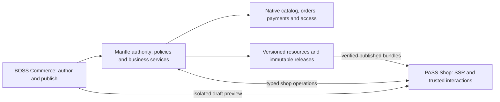

# IronStone PASS — Shop design

Oct 31, 2026 — design specification with staged delivery; Shop is not yet implemented.

**IronStone Shop** is the commerce application of **IronStone PASS — Public Application
Software Suite**. It serves customers browsing and buying physical goods, digital products and
subscriptions, and managing their purchases. **IronStone Commerce** in BOSS manages stores,
merchandising, themes, pages and operations. Shop is a public presentation/application layer over
Mantle, with a local authority or a separate remote authority; it does not require BOSS to run.

The initial complete release includes a visual theme editor **in BOSS Commerce**, sandboxed JS
templates, physical/digital checkout, prepaid subscriptions, and automatic recurring billing.
Liquid compatibility, advanced B2B, POS and a theme marketplace are later. This is a new design,
not a port of PopRestStore or a claim of Shopify feature compatibility.

**Inputs:** [Commerce research](../../mr-boss/plan/research-commerce.md),
[Commerce design](../../mr-boss/plan/design-commerce.md),
[design guide](../../mr-boss/plan/design-doc-guide.md),
[crosscut](../../mr-boss/plan/design-crosscut.md),
[Products](../../mr-boss/plan/design-products.md),
[Accounting](../../mr-boss/plan/design-accounting.md),
[Forum and PASS foundation](design-forum.md), [PASS deployment](../docs/Deployment.md),
and the source evidence in §3. The public screen inventories follow the design guide but use a
site shell, shopper capabilities and HTML templates rather than the BOSS launcher. Proposed
services/records are explicitly labelled; this document does not silently turn Forum proposals
into implemented features.

**Sections:** [1 shell](#1-shell) · [2 screens](#2-screens) · [3 evidence](#3-reference-evidence-and-disposition) ·
[4 authority](#4-sites-deployment-and-identity) · [5 catalog](#5-discovery-and-merchandising) ·
[6 cart](#6-carts-and-checkout-screens) · [7 checkout](#7-checkout-contract) ·
[8 payments](#8-payments-order-placement-and-existing-automation) ·
[9 accounts](#9-customer-account-and-service) · [10 subscriptions](#10-digital-delivery-and-subscriptions) ·
[11 content](#11-content-navigation-and-cross-app-integration) · [12 themes](#12-themes-templates-and-publishing) ·
[13 APIs](#13-service-and-api-catalog) · [14 data](#14-data-model-and-current-source-gaps) ·
[15 needs](#15-framework-and-data-needs) · [16 outputs](#16-documents-and-outputs) ·
[17 delivery](#17-adoption-and-delivery-stages) · [18 validation](#18-validation-and-completeness) ·
[19 decisions](#19-decided) · [20 open](#20-open).

## 1. Shell

Register app key `shop`, screen root `Shop` under `Pass.xml`, default mount `/shop`, target type
`productStore`, and a readiness service. Extend both PASS `Apps.js` and Mantle `PublicApps.js`,
the route/operation registries and the runtime's operator allowlist using Forum §13.1. Shop may
also mount at `/`; the current registry permits only Forum at root, so this is an explicit
extension. One Shop mount per PublicSite is the initial rule. Multiple stores use separate sites;
one store may have multiple sites with independently bound themes/content. No fallback store
is chosen for an unknown hostname.

The customer sees the configured brand. Generic defaults say **IronStone PASS** and **Shop**,
and this application's name is **IronStone Shop**. Shared account/security pages remain PASS
pages. Do not rename `mr-pass`, `Pass`, or established namespaces/routes as part of branding.

Navigation, configurable labels and order within supported destinations:

- Shop — Home, Categories, Search; ProductDetail from lists.
- Cart — Cart, Checkout, confirmation/result pages.
- My purchases — Orders, Downloads, Subscriptions; visible when authorized.
- Account — Sign in/Register or profile, Addresses, PaymentMethods, Sign out.
- Help — published policy/contact pages and private support/return flows.
- Community/Articles — links to other enabled PASS mounts when configured.

The theme supplies header/footer, menus, page layouts and composition. Critical account/payment
components remain trusted application components. No BOSS drawer, staff navigation, authoring
route, or embedded staff credentials reaches the public shell. All theme/page editing lives in
[Commerce §5](../../mr-boss/plan/design-commerce.md#5-website-authoring).

Catalog, category, search and informational pages are server-rendered HTML with normal links,
paginated results, descriptive headings, canonical URLs and usable content without JavaScript.
Cart and checkout use HTML forms with progressive enhancement; payment providers may require
JavaScript, disclosed before their selection. Trusted Vue components enhance variants, cart
updates, checkout and account tasks without compiling merchant browser code. `.qvue` is used for
those components, not as the entire storefront delivery model. Public TUI is not required;
Commerce authoring has the normal BOSS TUI counterparts.

Use accessible labels/errors, skip links, focus restoration, live total/status announcements,
keyboard-operable variant/quantity controls, reduced motion, and 390 px phone layouts. Dates,
language and formatting follow site/user preferences; money calculations stay decimal on the
authority. Theme translations use stable keys; the site's default locale is the explicit fallback.

## 2. Screens

Every Shop-owned row is `new`; S1–S4 are delivery stages, not unfinished public menu labels.
`html` in Impl means an XML screen selects a locked theme template; `qvue` denotes its trusted
interactive component. Public screen paths use `PASS:` in inventories. No staff editor is a Shop
screen. A simple review/address/payment dialog is a form on its parent, not another route.

| Screen | Path | Archetype | Impl | Purpose | Main record | Reused | Roles | Scope/stage | Context |
| --- | --- | --- | --- | --- | --- | --- | --- | --- | --- |
| Home | PASS:Shop/Home | landing | xml + html | Discover the store | authorized store projection | own | permitted visitor | new S1 | site/store, locale |
| Categories | PASS:Shop/Categories | tree list | xml + html | Browse published categories | ProductCategory | own public view | visitor | new S1 | store, tree |
| CategoryDetail | PASS:Shop/Categories/CategoryDetail | list | xml + html | Browse category products | catalog projection | own | visitor | new S1 | category, filters |
| Search | PASS:Shop/Search | list | xml + html | Search visible products/content | public search projection | PASS search foundation | visitor | new S1 | query, facets |
| ProductDetail | PASS:Shop/Products/ProductDetail | detail | xml + html/qvue | Choose and buy a product | Product + store projection | own | visitor; purchaser writes | new S1/S2 | product, variant |
| Page | PASS:Shop/Page | detail | xml + html | Read a published store page | WikiPage version + PublicShopPage | framework wiki rendering | visitor | new S1 | page/version |
| Cart | PASS:Shop/Cart | task | xml + html/qvue | Review intended purchases | OrderHeader in OrderOpen | own over Mantle | cart holder | new S2 | cart revision |
| Checkout | PASS:Shop/Checkout | wizard | xml + html/qvue | Provide/confirm delivery and payment | proposed StoreCheckout | own | cart holder; account for subscriptions | new S2/S3 | checkout revision |
| PaymentResult | PASS:Shop/Checkout/PaymentResult | task | xml + html/qvue | Resume or inspect a payment | public payment-attempt projection | Mantle gateway primitives | attempt holder | new S2 | attempt |
| OrderConfirmation | PASS:Shop/Orders/OrderConfirmation | detail | xml + html | Confirm an authoritative order | safe OrderHeader projection | own | order capability/self | new S2 | order |
| AccountOverview | PASS:Shop/Account | landing | xml + html | Find purchase work | authorized customer summary | shared PASS identity | self | new S2 | self/store |
| Addresses | PASS:Shop/Account/Addresses | settings | xml + html | Maintain own addresses | PartyContactMech | own over contact services | self | new S2 | self |
| PaymentMethods | PASS:Shop/Account/PaymentMethods | settings | xml + html/qvue | Manage tokenized methods | PaymentMethod | own safe projection | self | new S2 | self/provider |
| Orders | PASS:Shop/Orders | list | xml + html | Find own purchases | OrderHeader | own public view | self | new S2 | filters |
| OrderDetail | PASS:Shop/Orders/OrderDetail | detail | xml + html | Follow fulfillment and request help | safe order/shipments projection | own public view | self/order capability | new S2 | order |
| ReturnRequest | PASS:Shop/Orders/ReturnRequest | task | xml + html | Request an eligible return | Request + source order items | shared Mantle intake | self/order capability | new S2 | order, items |
| SupportRequest | PASS:Shop/Orders/SupportRequest | task | xml + html | Ask privately about a purchase | Request | shared Mantle intake | self/order capability | new S2 | order/request |
| Downloads | PASS:Shop/Downloads | list | xml + html | Retrieve entitled digital content | proposed StoreDownloadGrant | existing protected media primitives | self/delivery capability | new S2 | order item/grant |
| Subscriptions | PASS:Shop/Subscriptions | list | xml + html | Inspect paid/recurring access | Subscription + StoreRecurringContract | own over Mantle | verified self | new S3 | self |
| SubscriptionDetail | PASS:Shop/Subscriptions/SubscriptionDetail | detail | xml + html/qvue | Renew/manage billing and cancellation | recurring contract projection | own | verified self | new S3 | contract |
| Login | PASS:Account/Login | task | xml | Authenticate/recover account | UserAccount | Forum Account flow | anonymous | existing foundation S2 | site, checked return |
| Registration | PASS:Account/Register | wizard | xml | Verify a public account | registration challenge | Forum Account flow | anonymous | existing foundation S2 | site |
| AccountSettings | PASS:Account/Settings | settings | xml | Manage profile/security | PublicSiteProfile + account | Forum Account flow | self | existing foundation S2 | self |

Unavailable/withdrawn, empty search/cart, checkout failure and maintenance are states/templates
of these screens. Readiness and publication do not create public operational dashboards.

## 3. Reference evidence and disposition

Sources were inspected Oct 31, 2026. Local source paths are relative to their named checkout,
not copied machine-specific `/home/...` paths from the earlier research. Odoo is the checked-out
source, not a promise that an older released version has each feature. Learn behavior; do not
copy third-party implementation code. This table supplements Commerce research §§2–9.

| ID | Verified reference and source | Adopt / change / defer |
| --- | --- | --- |
| R1 | [PopRestStore](https://github.com/moqui/PopRestStore): README; `screen/store.xml`; `service/popstore/{StoreServices,ProductServices,CartServices,CustomerServices}.xml`; `service/pop.rest.xml`; `data/PopRestStoreAaaSetupData.xml` | Adopt server-rendered discovery, enhanced customer tasks, ProductStore/Mantle reuse and replaceable templates. Change routing, identity, public projection, checkout coordination and publishing as below. |
| R2 | ridgecrest: `data/RidgeCrestStoreDataPop.xml`, `screen/{popdynamic,popstatic,poptemplate}/`, `screen/rcherbals/checkout.xml`, `service/ridgecrest/CheckoutServices.xml` and `service/ridgecrest/vdc/VdcServices.xml` | Real store evidence for template overrides, typed store bindings, guest checkout composition and SystemMessage intake. Use protected provider methods and modern PASS identity; do not port FTL, Vue 2, store-specific tax code or custom review joins. |
| R3 | [Odoo website_sale source](https://github.com/odoo/odoo/tree/master/addons/website_sale): `models/website_checkout_step.py`, `website.py`, `product_public_category.py`, `product_feed.py`; `controllers/{cart,payment,delivery,reorder,portal}.py`; `templates/checkout/` | Adopt structured checkout with server validation, published categories, reorder, feed records and website integration. Steps can be presented flexibly, but arbitrary merchant step execution is deferred. Cart remains the business order. |
| R4 | [Frappe Web Template source](https://github.com/frappe/frappe/tree/develop/frappe/website/doctype/web_template): `web_template.py`; neighboring `web_page`, `web_page_block`, `website_route_redirect`; `website/path_resolver.py` | Adopt reusable template sections with typed fields, separation of content/route/template and explicit redirects. Extend MR Moqui wiki/resources instead of adopting another CMS data model. |
| R5 | Shopify official [theme architecture](https://shopify.dev/docs/storefronts/themes/architecture), [JSON templates](https://shopify.dev/docs/storefronts/themes/architecture/templates/json-templates), [section schema](https://shopify.dev/docs/storefronts/themes/architecture/sections/section-schema), [theme editor](https://shopify.dev/docs/storefronts/themes/tools/online-editor) | Adopt composable layouts/templates/sections/blocks, typed settings, alternate templates and editor preview. Specify our JS renderer and package API; no initial Liquid syntax or drop-in Shopify compatibility. |
| R6 | Ever Gauzy: `packages/plugins/cart/src/lib/commerce-checkout-session/commerce-checkout-session.entity.ts`, `checkout/cart-checkout.registry.ts`; catalog product/channel bindings; fulfillment shipping-option | Adopt durable checkout coordination and registered provider boundaries. Do not add a second commerce cart/order model or infer an existing admin UI from backend plugins. |
| R7 | Current MR Mantle: ProductStoreEntities, ProductDefinitionEntities, OrderEntities, AccountingPortalEntities, PublicEntities; order/payment/promotion/subscription services and SECAs | These are the business baseline. Extend guarded services rather than rebuilding pricing, customers, stock, payment or subscription ledgers. |
| R8 | Current PASS: `Apps.js`, `Schema.js`, `Routes.js`, `Facade.js`, `Contracts.d.ts`; Mantle PublicApps, ForumSchema, PassRoutes/PassApi; Forum §13 and Deployment | Reuse target-bound mounts, registered remote authority, shared identity, explicit publication and source-bound entitlements. Shop operations and root mounting are new registrations/extensions. |

### 3.1 Deliberate differences from PopRestStore

PopRestStore already offers broad template replacement: per-store server root/header/footer/
home/category/product/content/search paths, client page templates, and wiki-backed template
spaces selected by store/locale. This design does not describe it as a fixed-layout store.
Its separate catalog HTML and Vue customer pages are a useful precedent.

The changes are substantive:

- Replace regex hostname settings and the root's `POPC_DEFAULT` fallback with registered
  PublicSiteHost/mount resolution that conceals unknown hosts.
- Replace loose template-location overrides with validated packages, structured composition,
  exact-version releases, visual editing, draft preview and atomic publication/rollback.
- Replace FTL/Groovy and the legacy browser template stack with locked MR JS templates and
  trusted modern interaction components. Public data and rendering share a versioned contract.
- Replace the single web-session `cartOrderId`/`productStoreId` assumption and recovery of the
  latest open customer order with explicit site/store/currency cart ownership. The existing
  legacy lookup does not scope its latest-order search by store; Shop must.
- Do not export raw ProductStore/settings or a login API key as a generic `config.js` object.
  Expose a deliberately limited shop configuration and shopper projections.
- Preserve Mantle calls while adding durable attempts, frozen checkout totals and authoritative
  reconciliation. PopRestStore explicitly authorizes before `place#Order`, which also triggers
  authorization; Shop must resolve that interaction rather than reproduce it.
- Use current public account/access flows, masked/tokenized payment methods, permission-checked
  downloads and explicit publication. Customer transactions never authorize template execution.

## 4. Sites, deployment and identity

### 4.1 Authority and routing



The same authority boundary applies in-process and remotely. The preview connection is needed
only while editing; a published Shop does not call BOSS.

`PublicSiteApp.targetId` holds the ProductStore ID for app `shop`. Extend PublicApps' target
validator to recognize a real store and its organization. Only an operator changes targeted
mounts and host allowlists. The current one-app-root helper and route conflict checks must
support Shop at root without intercepting Account, Forum, API, token, asset or operational
routes. Shop is a target-bound app, not an alias for the old future app name `commerce`.

One authority owns all mutable business state. Local PASS calls it in-process. A remote PASS
frontend loads framework/webroot/PASS, its session database and published theme assets; it does
not load Mantle's business entity catalog, copy Party records or execute business services from
the theme. Registered transport carries deployment identity and the already checked site/mount;
browser parameters cannot substitute store, backend origin, organization or customer party.

Published theme release bundles may be cached on remote frontends after authenticated transfer
and digest verification. Public/product/order data is still projected by the authority. An
unreachable authority cannot accept offline orders or payments. Personalized responses fail
closed; public cached content is served only while the publication generation remains valid
under §12.7. There is no promise of an offline shopping cart mutation queue.

### 4.2 Shopper identity and authorization

Reuse PASS registration, verification, login, password recovery, second-factor and delegated
session flows. No new user directory or broad customer UserGroup grant. Site/store policy may
require account access for browsing or purchase. Public browsing and physical/digital guest
checkout are the defaults for a published retail store; subscriptions require a verified,
signed-in account so renewals and paid resource access have a stable owner.

Creating an account or completing checkout does not opt a shopper into a public profile,
community directory or marketing list. Guest email does not prove ownership of an existing
Party/account. Create or use the guest purchase identity scoped to the cart; merge/link only
after proof through the existing account verification process. Deduplication of internal Party
records is a separate authorized workflow and cannot transfer purchase access on email alone.

For every operation, intersect routed site/store, active shopper/cart capability, resource
ownership, publication and business eligibility. Signed-in order lists require customer identity;
guest order/download actions use narrow expiring capabilities. Customer account permissions do
not reveal staff notes, costs, supplier prices, gateway credentials or another store's purchases.

Cookies remain host-scoped, Secure/HttpOnly where appropriate; cookie writes require the
framework CSRF token. Use the existing registered SSO/session handoff across hosts rather than
a broadly scoped shared cookie. Rate limits cover account discovery, cart creation, coupons,
order lookup, checkout, downloads and reviews. A capability has random secret material with
only its digest stored; database record IDs remain ordinary sequenced IDs.

### 4.3 Publication/readiness

Sites and Shop mounts start disabled/unpublished. Readiness checks canonical host/mount,
organization/store, explicit assortment, active compatible theme, mandatory pages/terms,
locale/currency, payment capability, applicable shipping/tax policy and digital/recurring
fulfillment handlers. A browse-only release is permitted but must not advertise purchase.
Turning on checkout requires its independent readiness check. All checks run on the authority,
including when a remote frontend previews a proposed release.

Public page access always rechecks current site/mount publication; possession of an old theme
bundle or URL does not keep a withdrawn site accessible. Preview is a separate limited staff
capability with no real purchase or marketing side effects (§12.6).

## 5. Discovery and merchandising

### 5.1 Catalog projection

Proposed `mantle.product.ShopCatalogServices` exposes read-only shop views. The query begins
with the routed store and explicit effective product publication. Intersect `Product.salesAllowed`,
product lifecycle/availability, store browse/search roots and effective view/purchase category
rules. Categories organize an assortment; they are not a grant to expose every associated product.

A published virtual product exposes only eligible published variants. An unavailable variant
may be displayed as unavailable according to policy but never becomes a purchasable default.
Choose a real saleable variant before adding to cart. Shared master descriptions/media may be
reused; store-specific title/SEO/template/badge overrides live with the store publication, not
copies of Product. Public category pages omit private/empty descendants unless deliberately
published as content-only landing pages. Cycle and pagination limits apply to category trees.

Use existing `mantle.product.PriceServices.get#ProductPrice` and its store/buyer/currency/UOM/
effective-date context, with the existing named price services as extended by Products. Expose
unavailable price separately from valid zero price. Keep quantity breaks and promotional
adjustments explainable, but never return the internal price-rule trace, cost or margin publicly.
Final price, promotions, shipping and tax are recalculated by checkout.

Search, feed generation, recommendations, related products, reviews and structured metadata use
this same projection. Search indexes are candidate sources, not authorization. Withdrawal and
effective-date changes invalidate generations; an old index hit is filtered before being returned.
Postgres search remains sufficient; OpenSearch is optional. No anonymous raw UniversalSearch or
DataDocument access is introduced.

### Home

**Layout:** theme-composed landing with published navigation, hero/content, featured categories
and product sections.

| Form | Kind | Purpose | Highlighted fields | Widgets of note | Operations/services | Derived from |
| --- | --- | --- | --- | --- | --- | --- |
| HomeSections | component | Compose the published landing | composition, approved source projections | themed sections | `shop.getHome` | PopRestStore home; Shopify sections |
| SearchBox | find | Open catalog search | query | accessible search input | — | PopRestStore search |
| FeaturedProducts | list, read | Discover featured offers | image, name, public price, availability | product cards | `shop.getHome` | ridgecrest featured products |

Derived from PopRestStore home,
ridgecrest featured products and Shopify sections. Source queries are bounded and server-owned.
Empty sections are omitted; a configured empty store shows helpful contact/content without fake
products. **Needs:** SHOP-CATALOG, SHOP-THEME, SHOP-RENDER.

### Categories

| Form | Kind | Purpose | Highlighted fields | Widgets of note | Operations/services | Derived from |
| --- | --- | --- | --- | --- | --- | --- |
| CategoryTree | list, read | Browse the published tree | name, image, description, authorized children | nested links and keyboard expansion | `shop.getCategories` | ProductStoreCategory/ProductCategoryRollup; Odoo public categories |

Normal links and keyboard expand controls; a phone sees a nested list.
Derived from ProductStoreCategory/ProductCategoryRollup and Odoo public categories. **Needs:**
SHOP-CATALOG, SHOP-RENDER.

### CategoryDetail

| Form | Kind | Purpose | Highlighted fields | Widgets of note | Operations/services | Derived from |
| --- | --- | --- | --- | --- | --- | --- |
| CategoryHeader | display | Explain the selected category | name, safe body, image | theme composition | `shop.getCategory` | PopRestStore category |
| ProductFind | find | Narrow visible products | registered facets, sort, cursor | facet choices | — | Odoo shop grid |
| ProductGrid | list, read | Browse eligible offers | product card, public price, availability | responsive product cards | `shop.findProducts` | PopRestStore category/search |

Sort/facet keys are registered, never entity field expressions. Availability
and variant minimum price have explicit labels. Derived from PopRestStore category/search and
Odoo shop grid. **Needs:** SHOP-CATALOG.

### Search

| Form | Kind | Purpose | Highlighted fields | Widgets of note | Operations/services | Derived from |
| --- | --- | --- | --- | --- | --- | --- |
| SearchFind | find | Search public shop content | query, category, registered facets/sort | accessible filters | — | PASS search |
| SearchResults | list, read | Open eligible products/pages | summary, canonical URL, public price | result cards, pagination | `shop.search` | PASS search projection; Frappe routing |

Only
published shop pages participate; Forum/Publishing results are separate ACL-checked app sections
through the PASS search contract. No-match, invalid filter and unavailable backend are distinct
states. Derived from Frappe routing and PASS search projection. **Needs:** SHOP-CATALOG.

### ProductDetail

| Form | Kind | Purpose | Highlighted fields | Widgets of note | Operations/services | Derived from |
| --- | --- | --- | --- | --- | --- | --- |
| Product | display | Explain the product | title, safe description, gallery, price, availability, delivery/terms | accessible image gallery | `shop.getProduct` | PopRestStore product; Odoo product page |
| PurchaseSelection | single | Choose a purchasable offer | variant, quantity/UOM, permitted options, one-time/recurring offer | variant selectors, server price update | `shop.quoteSelection`, `shop.addCartItem` | PopRestStore add product; Mantle order services |
| PublicReviews | list, read | Read moderated feedback | rating, body, public author label, date, verified purchase | rating distribution | `shop.getReviews` | ProductReview; Odoo product discussion |
| SubmitReview | dialog | Submit or revise own purchase feedback | rating, body, display-name choice, order-item proof, own review/revision when editing | plain/rich text sanitizer | `shop.submitReview` | existing ProductReview model; new guarded public submission |
| RelatedContent | list, read | Discover relevant products/support | published related products, help articles, Forum links | normal links | product projection | ProductAssoc; Forum product binding |

The submit-review form fields above are complete; authority derives product/store/party and
validates the claimed purchase proof. Editing requires ownership and the expected review revision.
No direct ProductReview CRUD endpoint. Pending reviews are visible only to their author/staff,
and only approved reviews affect public aggregates. Add an approved-to-pending transition for
author edits; the current ProductReview status flow does not provide it. Purchase form errors preserve selections;
out-of-stock or unavailable pricing never silently substitutes a different variant. Schema.org
product/offer data matches the visible public projection and canonical URL. **Needs:**
SHOP-CATALOG, SHOP-CART, SHOP-SUPPORT.

### Page

| Form | Kind | Purpose | Highlighted fields | Widgets of note | Operations/services | Derived from |
| --- | --- | --- | --- | --- | --- | --- |
| PublishedPage | display | Read a published store page | title, body, template sections, locale, policy version | safe wiki fragments | `shop.getPage` | Frappe Web Page; PASS PublicSitePage |

It reads the exact published WikiPage version through a `PublicShopPage` binding,
not whatever is currently saved in its source wiki space. Derived from Frappe Web Page and PASS
PublicSitePage. Contact/return forms are trusted blocks calling the named intake operations;
theme text cannot submit arbitrary services. **Needs:** SHOP-CONTENT, SHOP-THEME.

## 6. Carts and checkout screens

### Cart

**Layout:** editable lines, discounts, estimated totals, delivery caveat and one Checkout action.
Use an ordinary page even when a theme also offers a mini-cart; both consume the same projection.

| Form | Kind | Purpose | Highlighted fields | Widgets of note | Operations/services | Derived from |
| --- | --- | --- | --- | --- | --- | --- |
| CartItems | list, editable rows | Review/change intended purchases | product/variant, quantity, unit price, adjustments, availability | bounded quantity input, remove | `shop.getCart`, `shop.updateCartItem`, `shop.removeCartItem` | PopRestStore CartServices; Mantle order items |
| PromoCode | single | Add/remove a code | code, eligibility result | generic rejection without private party hints | `shop.applyPromoCode`, `shop.removePromoCode` | PromotionServices add/remove OrderPromoCode |
| CartTotals | display | Explain estimated cost | items, discounts, shipping estimate, tax estimate, total/currency | changed-price notices | `shop.getCart` | get#OrderDisplayInfo |
| BeginCheckout | single | Start/resume checkout | cart revision, operation ID | one primary action | `shop.beginCheckout` | PopRestStore place path; Ever Gauzy checkout session |

Removing a line is reversible while the cart is open. A declined payment can return to editing
only when its attempt is resolved; an unknown outcome cannot. Mini-cart updates announce counts
without forcing focus or full-page reload. Cart access is not granted by knowing an order ID.
**Needs:** SHOP-CART, SHOP-CHECKOUT.

### Checkout

**Layout:** responsive single workspace with contact, delivery, payment and review groups, a
summary on desktop and a compact expandable summary on phones. A theme may present the groups
as one page or successive panels. The authority validates prerequisites in the fixed order
below; presentation never changes the business state machine.

| Form | Kind | Purpose | Highlighted fields | Widgets of note | Operations/services | Derived from |
| --- | --- | --- | --- | --- | --- | --- |
| Contact | wizard step | Identify the buyer/contact | verified account or guest email/name, optional phone | shared sign-in handoff | `shop.setCheckoutContact` | ridgecrest guest/returning checkout; PASS accounts |
| Addresses | wizard step | Supply billing/delivery facts | saved own address or postal fields, billing-same flag | locale-aware address, own-address picker | `shop.setCheckoutAddresses` | Mantle set#OrderBillingShippingInfo and contact services |
| Delivery | wizard step | Select a current quote | order part, carrier/method, quote ID, amount, estimate | available options with full cost | `shop.getDeliveryOptions`, `shop.selectDelivery` | StoreServices.get#StoreShippingOptions; Odoo delivery |
| Payment | wizard step | Choose an eligible method | provider/instrument, existing own token or hosted setup result | operator-installed provider component | `shop.getPaymentOptions`, `shop.selectPayment` | Mantle gateways; Frappe registry |
| ReviewPurchase | wizard step | Accept the authoritative purchase | lines, totals, due-now/later, recurring cadence/amount, delivery, terms version, required consents | changed-value comparison | `shop.getCheckout`, `shop.submitCheckout` | Odoo checkout validation; PopRestStore composition |

Contact/account creation is optional for ordinary guest purchases; recurring offers require a
verified account before payment. Marketing consent is an unchecked separate choice and is never
a prerequisite for purchase. Provider-hosted fields collect payment credentials; Shop receives
only provider references/tokens. Required address fields derive from destination and tax rules,
not a hard-coded US form. Digital-only carts omit delivery. Totals remain authoritative while
each invalid/expired quote or changed price returns a clear re-review state with the entered
non-sensitive data intact. **Needs:** SHOP-CHECKOUT, SHOP-PAYMENT, SHOP-ACCOUNT.

### PaymentResult

| Form | Kind | Purpose | Highlighted fields | Widgets of note | Operations/services | Derived from |
| --- | --- | --- | --- | --- | --- | --- |
| PaymentState | display | Explain the authoritative outcome | state, safe message, reference | bounded status polling | `shop.getPaymentResult` | PASS Billing/InvoicePay |
| ProviderAction | component | Complete a required provider step | approved hosted URL or supported SDK action | registered provider component/link | `shop.getPaymentResult` | Odoo/Frappe payment outcomes |
| ResumeCheckout | single | Resume a resolved attempt | attempt reference, revision | resume action | `shop.resumeCheckout` | proposed checkout coordination |

These fields are the full new public result contract.
Derived from PASS Billing/InvoicePay and Odoo/Frappe payment outcomes.

The return page proves only possession of its scoped attempt reference; it does not trust
`success`, amounts or transaction IDs in query parameters. A link from a hosted provider returns
to a server-generated canonical site/mount address. The authority queries/verifies the provider
and returns its result. Polling is bounded with backoff; a timeout says processing/unknown, never
paid or declined by inference. A pending attempt can be resumed across a refreshed frontend
session through its narrow capability, without exposing the whole customer account.
**Needs:** SHOP-PAYMENT.

### OrderConfirmation

| Form | Kind | Purpose | Highlighted fields | Widgets of note | Operations/services | Derived from |
| --- | --- | --- | --- | --- | --- | --- |
| Confirmation | display | Confirm the accepted order | reference, items/totals, payment/fulfillment, delivery summary | status and record links | `shop.getOrderConfirmation` | PopRestStore checkout success |
| NextActions | display | Offer authorized next steps | own order, downloads, subscription, verification | scoped links | `shop.getOrderConfirmation` | Mantle order summaries |

Derived from
PopRestStore checkout success and Mantle order summaries. A confirmation is available only after
authoritative placement; pending payment gets PaymentResult. A newly placed order may still need
staff approval, so wording must not promise shipping or access before the relevant state.
Refresh never places the order again. **Needs:** SHOP-CHECKOUT, SHOP-ACCOUNT.

## 7. Checkout contract

### 7.1 Cart ownership and lifecycle

The cart is an existing `OrderHeader` with `OrderOpen` status, store and `ScWeb` channel (or the
store's explicitly permitted web channel). Its lines, pricing, promotion adjustments and parts
are ordinary Mantle records. Proposed `StoreCartAccess` adds public ownership, activity and
expiry metadata; it does not store a second set of lines/totals.

The authority issues a secret cart capability, stored by the presentation session, with only a
digest on the authority. Cart scope includes site, store and currency. A logged-in identity may
attach its own cart; an existing verified account does not inherit all open orders with matching
email. On login, merge only two proven carts with matching scope and no pending checkout:
re-add source lines through `mantle.order.OrderServices.add#OrderProductQuantity`, reprice and
reevaluate codes, report unavailable lines, then retire the source capability atomically. Carts
from different stores/currencies stay separate. A conflicting pending checkout is resumed or
resolved first, not merged. Logout rotates capabilities so a later shared-browser user cannot
read the prior account's saved data.

Use existing `update#OrderProductQuantity`, `delete#OrderItem`,
`mantle.product.PromotionServices.add#OrderPromoCode` / `remove#OrderPromoCode`, and
`mantle.order.OrderInfoServices.get#OrderDisplayInfo` through guarded Shop services. Public
inputs specify product/options/quantity, not unit prices, customer IDs, status, store IDs or
adjustment amounts. Every mutation checks expected cart revision and operation ID.

Activity is updated for shopper actions, not background reads/repricing/jobs. Expired open carts
can be cancelled through the existing order path according to retention policy once no provider
attempt is unresolved. Do not delete paid/placed records to clean up cart storage.

### 7.2 Checkout coordination

Proposed `StoreCheckout` coordinates one current checkout for a cart. Use typed states
`editing`, `ready`, `paymentPending`, `placementPending`, `completed`, `expired`, `cancelled`
and `reviewRequired` as proposed status data. These are not replacements for OrderHeader or
Payment statuses. Revisions and durable operation results prevent duplicate writes across tabs,
retries and frontend restarts. One order can have historical attempts, but only one unresolved
submission for a frozen revision.

1. **Begin/resume:** prove cart ownership, publication and purchase eligibility; create or return
   its checkout. Snapshot the applicable store policy, terms and offer versions.
2. **Contact/address:** validate account requirements and owned saved records; save permitted
   contact/address data through existing services. No lookup result exposes whether another
   account already uses a guest email.
3. **Reprice:** calculate price, promotions, delivery and tax using existing Mantle entry points,
   including `mantle.product.StoreServices.get#StoreShippingOptions`,
   `mantle.shipment.CarrierServices.get#OrderShippingRatesBulk`, and
   `mantle.other.TaxServices.calculate#OrderSalesTax`. Quotes carry source, currency, scope,
   revision and expiry; a later address/line change invalidates affected quotes.
4. **Review:** return amounts as decimal strings plus formatted text, available payment methods,
   items/delivery promises, recurring consent and due-now/later totals. The client accepts the
   exact summary revision and terms versions, not an arbitrary `accepted=true` for unknown terms.
5. **Freeze:** lock/recheck the order, stock policy, effective publication, prices, quotes, code
   limits and eligibility. A mismatch produces `reviewRequired` and a comparison; never silently
   charge a higher amount. Persist immutable monetary snapshot/hash and begin attempt metadata
   in a committed short transaction before contacting a provider.
6. **Payment and placement:** §8 owns provider actions, outcome reconciliation and exactly-once
   logical order placement. Reject cart/address edits during unresolved monetary operations.
7. **Complete:** return the existing order/confirmation on every matching retry; retire mutation
   capabilities, retain scoped order access, and let normal order/fulfillment events drive outputs.

The core flow and prerequisites are code-owned. Themes can reorder explanatory sections or
choose single/multi-panel presentation, but cannot skip price/stock/tax/terms checks. Initial
checkout does not expose a database-driven arbitrary service workflow. A registered extension
may add typed non-sensitive fields and validation without taking authority over money or actor.

### 7.3 Failure and concurrency rules

Stable safe reason codes include `NOT_AVAILABLE`, `ACCESS_DENIED`, `STALE_REVISION`,
`REVIEW_REQUIRED`, `QUOTE_EXPIRED`, `PAYMENT_PENDING`, `PAYMENT_DECLINED`, `PAYMENT_UNKNOWN`,
`PROVIDER_UNAVAILABLE` and `RATE_LIMITED`. Map to field errors and customer-safe messages; hide
resource existence when authorization requires it. No UI matches raw gateway exception text.

Scope an operation ID to site, principal/capability and operation; persist its normalized input
digest and result. Matching replay returns the result; changed input with the same key conflicts.
Optimistic checks plus order/attempt locking guard multi-tab submission. Network requests to a
gateway do not occur while holding a database transaction open. A timeout leaves the attempt
unresolved until lookup/webhook reconciliation proves its outcome. Do not generate a new provider
idempotency key to escape an unknown previous request.

No cart reservation is invented beside Mantle. Follow the store's configured reservation policy;
checkout validates current availability before submitting and on authoritative placement. If
stock is lost after a financial action, keep the payment and order evidence, place the order only
under permitted backorder policy, otherwise enter an operator-visible exception with void/refund
recovery. Never promise stock merely because it was shown earlier.

## 8. Payments, order placement and existing automation

### 8.1 One payment authority

Use Mantle `Payment`, `PaymentMethod`, `PaymentGatewayResponse` and the existing gateway operation
interfaces. `mantle.account.PaymentServices.authorize#OrderPayments`, `authorize#SinglePayment`,
`capture#SinglePayment`, `release#SinglePayment`, `refund#SinglePayment`, and
`get#SinglePaymentGatewayDetails` remain the native path. Never directly mark a Payment paid
from a browser return or build a Shop payment ledger.

The current `PortalPaymentAttempt` is **invoice-specific**, and its worker assumes Billing
semantics. Extend it deliberately with a typed source purpose (`invoice`, `shopCheckout`,
`shopRenewal`), order/checkout/occurrence references, operation/snapshot identity and phase/result
metadata. Keep existing invoice behavior and URLs compatible. Refactor shared provider-attempt
coordination below the Billing and Shop wrappers; do not route a Shop order through invoice-only
`start#InvoicePayment`. Existing worker queries must select the proper purpose so Billing cannot
capture an unrelated Shop attempt. New Shop workers dispatch to the same typed lifecycle.

Payment forms use provider-hosted redirects or operator-installed tokenization components.
Raw card numbers/security codes never enter Shop templates, logs, records or frontend caches.
Provider capability registration covers currencies, tokenization, hosted/customer-action flow,
authorization/capture/void/refund, partial capture and off-session recurring consent. Unsupported
flows fail readiness instead of falling back to unsafe payment entry. Zero-total eligible orders
skip the gateway but still run all other purchase/fulfillment checks.

### 8.2 Placement and capture

For a frozen checkout, persist attempt/Payment references, call the provider using the stable
idempotency key, then reconcile under lock. Commit safe outcomes in separate short transactions.
Only the server verifies amount, currency, merchant account, source order and transaction identity.
An amount mismatch remains an exception, not a successful payment.

Physical items normally authorize first and capture through existing shipment/invoice policy.
Digital and paid subscription items require settled funds before access activation. For a mixed
cart, group order parts/payment allocations by fulfillment and capture policy; disclose due-now
and authorized-for-later amounts before submit. Use native order-part payments, not duplicate
totals. A provider with supported partial capture can share an authorization; otherwise use
separate native payments per policy group. Readiness prevents a combination the provider cannot
process. A partial success leaves a visible recoverable checkout; it never recharges a completed
group during retry.

After payment readiness, call existing `mantle.order.OrderServices.place#Order` once for the
frozen order. Record durable placement intent before the call and inspect actual order state on
recovery: a crash after placement returns that order rather than repeating its side effects.
If a provider succeeded but placement fails, preserve the attempt and financial record for
reconciliation/compensation; do not lose them in a rolled-back cart transaction.

### 8.3 Rule audit

| Existing automation | Kept or changed for Shop |
| --- | --- |
| `OrderPlacedAuthorizePayments` in AccountingPayment.secas.xml | Keep the authoritative service hook; extend authorization to recognize Shop's completed or pending attempt. Preauthorization plus placement must be idempotent, not two provider requests. |
| `OrderPlacedAutoApprove` in OrderReturn.secas.xml; `OrderPreApproveCredit` in AccountingCredit.secas.xml | Keep configured delay, registered ProductStoreApprove checks and credit policy. Add a narrow Mantle pre-approve readiness check for Shop orders so pending/unknown payment or incomplete mandatory purchase validation blocks approval. |
| ProductAsset.secas.xml reservation rules and `OrderItemHandleChange` EECA | Keep native reservation/line-change paths and store policy. Enforce checkout freeze in the guarded order mutation services; staff edits to an active checkout must explicitly resolve/release it first. |
| `OrderPlacedSendEmail`, `OrderApprovedSendEmail`, `OrderApprovedNotify` | Keep status-triggered outputs; idempotent delivery records prevent replay duplicates. Confirmation rendering does not send mail. |
| `ShipmentOutgoingPackedCreateInvoices`, `ShipmentShippedFinalizeInvoices` | Keep physical invoicing/capture behavior, including `salesInvoiceFinalizedAtShip`. The public frontend only reports it. |
| `OrderApprovedFulfillSubscriptions` in ProductSubscription.secas.xml | Extend for Shop: existing fulfillment creates Subscription before invoicing/applying payment. Separate preparation/settlement from activation, and retry the source-bound activation only after required settlement. Retain non-Shop policy behavior unless explicitly migrated. |
| `PaymentApplyForInvoice` and AccountingLedger posting rules | Keep applications/postings through native services. Payment retries cannot make duplicate invoices, applications, captures or GL postings. |
| Existing return processing rules | Keep the shared policy/Accounting mode; a public return request cannot authorize or settle itself. |

The digital/subscription change needs a durable fulfillment marker keyed by order item/resource,
so a crash after invoice creation but before activation can resume each step independently.
Do not assume Subscription existence proves that its payment succeeded. Failed capture gives no
new download or access grant. A fully paid zero-charge resource follows its explicitly accepted
zero-price policy, not a fake captured payment.

### 8.4 Provider returns, webhooks and reconciliation

Provider endpoints and credentials are operator registered. Return URLs are built from canonical
host/mount and a short-lived attempt reference, never caller-supplied origins. Verify webhook
signatures and event/account identity before applying facts; deduplicate provider events and
reject stale transitions. Both callbacks and polling use one reconciliation service. A provider
event cannot change cart totals or directly grant a subscription.

Current PASS CSP allows same-origin form submission and forbids framing. Hosted checkout can
use a link to the approved provider, as Billing does. Embedded provider flows require an explicit
operator CSP/SDK capability extension, not `*`, arbitrary merchant scripts or a globally weaker
policy. Preview framing has a separate policy (§12.6).

Jobs inspect pending attempts with bounded retries/backoff, record safe errors, and continue after
one independent attempt fails. Operators see unresolved amount/account mismatches and long-lived
unknown states in Commerce. Only a verified provider result or authorized financial resolution
can leave the unknown state; elapsed time alone is not proof of failure.

## 9. Customer account and service

Proposed `mantle.party.ShopCustomerServices` projects customer-owned data and calls existing
contact/payment/order services after its own site/store/ownership checks. It never trusts a
browser Party ID. Staff views remain Commerce Customer360; public views below deliberately
omit internal fields and actions.

### AccountOverview

| Form | Kind | Purpose | Highlighted fields | Widgets of note | Operations/services | Derived from |
| --- | --- | --- | --- | --- | --- | --- |
| PurchaseSummary | display | Summarize purchase work | recent orders, pending action, downloads, subscriptions | scoped result cards | `shop.getAccount` | ridgecrest account home |
| AccountLinks | display | Open profile and purchase tasks | profile/security, addresses, methods, orders | registered PASS links | `shop.getAccount` | Frappe portal navigation |

Derived from ridgecrest account home and Frappe role-aware portal navigation. Empty
sections link back to published catalog; no public profile is created to fill an account card.
**Needs:** SHOP-ACCOUNT.

### Addresses

| Form | Kind | Purpose | Highlighted fields | Widgets of note | Operations/services | Derived from |
| --- | --- | --- | --- | --- | --- | --- |
| AddressList | list | Find owned addresses | formatted address, purposes, default flags | locale-aware display | `shop.getAddresses` | PopRestStore customer contacts |
| AddressEdit | dialog | Save an owned address | name, postal fields, required phone, purpose, revision | locale-aware postal fields | `shop.storeAddress` | Mantle contact forms |
| EndAddress | dialog | Stop using an address | own address, confirmation | usage warning | `shop.endAddress` | PartyContactMech effective dates |

Call `shop.getAddresses`, `shop.storeAddress`,
`shop.endAddress`, reusing existing `mantle.party.ContactServices.get#PartyContactInfoList`,
`store#PartyContactInfo`, `create#PostalAddress`, `update#PartyPostalAddress` and effective
PartyContactMech handling. Derived from ridgecrest account/profile and Mantle contact forms.
An edit does not rewrite an already placed order's address history. Address ownership is
checked before both selection and modification. **Needs:** SHOP-ACCOUNT.

### PaymentMethods

| Form | Kind | Purpose | Highlighted fields | Widgets of note | Operations/services | Derived from |
| --- | --- | --- | --- | --- | --- | --- |
| SavedMethods | list, read | Inspect own tokenized methods | provider, masked brand/digits, expiry, recurring contracts | masked descriptors | `shop.getPaymentMethods` | PopRestStore customer methods |
| AddMethod | component | Complete protected setup | registered provider, hosted/tokenized setup result | trusted provider handoff | `shop.beginPaymentMethodSetup`, `shop.finishPaymentMethodSetup` | PASS Billing provider pattern |
| EndMethod | dialog | Replace or end a method | method, affected contracts, replacement or stop-future-billing, confirmation | impact preview | `shop.endPaymentMethod` | native PaymentMethod; proposed contract guard |

`shop.getPaymentMethods`, `shop.beginPaymentMethodSetup`, `shop.finishPaymentMethodSetup` and
`shop.endPaymentMethod` wrap existing `mantle.account.PaymentMethodServices.get#PartyPaymentMethodInfoList`,
`store#PaymentMethodInfo`, and `delete#PaymentMethod` after ownership/provider checks.
Derived from PopRestStore customer methods, updated to hosted/tokenized entry.

A method used by recurring contracts cannot silently disappear while those contracts continue
charging it. Confirmation identifies affected contracts; replacement is validated at the provider
before switching. No API returns reusable provider tokens to templates; only opaque method
choices and masked descriptors. **Needs:** SHOP-ACCOUNT, SHOP-PAYMENT, SHOP-SUBSCRIPTION.

### Orders

| Form | Kind | Purpose | Highlighted fields | Widgets of note | Operations/services | Derived from |
| --- | --- | --- | --- | --- | --- | --- |
| OrderFind | find | Find own submitted purchases | order reference, date range, status | date-period | — | Odoo portal |
| Orders | list, read | Inspect purchase progress | reference, date, total/currency, payment/fulfillment | authorized order links | `shop.findOrders` | ridgecrest order history |

Derived from ridgecrest
order history and Odoo portal. Exclude open carts and recurring base/template orders. A guest
link opens its one order; it cannot enumerate other purchases. **Needs:** SHOP-ACCOUNT.

### OrderDetail

| Form | Kind | Purpose | Highlighted fields | Widgets of note | Operations/services | Derived from |
| --- | --- | --- | --- | --- | --- | --- |
| OrderSummary | display | Explain accepted purchase | lines, taxes, discounts, total, status, placed addresses | current fulfillment alongside historic terms | `shop.getOrder` | get#OrderDisplayInfo; Odoo portal |
| Shipments | list, read | Follow delivery | shipped items, packages, carrier, tracking/ETA | approved carrier link | order projection | Mantle Shipment and package routes |
| PurchaseDocuments | list, read | Read permitted documents | invoice/receipt, available date | authorized PDF or Billing link | `shop.getOrderDocument` | existing invoice print and external access |
| Reorder | single | Rebuild eligible lines in a current cart | selected order items, quantities, changed/unavailable summary | preview before add | `shop.previewReorder`, `shop.reorder` | Odoo reorder controller |
| OrderActions | display | Request permitted help | return eligibility, support, downloads, cancel eligibility | capability-derived actions | order projection; `shop.requestCancellation` | shared Customer Service policies |

Reorder calls the current cart/pricing path; it does not clone historic prices, discounts,
shipping or subscription consent. Subscription lines require a fresh offer/consent through
SubscriptionDetail. Cancellation is a request unless the shared cancellation policy expressly
permits immediate cancellation before fulfillment. Payments/refunds follow the normal financial
path. Customer-specific documents use checked download capabilities, never raw resource URLs.
**Needs:** SHOP-ACCOUNT, SHOP-SUPPORT.

### ReturnRequest

| Form | Kind | Purpose | Highlighted fields | Widgets of note | Operations/services | Derived from |
| --- | --- | --- | --- | --- | --- | --- |
| ReturnableItems | list, read | Explain eligible quantities | owned item, fulfilled/returned/eligible quantities, policy reason | item selection | `shop.getReturnOptions` | find#ReturnableOrderItems; Customer Service |
| RequestReturn | single | Request a return decision | selected quantities, reason, description, requested outcome, scanned attachment | guarded upload and confirmation | `shop.requestReturn` | Odoo withdrawal request; shared return policy |

These are the full new request fields; source order/customer/store are authority-derived.
Reuse existing `mantle.order.ReturnServices.find#ReturnableOrderItems` and shared return policy
for eligibility. Submit creates a linked Request and acknowledged intake result; staff authorizes
ReturnHeader/ReturnItems using the existing workflow. Derived from Odoo withdrawal request and
Customer Service return policy. It cannot directly issue a refund, promise acceptance or publish
an attachment. **Needs:** SHOP-SUPPORT.

### SupportRequest

| Form | Kind | Purpose | Highlighted fields | Widgets of note | Operations/services | Derived from |
| --- | --- | --- | --- | --- | --- | --- |
| PurchaseQuestion | single | Request private purchase help | subject, message, own order/items, contact channel, scanned files | source picker and guarded upload | `shop.requestSupport` | ridgecrest public requests |
| RequestReceipt | display | Confirm private intake | request reference, customer-visible state, support destination | registered support link | `shop.requestSupport` result | Forum §13.4; shared public support |

Full new fields as listed; the
server supplies source identity/store. Reuse Mantle Request services and shared public support
policy. If PASS Support is enabled, hand off through its registered mount; otherwise show the
receipt and configured communication channel. Do not depend on an uninstalled Support app.
Derived from ridgecrest public requests and Forum §13.4. **Needs:** SHOP-SUPPORT.

### Shared account screens — Context passed

| Screen | Context and reuse |
| --- | --- |
| Login | Existing PASS Account/Login and its second-factor/recovery flow. Site and checked local return path point back to checkout; successful login explicitly reconciles proven carts. |
| Registration | Existing Account/Register verification/site-eligibility flow. Registration policy comes from the site; purchase does not bypass a closed/invitation-only policy. No automatic public profile discoverability. |
| AccountSettings | Existing Account/Settings identity/security/preferences. Shop links its addresses/payment methods/orders; it does not duplicate password, verification or second-factor forms. |

## 10. Digital delivery and subscriptions

### Downloads

| Form | Kind | Purpose | Highlighted fields | Widgets of note | Operations/services | Derived from |
| --- | --- | --- | --- | --- | --- | --- |
| DownloadList | list, read | Find entitled files | product, order, file/version, entitlement dates, availability, filename/size | authorized download links | `shop.getDownloads` | ProductContent PcntDownload; protected media |
| DownloadAction | single | Request protected delivery | selected grant | short-lived scoped action | `shop.issueDownload` | source-bound subscription access |

Derived from ProductContent `PcntDownload`, protected PASS media
and source-bound subscription access. These are complete public fields; no private location,
storage key or provider credential is returned.

Proposed `StoreDownloadGrant` binds an eligible settled order item to a specific resource
version and recipient, with expiry/revocation/audit metadata. A request for a download issues
a short-lived scoped capability (default ten minutes, configurable downward). The streaming
handler rechecks current grant state; a cached asset URL cannot bypass revocation. Range
requests remain authorized. Guest delivery requires proof via the scoped order/delivery link
sent to the purchase contact, not an order-number/email guessing form. Signed-in lists show
only linked owned purchases. Refund/chargeback policy revokes the affected grant; historical
orders/documents remain readable. Public previews are separate ProductContent entries.
**Needs:** SHOP-DIGITAL, SHOP-PAYMENT.

### Subscriptions

| Form | Kind | Purpose | Highlighted fields | Widgets of note | Operations/services | Derived from |
| --- | --- | --- | --- | --- | --- | --- |
| SubscriptionList | list, read | Inspect own access and renewals | product/plan, paid-through, next renewal/amount, payment action, state | separate billing/access status | `shop.getSubscriptions` | Mantle Subscription; Forum paid access |

Derived from existing Subscription records and Forum paid
access. It includes prepaid access even when no recurring contract exists. Status describes
billing and access separately: cancellation of future renewal does not mean the paid term has
already ended. **Needs:** SHOP-SUBSCRIPTION.

### SubscriptionDetail

| Form | Kind | Purpose | Highlighted fields | Widgets of note | Operations/services | Derived from |
| --- | --- | --- | --- | --- | --- | --- |
| Subscription | display | Explain current agreement/access | plan/version, price/currency/cadence, terms, paid-through, next charge, cancellation | separate billing/access state | `shop.getSubscription` | Mantle Subscription/recurring order |
| RenewPrepaid | single | Purchase another fixed term | current eligible offer, term, price, review | current-offer preview | `shop.beginSubscriptionPurchase` | SubscriptionServices renewal |
| RenewalHistory | list, read | Inspect own charges/access | period, order/invoice, amount, state, next retry | safe order/document links | subscription projection | recurring order occurrences |
| ChangeMethod | single | Replace future billing method | owned eligible method, affected contracts, consent | hosted setup handoff | `shop.changeSubscriptionMethod` | native payment methods |
| CancelRenewal | dialog | Stop future automatic billing | end-of-paid-term date, reason optional, revision, confirmation | clear access-until notice | `shop.cancelSubscription` | recurring schedule + resource expiry |
| ResolveRenewal | single | Complete a failed/action-required renewal | occurrence, verified provider action, current terms | same attempt/result flow | `shop.resumeRenewal` | payment reconciliation contract |

The cancellation form fields listed are complete. Changing cadence/plan or prorating a term is
later; a customer can cancel future renewal and buy a different offer through a fresh consent.
**Needs:** SHOP-SUBSCRIPTION, SHOP-PAYMENT.

### 10.1 Offers and recurring records

Existing `ProductSubscriptionResource`, `SubscriptionResource` and `Subscription` remain the
access model. Existing recurring orders use `OrderHeader.recurCronExpression`,
`recurAutoInvoice`, `lastOrderedDate`, `mantle.order.OrderServices.update#OrderRecur`,
`create#RecurringOrders` and `create#RecurringOrder`. These are useful primitives, not a complete
consumer subscription contract: they do not by themselves provide accepted plan versions,
customer cancellation, durable per-period payment recovery or off-session consent.

Propose `StoreRecurringOffer` for effective product/plan/cadence/price/terms choices,
`StoreRecurringContract` for the customer's accepted source-bound agreement, and
`StoreRenewalOccurrence` for one due billing period. Money and order lines remain on native
orders/invoices/payments. An occurrence has a unique contract + scheduled-period key and links
its order/payment attempts, result and next retry. This is coordination, not a new billing ledger.

At checkout, allow physical/digital one-time lines and subscription purchases together, but
split native order parts and future recurring base orders by store, currency, customer, cadence
and capture policy. The first actual purchase is an ordinary order and grants its paid term.
Recurring base orders are templates with the next period's schedule; they never ship, invoice
or grant access themselves. Different cadences cannot share an ambiguous recurring order.

For Shop-linked recurring base orders, extend the existing recurring-order worker to dispatch
through the occurrence coordinator; exclude them from an unguarded second clone loop. Retain
legacy behavior for other recurring orders. Reuse cloning/order services after the coordinator
has claimed the period. Each scheduled period makes at most one native renewal order; concurrent
jobs and retries return that occurrence. Reuse Accounting's native invoice/application paths,
without accidentally combining the subscription fulfillment invoice and `recurAutoInvoice`
into two invoices for the same order items.

The first release supports fixed recurring monetary terms/cadence accepted by the customer.
Taxes remain determined by applicable policy at billing. A price/currency/cadence change outside
the accepted contract requires renewed explicit consent; otherwise pause renewal and notify.
Do not silently substitute the latest catalog price for a promised fixed plan. Complex usage
metering, proration, plan switching and physical subscription-box orchestration are later.

### 10.2 Renewal, cancellation and access

Use an approved saved provider token with explicit recurring/off-session consent. For each due
occurrence, prepare the native renewal order and durable attempt, then charge through the same
payment reconciliation machinery. Customer-action-required outcomes open a scoped action flow.
Retries use the same occurrence and unresolved provider identity. The default retry schedule is
one day, three days and seven days after the initial failure, bounded by the store's approved
policy; never retry unknown outcomes as new charges. Send deduplicated failure/action notices.

Access lasts through the already paid term. **No grace period by default**, matching Forum's
contract. Failed renewal does not extend it; a later successful renewal starts from the paid
boundary if continuous, otherwise from the successful recovery time. Cancellation defaults to
end of the current paid term, stops future unstarted occurrences and preserves existing access.
A renewal already in flight must reconcile before cancellation can claim it never charged.
Refund/immediate termination is a separate authorized financial/access operation, not implied
by the Cancel renewal button. Retry exhaustion stops automatic attempts and leaves a clear
customer/staff recovery action.

On settled, approved fulfillment, use existing SubscriptionServices interfaces
`init#SubscriptionResource`, `renew#SubscriptionResourceAccess`,
`revoke#SubscriptionResourceAccess`, `restore#SubscriptionResourceAccess`, and
`destroy#SubscriptionResource`. Public resources use existing `PublicSubscriptionBinding` and
`PublicAccessGrant` contracts. Extend fulfillment to carry explicit contract/resource-instance
identity: the current latest-party/resource lookup has a resource-instance TODO and must not
renew another independent subscription merely because the same person bought it.

Every activation/renewal/revocation is keyed to its source order item/occurrence/resource. Expiry
uses `expire#SubscriptionAccess`; restoration affects only the authorized remaining period.
Ending one subscription does not remove independent manual/organization grants. A paid resource
never adds a UserGroup. Refunds/chargebacks reconcile the relevant paid period/grant and notify
operators when policy needs a decision; webhooks do not directly edit site membership.

## 11. Content, navigation and cross-app integration

Published pages bind exact WikiPage versions. Themes compose approved content fragments and
resource projections; editing a wiki draft does not change the public page. Navigation and
redirects are versioned configuration with locale-aware labels and typed destinations. Link
resolution uses the selected site's registered mounts. Reserved routes cannot be shadowed.

Product/category URLs contain stable IDs plus decorative slugs from existing
`mantle.product.StoreServices.generate#UrlSlugFromProductName` and
`generate#UrlSlugFromCategoryName`/`format#UrlSlug` conventions. Access checks precede old-slug
redirects. Do not use a slug alone as a cross-store lookup key. Content page paths are unique
within site/mount/locale and have explicit redirect history. Sitemap/canonical/hreflang/robots
outputs contain only current public pages; cart/account/checkout, internal search combinations
and all previews are noindex. Structured product data agrees with visible price/availability.

Forum links use `CommunicationEventProduct` and the shared source-access contract. A private
order question remains private Request/help content. A public product discussion does not
disclose its participants' purchases. Article/product links use published target projections;
full Blog/Publishing authoring remains its own future design. Shop informational pages are not
a second blog platform.

Store confirmation/shipping/review/recovery messages reuse `ProductStoreEmail` and approved
EmailTemplates with authoritative event data. Distinguish transactional notices from marketing
consent. Reuse Comms suppression and PASS delivery primitives with event/recipient/template
deduplication; do not claim the Forum-specific notification outbox already supports Shop.
Guest recovery is opt-in by store and subject to recipient eligibility/consent, capped sends
and completion suppression. A recovery link restores only its owned cart scope, reprices it,
and requires new purchase consent.

## 12. Themes, templates and publishing

### 12.1 Ownership and engine contract

Commerce §5 owns all authoring screens, including the initial visual editor. Framework owns
the safe renderer, resource revisions, parsing/escaping and immutable asset delivery. Mantle
owns theme/page/site bindings, publication authorization and approved business projections.
PASS selects the authorized release, assembles the page view and renders it. Installed component
code may provide new trusted data sources and interaction components; a merchant theme cannot.

The initial engine ID is **`js-fancy`**, implemented using MR's locked `.html.fancy-locked`
renderer plus the guarded composition adapter below. Current configuration already registers
`fancy-locked` and `html.fancy-locked`; they receive plain snapshots without `ec`. That alone is
not the full Shop theme system. Schema validation, bounded composition, SafeHtml/URL handling,
asset policy, resource limits, release management and remote delivery are explicit new work.

Reserve a renderer registration contract `validate(package, apiVersion)` and
`render(templateKey, view, composition, limits) -> html + diagnostics + dependencies`, where
view is plain approved data and dependencies are permitted release resource IDs. This is a
design interface, not a currently callable MR API. A future Liquid engine must meet the same
data, safety, versioning and output contract. Liquid syntax/object/filter coverage, Shopify
imports and compatibility tooling require a separate later design; do not accept `.liquid` now.

### 12.2 Package and concrete example

Theme files are versioned resources under one allowed package root, supported by `dbresource://`
or operator-configured `git://` storage. A release pins every resource version and digest; no
request follows an arbitrary mutable resource URL. Starter packages may ship in components and
be copied into editable resources. A dependency is another approved pinned package, never a
runtime package-manager install. The initial package is self-contained apart from trusted
component registrations and its declared approved assets.

```text
theme.json
layouts/store.html.fancy-locked
templates/home.json
templates/product.json
templates/product.featured.json
templates/category.json
templates/search.json
templates/page.json
templates/cart.json
templates/checkout.json
templates/account.json
sections/product-main.html.fancy-locked
sections/product-main.schema.json
sections/hero.html.fancy-locked
sections/hero.schema.json
blocks/text.html.fancy-locked
snippets/product-card.html.fancy-locked
config/settings.schema.json
config/settings.json
locales/en.json
assets/store.css
assets/logo.svg
```

The locale filename is illustrative, not a system default. Additional page templates cover
order results, orders, downloads, subscriptions and not-available/error states. Account/security
flows embed trusted components; merchant markup does not replace authentication mechanics.

Example `theme.json` (proposed schema):

```json
{
  "schemaVersion": 1,
  "name": "Stone Market",
  "engine": "js-fancy",
  "viewApiVersion": 1,
  "layout": "store",
  "requiredComponents": ["shop.productPurchase", "shop.cart", "shop.checkout"],
  "styles": ["assets/store.css"],
  "defaultTemplates": {"home": "home", "product": "product", "checkout": "checkout"}
}
```

The example omits the remaining required default-template entries for brevity; validation lists
every supported page kind and required contract. Merchant source cannot supply executable
component implementations. Example `templates/product.json`:

```json
{
  "layout": "store",
  "sections": {
    "main": {"type": "product-main", "settings": {"showSku": false}},
    "story": {"type": "hero", "settings": {"heading": "Made for everyday use"}}
  },
  "order": ["main", "story"]
}
```

Example `sections/hero.schema.json`:

```json
{
  "name": "Hero",
  "settings": [
    {"id": "heading", "type": "text", "label": "Heading", "maxLength": 160},
    {"id": "image", "type": "image", "label": "Image"},
    {"id": "destination", "type": "resourceLink", "label": "Link"}
  ],
  "blocks": [{"type": "text", "limit": 4}],
  "allowedPageKinds": ["home", "product", "category", "page"],
  "presets": [{"name": "Hero", "settings": {"heading": "Welcome"}}]
}
```

Example locked section markup:

```html
<section class="store-hero">
  <h2>${section.settings.heading}</h2>
  <#if section.image>
    
  </#if>
</section>
```

`section.image` is a resolved approved media projection, not an arbitrary merchant URL. The
HTML renderer escapes interpolated values. A product-card loop uses the existing `<#list ... as
...>` dialect with approved `productList` data; unsupported FTL macros or Liquid are errors.
The composition adapter resolves sections/snippets and approved component slots outside the
template's unrestricted expression namespace, rather than giving templates a resource facade.

### 12.3 Typed settings, composition and data

Settings types initially include text, multiline text, sanitized rich text, boolean, bounded
number, enum, color, image, resourceLink, product, category, page and approved dynamic-source
binding. Schema controls defaults, bounds, required values, localization and where a section is
allowed. No arbitrary JavaScript expression is stored as a setting. Theme developers edit
locked expressions only in template source with separate permission. Stable section/block IDs
survive reordering and selection in the editor; validation rejects duplicate IDs, unknown types,
invalid references and recursive composition.

Global theme settings, template settings and section/block instances are separate. Default
schema values apply only when an instance omits a value; explicit empty/false/zero is preserved.
Template selection is explicit resource assignment, then page-kind default in the active release;
there is no uncontrolled chain of mutable per-store resource overrides. A missing required
template blocks publication. The built-in safe not-available/error template handles runtime
failure and does not expose draft or private source text.

The view contract contains only `site`, `shop`, `locale`, `page`, `navigation`, `settings`,
`section`, `blocks`, and the needed `product`, `category`, `productList`, `cart`, `checkout` or
`account` projection. Include stable public IDs/links, formatted display values and decimal
amount strings. Private projections are request-scoped and never serialized into public release
bundles. Do not include `ec`, `sri`, entities, service callers, secret keys, payment tokens, staff
fields, arbitrary resource locations or a raw user/session object.

Example approved product-page view fragment (proposed view API v1):

```json
{
  "site": {"displayName": "Stone Market"},
  "shop": {"baseUrl": "/shop"},
  "locale": "en-US",
  "page": {"kind": "product", "canonicalUrl": "/shop/products/10000/stone-mug"},
  "section": {
    "id": "story",
    "settings": {"heading": "Made for everyday use"},
    "image": {"url": "/shop/assets/sha256-example/mug.webp", "alt": "Stoneware mug"}
  },
  "product": {
    "id": "10000",
    "name": "Stone mug",
    "price": {"amount": "24.00", "currencyUomId": "USD", "display": "$24.00"},
    "availability": {"label": "Available", "purchasable": true}
  }
}
```

IDs, locale, price and asset path are illustrative. The real asset route comes from the
validated manifest, and the trusted purchase component receives only its separate permitted
action/variant contract. No template computes an authoritative total from this display data.

Registered source descriptors choose approved catalog/page/media queries with typed arguments
and bounded result sizes. Assemble each page's sources in batches to avoid one request per card.
Formatting/translation and approved link/media helpers are pure, narrowly scoped functions;
they cannot call services or fetch resources. Dynamic markup slots carry opaque safe-fragment
values made by the adapter, not a general `raw(string)` escape hatch for merchant expressions.

### 12.4 Rendering and safety

Request flow: resolve host/mount → authorize current site/store/page → select active release →
assemble approved source projections → choose template → compose layout/sections/blocks → render
locked expressions → validate/emit safe HTML and declared assets → enhance trusted components.
Preview uses the same rendering path with a different authorized release, not a mock renderer.

Sandboxing server access does not make literal HTML, CSS or URLs safe. Validate source markup
and rendered contexts; reject scripts, event attributes, executable/data-HTML URLs, unapproved
frames/forms and styles capable of external exfiltration. Sanitize rich content and SVG assets.
Restrict resource references to the declared immutable manifest and registered safe media/link
handlers. `raw` is not allowed for arbitrary values. Trust only adapter-produced fragments;
escaping HTML text alone is insufficient for URL/CSS/attribute contexts. Test these boundaries.

Enforce execution time, memory, expression/loop, include depth, output size and query-count
budgets. Defaults for the first renderer: 100 sections per page, 100 blocks per section, nesting
depth 8 and 2 MiB rendered HTML; operator limits may lower them. Use the framework runtime's
bounded execution facility, adding one if its current template API cannot enforce a per-render
budget. No infinite loop, recursion or output expansion can consume an unbounded request worker.

An independent optional section failure logs its release/template/section ID and safe reason,
omits that section or uses its defined neutral placeholder, and lets the rest render. Required
product/cart/checkout component failure stops the purchase action with a safe retry state.
Never catch a failed authorization or settlement check and continue purchasing. Developer
diagnostics stay in authenticated preview/Commerce logs; public pages get safe messages.

### 12.5 Drafts, releases and publication

Theme drafts and page/navigation drafts are editable, revision-checked resources. A proposed
`PublicThemeRelease` pins the package manifest, file revisions/digests, schemas, settings,
composition and renderer/view API versions. Bind the active theme to site + app mount, not a
global mutable theme string. Existing PublicSite.theme branding settings remain supported until
explicitly adopted into a Shop theme; Forum does not silently change its theme semantics.

Validation compiles templates, checks schemas/links/assets/required components, renders bounded
representative pages and proves package completeness. Publish rechecks the current draft and
validation digest, authorization and site bindings; then atomically advances the active release
and publication generation. It does not publish draft products or page bodies as a side effect.
Page/navigation publication pins their own versions; live rendering always intersects current
business publication even when an old theme references a withdrawn resource.

Rollback activates an existing validated immutable release through the same publication gate.
It leaves a new audit event and never restores expired permissions or product eligibility.
Concurrent publishing requires expected active revision. Remote nodes fetch a complete manifest
and verify every resource before using it; a node missing the selected release returns a safe
unavailable state rather than mix files from different releases. Old bundles may be garbage
collected only when no active release, retained history or preview depends on them.

### 12.6 Visual preview

Commerce's visual editor has an outline, live preview and typed property panel. Authorize a
short-lived preview for an exact site/mount/draft, actor and representative resource context.
It is noindex/no-store, excludes analytics, sends no notifications, performs no real cart/payment
mutations and uses safe synthetic private-state fixtures or the actor's explicitly authorized
redacted data. It cannot impersonate arbitrary shoppers to expose their records.

The current PASS shell has `frame-ancestors 'none'`. Do not globally remove it to make preview
work. Serve the preview in a dedicated isolation context/origin with a specific operator-allowed
BOSS parent origin, minimal cookies and narrowly checked postMessage events. Live Shop remains
unframeable unless an explicitly supported deployment policy requires otherwise. Preview tokens
are not general public API credentials and must not appear in third-party referrers/logs.

Source preview and editor selection render the actual draft through the same theme adapter.
Device width, locale, product/category/page and empty/error states are selectable. Save changes
only the draft; publish is an explicit separate confirmation with affected pages and findings.

### 12.7 Caches, assets and remote delivery

Cache compiled templates by engine/API version and immutable digest. Cache anonymous page/data
projections by site/mount/store, publication generation, theme/page versions, locale, currency,
tax-display context and bounded query parameters. Personalized prices, cart/account/checkout,
capabilities and drafts are private/no-store and never share anonymous cache entries.

Authority-issued publication generations invalidate affected catalog, content, feeds and public
HTML. Request authorization checks current generation before using cached projections; cluster
notifications speed invalidation but are not the only withdrawal guarantee. If the authority or
current publication check is unavailable, do not serve a cache entry whose eligibility cannot
be established. Immutable public assets can remain cached by digest only if their public
classification permits it; protected downloads always use current access checks.

Remote PASS obtains theme bundles through its fixed authenticated authority connection and
verifies manifest digests/API compatibility. Themes cannot name arbitrary origins or initiate
network fetches. Readiness blocks unsupported renderer versions before activation. Operator
assets/components have their own approved CSP entries; theme settings cannot broaden CSP.

## 13. Service and API catalog

### 13.1 Public transport and types

All operations below are **proposed**, registered explicitly in PASS `Schema.js`/`Routes.js`
and the authority's matching registry, with declared inputs and result projections in
`Contracts.d.ts`. Continue using `pass.Facade.call#Operation` and the existing result/error
envelope. Dotted `shop.*` keys are an explicit extension to the operation-name vocabulary;
verify route encoding/registry parity rather than assuming a new REST or GraphQL server.

Every call receives trusted resolved site/app/mount/store and actor/cart context from the
facade, not caller-supplied authority fields. Browser input is allowlisted. Writes carry durable
operation ID and expected resource revision; paginated reads accept bounded limit/cursor and
registered sort/facet keys. Responses return declared fields only, safe error codes, authorized
next actions and relevant revision/generation. Money and quantities cross the boundary as
decimal strings with currency/UOM and separate localized display text. Instants have an explicit
zone-independent representation plus localized display text where needed.

Core proposed DTO families are `ShopContext`, `CatalogPage`, `ProductView`, `CartView`,
`CheckoutView`, `PaymentAttemptView`, `CustomerOrderView`, `DownloadView`, `SubscriptionView`
and `ThemeReleaseManifest`. View objects carry capabilities, not broad entity maps. Theme views
are a further restricted projection, not every API result made automatically available to templates.

Anonymous writes are limited to proven cart/checkout capabilities and explicit registration/
guest-recovery/intake paths. Extend PASS's token-write handling with operation-specific grant
checks and registered remote-deployment binding; do not turn every Shop operation into
`anonymous-all` authority. Authenticated self-service still checks ownership. Payment webhooks,
workers, theme authoring and BOSS operations are not public `shop.*` operations.

### 13.2 Operation families and primary Mantle reuse

Package aliases below are **proposed**: K = `mantle.product.ShopCatalogServices`,
C = `mantle.order.ShopCartServices`, X = `mantle.order.ShopCheckoutServices`,
A = `mantle.party.ShopCustomerServices`, D = `mantle.product.ShopFulfillmentServices`,
R = `mantle.product.ShopSubscriptionServices`. Named services receive a restricted `input` map
and return declared `result`; the underlying business services keep their normal typed APIs.
These wrappers add public ownership/projection/orchestration, not merely alternate names.

| Public operations | Proposed service operations | Principal input/result | Existing primary path or required extension |
| --- | --- | --- | --- |
| `shop.getHome`, `shop.getCategories`, `shop.getCategory`, `shop.findProducts`, `shop.search`, `shop.getProduct`, `shop.quoteSelection`, `shop.getReviews`, `shop.getPage` | K.get#Home, get#Categories, get#Category, find#Products, search#Shop, get#Product, quote#Selection, get#Reviews, get#Page | public resource/filter/locale → published bounded view | ProductStore/category/content/price records; get#ProductPrice; current-publication/search guard is new |
| `shop.getCart`, `shop.addCartItem`, `shop.updateCartItem`, `shop.removeCartItem` | C.get#Cart, add#CartItem, update#CartItem, remove#CartItem | capability + selected product/quantity/revision → CartView | OrderServices.add#OrderProductQuantity, update#OrderProductQuantity, delete#OrderItem; OrderInfoServices.get#OrderDisplayInfo |
| `shop.applyPromoCode`, `shop.removePromoCode` | C.apply#PromoCode, remove#PromoCode | cart + code/revision → repriced CartView | PromotionServices.add#OrderPromoCode, remove#OrderPromoCode, apply#OrderPromotions |
| `shop.beginCheckout`, `shop.getCheckout`, `shop.resumeCheckout` | X.begin#Checkout, get#Checkout, resume#Checkout | cart/checkout revision → CheckoutView | new coordination over the existing open order |
| `shop.setCheckoutContact`, `shop.setCheckoutAddresses` | X.set#CheckoutContact, set#CheckoutAddresses | verified account or permitted guest contact/address → revised checkout | ContactServices.store#PartyContactInfo; OrderServices.set#OrderBillingShippingInfo |
| `shop.getDeliveryOptions`, `shop.selectDelivery` | X.get#DeliveryOptions, select#Delivery | address/part/quote → eligible rates and revised checkout | StoreServices.get#StoreShippingOptions; CarrierServices.get#OrderShippingRatesBulk; TaxServices.calculate#OrderSalesTax |
| `shop.getPaymentOptions`, `shop.selectPayment`, `shop.submitCheckout`, `shop.getPaymentResult` | X.get#PaymentOptions, select#Payment, submit#Checkout, get#PaymentResult | permitted method, accepted snapshot/terms → attempt/action or placed order | OrderServices.add#OrderPartPayment, place#Order; PaymentServices.authorize#OrderPayments and native single-payment gateway services; generalized attempt coordination |
| `shop.getOrderConfirmation`, `shop.getAccount`, `shop.findOrders`, `shop.getOrder`, `shop.getOrderDocument` | A.get#OrderConfirmation, get#Account, find#Orders, get#Order, get#OrderDocument | self/scoped order capability → safe summary or protected document | OrderInfoServices.get#OrderDisplayInfo; native document rendering/access; no raw internal order display output |
| `shop.previewReorder`, `shop.reorder`, `shop.requestCancellation` | A.preview#Reorder, reorder#Order, request#Cancellation | owned order/items → current offer preview/cart or request receipt | OrderServices.add#OrderProductQuantity, shared cancellation eligibility; new ownership and replay guards |
| `shop.getAddresses`, `shop.storeAddress`, `shop.endAddress` | A.get#Addresses, store#Address, end#Address | self + own address/revision → own addresses | ContactServices.get#PartyContactInfoList, store#PartyContactInfo, create#PostalAddress, update#PartyPostalAddress |
| `shop.getPaymentMethods`, `shop.beginPaymentMethodSetup`, `shop.finishPaymentMethodSetup`, `shop.endPaymentMethod` | A.get#PaymentMethods, begin#PaymentMethodSetup, finish#PaymentMethodSetup, end#PaymentMethod | self + registered provider/own method → masked choices/setup action | PaymentMethodServices.get#PartyPaymentMethodInfoList, store#PaymentMethodInfo, delete#PaymentMethod; new hosted setup and contract-impact guard |
| `shop.getReturnOptions`, `shop.requestReturn`, `shop.requestSupport` | A.get#ReturnOptions, request#Return, request#Support | owned order/item + reason/body/scanned handle → safe intake receipt | ReturnServices.find#ReturnableOrderItems; existing Request service path and shared support access, extended with store/source binding |
| `shop.submitReview` | K.submit#Review | proven purchase/product + rating/body, optional own review/revision → pending receipt | ProductReview; new moderated public write and approved-to-pending edit transition, no generic entity API |
| `shop.getDownloads`, `shop.issueDownload` | D.get#Downloads, issue#Download | self/delivery capability + grant → protected download action | PcntDownload content and framework protected streaming; new order-item entitlement |
| `shop.getSubscriptions`, `shop.getSubscription`, `shop.beginSubscriptionPurchase`, `shop.changeSubscriptionMethod`, `shop.cancelSubscription`, `shop.resumeRenewal` | R.get#Subscriptions, get#Subscription, begin#SubscriptionPurchase, change#SubscriptionMethod, cancel#Subscription, resume#Renewal | verified self + owned contract/offer/occurrence → subscription view or checkout/action | existing Subscription/recurring-order/payment services with proposed offer/contract/occurrence guards |

Additional internal service operations prepare/resolve attempts, dispatch provider events, expire
checkouts, fulfill settled items, generate/execute renewal occurrences and dispatch notices.
They are not browser API entries. Commerce calls scoped staff methods of the same business
modules, not public operations with forged shopper context. Media uploads use existing staging/
scanner handling; only server-owned scanned handles cross into intake services.

## 14. Data model and current-source gaps

### 14.1 Existing foundations

| Existing records/services | Reuse and limitation |
| --- | --- |
| `mantle.product.store.ProductStore` and its category/product/settings/ship/gateway/email/facility/party/group/approval/wiki/document children | Store/channel policy and bindings; ProductStoreProduct currently has signature requirements, not a complete publication/theme model |
| `mantle.order.OrderHeader`, OrderPart, OrderItem, OrderPromoCode; OrderServices and OrderInfoServices | Cart/order/recurring templates and totals; public cart ownership, frozen checkout and durable attempts need extensions |
| Product, variants/features/associations, ProductContent, ProductCategoryContent, ProductPrice/list/rule services | One catalog/pricing model; public projection/explicit assortment and protected digital delivery are additional |
| ProductReview and `PrvwPending`, `PrvwApproved`, `PrvwDeleted` | Existing moderation states; guarded submission, purchase proof, decision history and safe public projection are new |
| Payment, PaymentMethod, PaymentGatewayResponse and `PortalPaymentAttempt` | Native financial records and hosted Billing precedent; attempt is currently invoice-specific, not an existing generalized checkout API |
| ProductSubscriptionResource, SubscriptionResource, Subscription; recurring OrderHeader fields | Existing resource lifecycle and recurring-order jobs; source-instance-safe paid activation, accepted terms and per-period charge recovery are incomplete |
| PublicSite/Host/App/Party/Profile/Page, PublicAccessGrant, PublicSubscriptionBinding | Shared sites/accounts/access, targeted mounts and entitlement sources; Shop target/operations/theme bindings are new |
| framework WikiPage/resources/revisions, media, jobs, search, mail, SystemMessage | Reuse content versions and infrastructure; not a pre-existing theme publisher or commerce outbox |

### 14.2 Proposed extensions and coordination records

Names below are proposed Mantle entities, with scope and keys required to prevent duplication.
Detailed field lists are limited to new records; use existing native fields for business facts.
All persistent states use status/enum data, all ordinary IDs use sequences, and mutable writes
carry audit actor/time/reason and expected revision. Token secrets are generated cryptographically
and stored only as digests, separately from record IDs.

| Record / extension | Essential fields and invariant |
| --- | --- |
| `ProductStoreProduct` extension, `mantle.product.store` | product/store existing key; publication state, publishFrom/thru, template key, badge/featured metadata, localized override reference, revision. No row means not publicly published; default-null legacy data is not automatically visible. |
| `StoreCartAccess`, `mantle.order` | access ID, order/site/mount/store/currency, optional verified customer, capability digest, last shopper activity, expiry/revocation, revision. One authoritative order; capability cannot switch scope. |
| `StoreCheckout`, `mantle.order` | checkout ID, order/cart access, state/revision, accepted policy/terms versions, quote references/expiry, frozen summary/hash, current submission operation, expiry, completion result. Unique active coordination per order. |
| `PortalPaymentAttempt` extension, `mantle.account.payment` | existing Payment key; typed source purpose, order/checkout/occurrence, store/site, operation/input digest, monetary snapshot hash, provider idempotency/event reference, phase and safe outcome. Preserve invoice fields/semantics; purpose-specific workers. Provider secrets stay configuration. |
| durable Shop operation results | existing PASS idempotency facility extended for cart capabilities and Shop scopes; normalized input digest, scope, operation key, result/reference, retention. Do not invent a second global operation ledger if the existing facility can hold the required scope. |
| `StoreItemFulfillment`, `mantle.product.store` | order/item/resource unique source, prepared invoice/payment links, settlement/activation states, granted resource/subscription ID, last safe error. Enables retry between settlement and activation without duplicate grants/invoices. |
| `StoreDownloadGrant`, `mantle.product.store` | grant ID, source order/item, recipient, resource/version, from/thru, revocation reason/date, usage audit. Never stores a publicly reusable raw resource URL. |
| `StoreRecurringOffer`, `mantle.product.subscription` | offer ID, store/product/resource, effective dates, fixed plan/price/currency/cadence, terms version, eligible providers, retry/cancellation policy, revision. Accepted contracts pin this version. |
| `StoreRecurringContract`, `mantle.product.subscription` | contract ID, verified customer/site/store, accepted offer/terms/consent, owned payment-method reference, recurring base-order refs, resource instance, schedule zone/next due, paid-through, cancel-at, state/revision. No separate money balance. |
| `StoreRenewalOccurrence`, `mantle.product.subscription` | occurrence ID, contract/scheduled-period unique key, order, attempt, invoice, due period, state, attempt count/next retry, settled/fulfilled facts. At most one renewal order per period; no second clone loop. |
| review extension/audit | review order-item proof plus append-only decision actor/time/reason and revision; approved-to-pending status transition for owned edits. Public aggregates include only approved state. |
| `PublicTheme`, `PublicThemeRelease`, `PublicThemeBinding`, `mantle.public` | theme identity/engine/draft revision; immutable release manifest/version/digest and validation; site/app-mount active release/revision/generation. File contents remain framework resources. |
| `PublicShopPage`, `PublicShopNavigation`, `mantle.public` | site/mount/locale/route or menu key; exact WikiPage/template/composition version, publication window/state, SEO/policy role, redirects/typed destinations, revision. Avoid copying wiki bodies into Mantle. |
| commerce delivery extension | source event + recipient + template/version unique key, eligibility/consent snapshot, state/attempts/next try and safe error. Extend shared outbox primitives; no second email transport. |

Store shipping-rate and product-feed records belong to Commerce's needs table. They feed Shop
quotes/catalog outputs; this document does not define competing records. `PublicSite.theme`
remains the current small branding object; a release manifest is not stuffed into that field.

### 14.3 Compatibility and unresolved current implementation limits

Implementation must explicitly resolve: root mounting currently limited to Forum; registry/type
parity for a target-bound Shop; remote anonymous cart capability writes; locked-renderer budgets
and safe composition; provider idempotency/hosted/recurring capabilities; invoice-specific portal
attempt handling; paid fulfillment ordering; recurring source-instance ambiguity; and public
catalog/feed invalidation. These are named design needs, not evidence of built functionality.

Provider adapters unable to reconcile unknown outcomes or perform the required capture/recurring
flow do not pass purchase readiness. The design does not pretend the presence of a gateway
config row proves a working production adapter. Maintain existing non-Shop order, Billing,
Forum, supplier and staff flows while adding narrow Shop guards.

## 15. Framework and data needs

Every row is a proposed addition/extension. Existing subsystems remain their owners; do not
implement general rendering, auth, payment or transport infrastructure in BOSS scripts.

| Need | Kind | Proposed as / owner | Used by | Stub spec |
| --- | --- | --- | --- | --- |
| SHOP-MOUNT | service type, seed data | PASS/Mantle app registration and framework route extension | all Shop pages | Target ProductStore, optional root, one Shop per site, reserved-path protection, local/remote parity and readiness |
| SHOP-CATALOG | data model, service type | ShopCatalogServices and store publication / Mantle | discovery, reviews, feeds | One published safe catalog projection; variant/price/category rules, bounded search, review proof/moderation, current-access filtering |
| SHOP-CART | data model, service type | ShopCartServices and StoreCartAccess / Mantle | Cart, login merge, recovery | Open orders, scoped capabilities, ownership/revision/idempotency, same-scope merge and activity/retention |
| SHOP-CHECKOUT | data model, service type | ShopCheckoutServices and StoreCheckout / Mantle | Checkout, confirmation | Fixed validated core, fresh quotes, frozen monetary snapshot, durable placement/recovery, shared price/tax/stock/promotion services |
| SHOP-PAYMENT | data model, service type, tool | Generalized native payment-attempt coordination and approved adapters / Mantle/framework | Checkout, payment methods, renewals | Hosted/tokenized entry, purpose isolation, provider capability checks, no duplicate charge/capture, signed callbacks and authoritative reconciliation |
| SHOP-ACCOUNT | service type | ShopCustomerServices / Mantle, PASS account mounts | account/orders | Self/capability-safe projections, no email-only account linking, saved-address/method ownership, safe documents/reorder |
| SHOP-DIGITAL | data model, service type | StoreItemFulfillment/StoreDownloadGrant and ShopFulfillmentServices / Mantle | Downloads | Settled approved source item, exact resource version, protected streaming, idempotent grant/revocation |
| SHOP-SUBSCRIPTION | data model, service type, seed data | offer/contract/occurrence and ShopSubscriptionServices / Mantle | subscriptions/Commerce | Native recurring orders and resource lifecycle, explicit source-instance identity, consent, unique periods, no default grace, failed-payment/cancel recovery |
| SHOP-SUPPORT | service type | safe review/return/support intake and source bindings / Mantle | product/order/customer service | Purchase proof, scan-gated attachments, private case handoff and current-access Forum links; no public refund/posting API |
| SHOP-CONTENT | data model, service type | PublicShopPage/Navigation and ThemeServices / Mantle, wiki / framework | Page, menus, policy/SEO | Version-pinned publication, typed routes/redirects, localization, no incidental wiki publication |
| SHOP-THEME | tool, service type, data model | locked theme composition renderer / framework; theme/releases/bindings / Mantle | all themed pages; Commerce editors | Package/API/schema validation, approved sources/slots, sandbox plus contextual markup safety, immutable releases, Liquid engine reserved for later |
| SHOP-RENDER | render mode, Vue component, tool | PASS HTML page adapter/trusted components, isolated preview and immutable bundles / framework | discovery, transactions, Commerce preview | SSR discovery, accessible progressive enhancement, exact preview, budgets, safe partial failure, generation-aware caches and remote transfer |
| SHOP-OUTBOX | service type, data model | extend shared durable delivery/jobs / Mantle/framework | confirmations, recovery, renewals | Source/recipient/template deduplication, consent separation, retry/backoff, redacted diagnostics and independent-item continuation |

## 16. Documents and outputs

| Output | Kind | From screen | Derived from |
| --- | --- | --- | --- |
| Public catalog/content and product metadata | HTML / structured metadata | Home, Categories, Search, ProductDetail, Page | one authorized projection and selected release |
| Sitemap, robots and locale/canonical links | XML/text/HTML metadata | site publication | registered routes and current public pages; no account/checkout/preview URLs |
| Order confirmation and delivery notices | transactional email | authoritative order/shipment events | ProductStoreEmail and native OrderInfo/Shipment events |
| Receipt/invoice/return documents | authorized HTML-print/PDF | OrderDetail | existing Accounting/Warehouse documents and access checks |
| Digital delivery | protected bytes + notice | Downloads | settled source entitlement, immutable version, checked capability |
| Subscription notices | transactional email | SubscriptionDetail / renewal lifecycle | accepted contract, occurrence and source access state |
| Cart recovery | consent-eligible email | Commerce recovery job/action | inactive cart, registered template and expiring recovery capability |
| Product feeds | registered XML/CSV/JSON | Commerce FeedDetail | public catalog projection; Commerce owns builds/publication |
| Theme preview/release | isolated HTML / immutable manifest+assets | Commerce editors | exact draft or pinned release; never customer state in an archive |

## 17. Adoption and delivery stages

### 17.1 Existing stores and templates

Provide an adoption preview for existing ProductStore categories/settings/content, slugs,
gateways, facilities and email templates. Propose explicit publication records from selected
eligible products; require a publisher to approve them. Do not auto-enable public access from
legacy settings. Host regexes/default stores must be replaced with exact registered hosts/mounts.
Legacy `storeDomain` may remain for compatible email output until canonical links are adopted.

Map PopRestStore template roles and wiki content sources to package templates/sections and
version-pinned pages. This is a migration aid, not automatic execution of FTL, Groovy, Vue 2 or
arbitrary JavaScript. Unsupported syntax and ambiguous routes are actionable conversion
findings. Preserve source resources and business record IDs; do not overwrite the old storefront
or move historic orders. Active legacy carts are not transferred by copying session IDs; users
restart or explicitly revalidate selected items in a new owned Shop cart.

Start with a disabled mount, validate a browse-only site and theme preview, then enable purchases
only after provider, stock/tax and digital/recurring lifecycle checks pass. Rollback can withdraw
the mount or restore a prior theme without undoing already placed orders/payments. Reconcile
pending attempts on the authority even if the presentation release is rolled back.

### 17.2 Delivery gates

**Dependencies:** S1 extends the existing PASS site/account/authority registry and depends on
Commerce C1 for controlled authoring; framework locked execution/markup limits and immutable
resources must work before any merchant package runs. S2 requires S1 plus native price/tax/stock
configuration, provider reconciliation, guarded placement and settlement-before-digital-access
automation. S3 builds on S2's payment machinery and the existing PASS subscription/resource
contract, adding unique occurrences, source-instance fulfillment, expiry and recurring consent.
S4 uses the same catalog/publication generations and intake identities; neither feeds nor a
remote storefront may invent weaker publication or order acceptance rules. All four gates
also require local/remote parity; BOSS is needed for authoring, not live Shop operation.

| Stage | Capability | Acceptance gate |
| --- | --- | --- |
| S1 — public catalog and themes | app routing, publication, safe catalog/pages, theme adapter/releases, Commerce visual/source editors and preview | Local/remote public browsing, explicit publication, sandbox/asset/caching tests, preview isolation, accessible SSR |
| S2 — purchases and account | owned carts, checkout/payment, physical/digital fulfillment, order self-service, reviews/returns/support, recovery notices | Double-submit/timeout/callback/stock-change scenarios; no unauthorized access or unpaid downloads; native accounting/warehouse effects once |
| S3 — prepaid and recurring access | accepted offers/contracts, occurrences, payment recovery, cancellation and resource access | Unique period/charge, paid-source activation, failure/expiry/refund/restore and independent-grant cases |
| S4 — channel/operational completion | Commerce feeds/connectors, scheduled publication/metrics, adoption diagnostics and production operations | Withdrawal-safe outputs, partial-failure continuation, observability, retention and rollback/reconciliation drills |

S1–S4 define the complete first release; visual editing and recurring purchases are included,
not future optional placeholders. Provider adapters are explicit deployment capabilities; unsupported
ones stay out of the public method selector. Later scope is Liquid compatibility, advanced B2B,
POS/offline terminals, loyalty/cross-store programs, proration/usage billing, physical subscription
boxes, wishlists/comparison, a theme marketplace and the separate Publishing editorial app.

## 18. Validation and completeness

### 18.1 Implementation acceptance scenarios

| Scenario | Required result |
| --- | --- |
| Two sites/stores, one shopper, local and remote modes | Host/mount selects the authority context; cart/order/catalog cannot cross store/site/currency boundaries; root Shop does not capture Account/API/token routes |
| Anonymous browse and explicit publication | Unpublished products/variants/wiki drafts never appear in HTML, search, recommendations, metadata or feeds; no-index/private routes are absent from sitemap |
| Guest checkout and later account login | No email-only purchase takeover; proven same-scope carts merge once and reprice; pending checkout is not merged; logout hides prior private state |
| Price/stock/address/promotion changes | Quotes and accepted summaries invalidate appropriately; changed totals require review; exhausted codes and unavailable variants are refused at commit |
| Duplicate submit, crash and callbacks | Same operation returns same result; changed input conflicts; provider keys and occurrence identities remain stable; one logical order/payment/capture/invoice/grant/notice |
| Unknown provider outcome | Processing state persists across frontend restart; no new charge while unresolved; verified lookup/webhook reconciles; independent attempts continue |
| Mixed physical/digital purchase | Policy-specific payment allocation and due-now/later display agree; physical invoice/capture follows existing flags; digital access waits for settlement and authoritative fulfillment |
| Failed placement after provider success | Payment evidence survives; explicit recovery/void/refund or permitted backorder; no false confirmation and no orphaned untracked charge |
| Protected download | Self/guest capability reads only its paid resource/version; wrong item, expired token, refund/revocation and raw-location attempts fail; range requests stay guarded |
| Prepaid/recurring purchase | Account and consent required for subscriptions; first term and next schedule are distinct; base recurring order never grants/invoices/ships |
| Renewal race/failure/cancellation | One occurrence/order per period; no second clone loop or duplicate invoice; failed payment gives no extension; default expiry has no grace; in-flight cancellation reconciles accurately |
| Multiple access sources | Revoking/refunding one term does not remove independent manual/organization grants or renew another contract's resource instance |
| Account/payment self-service | Saved addresses/methods are owned; tokens never reach templates; removing a method names affected contracts; past orders preserve accepted addresses/terms |
| Reviews and support | Pending/edited reviews are not publicly counted; purchase proof is server-derived; attachments scan; return intake cannot authorize/refund; private notes do not leak to Forum |
| Theme visual/source edit | Schema controls and source editor affect the same draft; keyboard and drag operations agree; required purchase components cannot be removed; no browser script accepted |
| Renderer attacks and limits | No ec/resource/service/network access, raw markup escape, executable URL or CSS/SVG exfiltration; unbounded expressions/loops/output terminate safely |
| Preview and publication | Same renderer for draft/live; preview noindex/no-store, no real payment/mail/analytics, parent origin checked; stale draft and incomplete remote release cannot publish |
| Rollback and withdrawal | Restored theme does not restore withdrawn products/pages; current generation gates caches/feeds; authority outage cannot serve unverified private/withdrawn content |
| Partial failures | Optional section, feed product, channel message, delivery or renewal failure names its source and lets independent work continue; money/access invariants fail strictly |
| Accessibility and devices | No overflow at 390 px, full keyboard checkout, labelled errors/focus, announced totals, reduced motion, no-JS discovery and usable basic cart forms |

### 18.2 Test ownership and design checks

Mantle fast server specs prove business permissions, state transitions, idempotency and
financial/resource invariants using isolated provider doubles. Framework tests prove sandbox,
resource/version/digest, renderer limits, route and streaming boundaries. PASS HTTP/browser
specs prove local/remote parity and customer walks using Moqui's existing runners, without Node
as a test dependency. Do not use UI tests as a substitute for business-rule specs.

Split features to run well under 15 seconds. Mark genuinely slow scenario tests as slow and run
only with explicit permission when their scenario output is needed. For this documentation pass,
validate links/anchors, screen coverage, API/service names, needs references and inventory
mappings; no build or slow test is required. Do not claim these future acceptance scenarios have
already passed merely because the design and branding changes validate.

Every §2 own screen has a form/layout contract above; shared account screens have Context passed
blocks. Existing services called by forms through the public facade are mapped additively in
the BOSS USL inventory with `PASS:` paths. New proposed services and job-only/internal helpers
are not invented as existing inventory rows. Commerce owns the baseline ProductStore forms and
staff editors; Shop does not claim internal SimpleScreens forms as a public UI implementation.

## 19. Decided

| Decision | Notes |
| --- | --- |
| Naming | IronStone PASS and IronStone Shop; component/key identities stay `mr-pass` and `shop` |
| Ownership | Public customer application in PASS; all theme/page authoring in BOSS Commerce; business data/rules in Mantle; reusable renderer/resource infrastructure in framework |
| Authority | Existing PASS local/remote authority and account model, one Shop mount per site targeting ProductStore; optional root is a new explicit registry extension |
| Initial breadth | Physical and digital purchases, prepaid and automatic recurring access, failure recovery and cancellation; scoped stages form one complete first release |
| Presentation | Server-rendered discovery and content; progressive trusted interactions; full theme composition with protected business components |
| Templates | MR JS fancy locked engine first, sections/blocks/settings/schema plus exact release versions; Liquid engine/compatibility later |
| Merchant trust | Sandboxed template source only; no unrestricted browser scripts, execution context or data/service access; operator code adds integrations/components |
| Cart and checkout | Open native orders with scoped capability metadata; fixed validated core and durable checkout coordination; no separate cart/order ledger or arbitrary step engine |
| Payments | Native Payment/gateway services, generalized attempt coordination preserving Billing; no trust in browser success parameters and no retry-as-new while unknown |
| Fulfillment | Existing order/stock/invoice/SECA ownership; explicitly extend digital/subscription ordering to settle before granting access |
| Subscriptions | Verified account, accepted fixed terms, unique occurrences and explicit resource-instance binding; no default grace; cancellation at paid-term end; no UserGroup grants |
| Content | Explicit store publication and exact WikiPage versions; theme rollback cannot restore business publication; shared Forum/Publishing links preserve source access |
| Legacy compatibility | Assisted adoption, no automatic publication/host fallback or legacy template execution; preserve historic business records and existing non-Shop flows |

## 20. Open

No first-release product decision is left to an implementation agent. The chosen provider
adapters, credentials, supported destinations/currencies, concrete brand/theme, retry-policy
overrides and business terms are operator/store configuration within these contracts. A provider
that lacks a required capability is disabled, not a reason to weaken the contract. Liquid,
advanced B2B/POS, proration and other later capabilities in §17 require separate designs.
